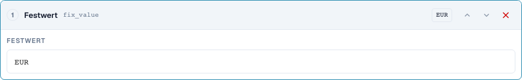
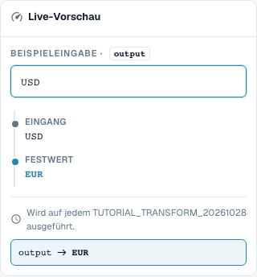
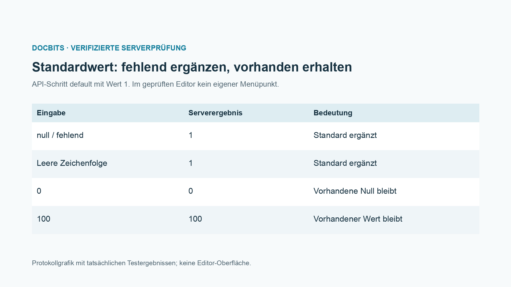

# Felder übernehmen, Festwerte, Leeren und Standardwerte

[Zurück zum vollständigen Praxisüberblick](praxisueberblick.md)

Ziel Ergebnis · Quelle Originaltext für Feldübernahme; Festwert nur unter enger Bedingung; Leeren gesondert testen.

## Vorgehen im Editor

1. Den vorgesehenen Dokumenttyp öffnen und den Geltungsbereich wählen.
2. Ziel und gegebenenfalls eine getrennte Quelle einstellen.
3. Die unten beschriebenen Schritte in der passenden Reihenfolge konfigurieren.
4. Eingabe und Gegenfall in der Vorschau prüfen und mit dem Servertest vergleichen.
5. Eine gespeicherte Regel erneut öffnen; die Dokumentwirkung mit einem isolierten Beleg prüfen.

<figure><figcaption>
Konfiguration der Schritte. Originalaufnahme der deutschen Oberfläche. Die Vorschau verändert keine gespeicherten Dokumente.
</figcaption></figure>

<figure><figcaption>
Live-Vorschau mit Schulungswert. Originalaufnahme der deutschen Oberfläche. Die Vorschau verändert keine gespeicherten Dokumente.
</figcaption></figure>

## 1. Feldübernahme

Für eine Feldübernahme wähle ich zuerst das Zielfeld und dann eine andere Quelle. Wenn die Bestellnummer im falschen Feld steht, kann ich sie aus diesem Feld lesen, trimmen und im richtigen Zielfeld speichern. Eine Bedingung Ziel ist leer schützt eine bereits vorhandene Bestellnummer. Die Quelle bleibt erhalten. Das ist eine Kopie mit Verarbeitung und kein Verschieben. Ich prüfe ein leeres Ziel, ein bereits gefülltes Ziel und eine leere Quelle.

## 2. Festwert und Leeren

Ein Festwert ignoriert den bisherigen Inhalt. Setze ich die Währung auf Euro, überschreibt die Regel auch eine vorhandene andere Währung. Dafür brauche ich eine enge fachliche Bedingung. Leeren schreibt eine leere Zeichenfolge in das Zielfeld. Es ist kein Löschen des gesamten Feldes oder Dokuments. In der Vorschau prüfe ich vor allem den Gegenfall, damit die Regel keine gültigen Werte entfernt. Die Speicherung der Regel allein beweist noch keine Änderung eines Dokuments.

## 3. Standardwerte

Die Serverschnittstelle unterstützt zusätzlich eine Standardwertaktion. Sie ergänzt einen Wert nur bei fehlender oder leerer Eingabe. Eine vorhandene Null bleibt Null. Diese Aktion ist in der geprüften Schrittauswahl des normalen Editors nicht als eigener Schritt vorhanden. Im Editor kann ich den gewünschten Standardfall häufig mit der Bedingung Ziel ist leer und einem Festwert abbilden. Ich zeige diese Unterscheidung offen und behaupte keinen zusätzlichen Menüpunkt. Ein Standardwert ist immer eine fachliche Entscheidung, besonders bei Preisbasis, Menge oder Währung.

## Geprüfte Beispiele und Gegenfälle

Diese Werte wurden serverseitig als trockener Test geprüft. Ein solcher Test verändert keine gespeicherten Dokumente.

| Fall | Eingabe | Serverergebnis |
| --- | --- | --- |
| fixed | `USD` | `EUR` |
| fixed | `null` | `EUR` |
| clear | `Altwert` | `` |
| clear | `` | `` |
| default-api | `null` | `1` |
| default-api | `` | `1` |
| default-api | `0` | `0` |
| default-api | `100` | `100` |
| copy | `  po-4711  ` | `PO-4711` |

## Abnahme

Prüfen Sie einen passenden Fall, einen Gegenfall, einen leeren Wert und ein bereits verarbeitetes Ergebnis. Wiederholen Sie den Dokument-Speichervorgang. Prüfen Sie PO-Abgleich und ERP-Empfang zusätzlich, wenn sie zum fachlichen Ziel gehören.

<figure><figcaption>
Tatsächliche Ergebnisse am isolierten Schulungsbeispiel, als Protokollgrafik dargestellt. Dies ist keine nachgezeichnete Editor-Oberfläche.
</figcaption></figure>
