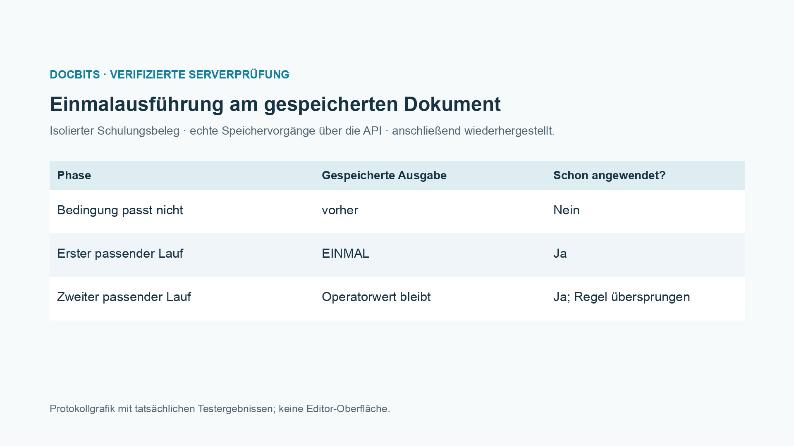
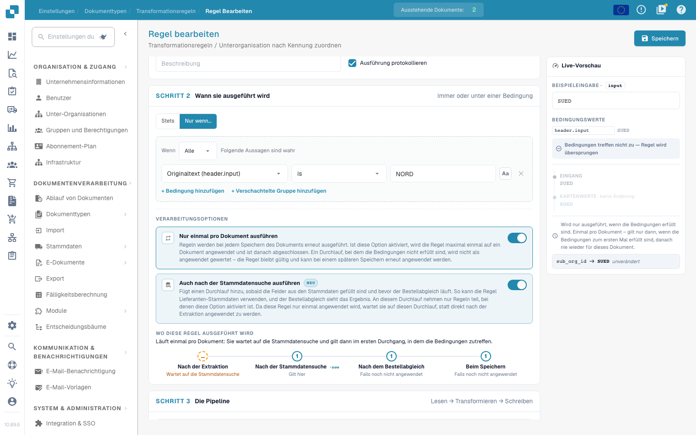

# Routing, Reihenfolge, Stammdaten und Wiederholungen

[Zurück zum vollständigen Praxisüberblick](praxisueberblick.md)

Routing · Ziel Unterorganisation · vorhandenes Ziel verwenden; Bedingungen, Ausführungsphasen und Wiederholung gesondert prüfen.

## Vorgehen im Editor

1. Den vorgesehenen Dokumenttyp öffnen und den Geltungsbereich wählen.
2. Ziel und gegebenenfalls eine getrennte Quelle einstellen.
3. Die unten beschriebenen Schritte in der passenden Reihenfolge konfigurieren.
4. Eingabe und Gegenfall in der Vorschau prüfen und mit dem Servertest vergleichen.
5. Eine gespeicherte Regel erneut öffnen; die Dokumentwirkung mit einem isolierten Beleg prüfen.

Das Routingbeispiel verwendet in der internen Prüfung ein vorhandenes Ziel. Die öffentliche Anleitung enthält keine internen Unterorganisationskennungen.

## 1. Unterorganisation

Routing schreibt derzeit die Unterorganisation des Dokuments. Ich kann ein festes Ziel aus der vorhandenen Auswahl setzen oder einen Quellwert auf eine Unterorganisation abbilden. Eine passende Lieferantenbedingung begrenzt die Zuordnung. Das ist weder eine Benutzerberechtigung noch eine Freigabeentscheidung. Ich verwende nur gültige vorhandene Unterorganisationen und prüfe den Gegenfall. In dieser Folge bleibt das Routingbeispiel eine Vorschau; es verschiebt keine produktiven Dokumente.

## 2. Ausführungsphasen

Die Geltungsbereiche laufen in der Reihenfolge Kopffeld, Routing, Tabellenzeilen und Tabellenspalte. Innerhalb eines Bereichs gelten Priorität und Regelschlüssel. Eine bereinigte Kopfquelle kann daher bereits vom Routing gelesen werden. Mit der zusätzlichen Ausführung nach dem Stammdatenlookup kann eine Regel Werte verwenden, die erst aus Stammdaten ergänzt werden. Diese Option ergänzt einen Durchlauf vor dem Bestellabgleich. Sie verschiebt nicht sämtliche anderen Ausführungen dorthin.

## 3. Einmalregeln und Nachweis

Nur einmal pro Dokument ausführen begrenzt eine tatsächlich angewendete Regel. Eine nicht erfüllte Bedingung verbraucht diese Ausführung noch nicht. Zusammen mit der Lookup-Option wartet die Regel beim ersten Extraktionsdurchlauf auf die spätere Phase. Für Teilstücke und reguläre Ausdrücke bleibt die getrennte Quelle trotzdem erforderlich. Ich prüfe eine erstmalige Anwendung, einen nicht passenden Fall und ein erneutes Speichern. Im Protokoll suche ich nach Bedingung, Ergebnis und Ausführungsphase. Erst ein neu geladenes Dokument belegt die gespeicherte Wirkung. Ein ERP-Eingang und ein Bestellabgleich brauchen jeweils ihren eigenen Nachweis.

## Abnahme

Prüfen Sie einen passenden Fall, einen Gegenfall, einen leeren Wert und ein bereits verarbeitetes Ergebnis. Wiederholen Sie den Dokument-Speichervorgang. Prüfen Sie PO-Abgleich und ERP-Empfang zusätzlich, wenn sie zum fachlichen Ziel gehören.

<figure><figcaption>
Tatsächliche Ergebnisse am isolierten Schulungsbeispiel, als Protokollgrafik dargestellt. Dies ist keine nachgezeichnete Editor-Oberfläche.
</figcaption></figure>

Im gespeicherten Integrationstest verbrauchte eine nicht passende Bedingung die Einmalausführung nicht. Beim ersten passenden Speichern wurde EINMAL geschrieben. Beim zweiten passenden Speichern blieb der vorbereitete Operatorwert erhalten, und der gespeicherte Anwendungsnachweis war weiterhin gesetzt. Der Testbeleg wurde anschließend wiederhergestellt. Der trockene Servertest kann weiterhin ein hypothetisches Ergebnis berechnen; prüfen Sie deshalb zusätzlich seinen Hinweis `already_applied` und das tatsächlich gespeicherte Dokument.

<figure><figcaption>
Einmalausführung und zusätzliche Lookup-Phase gemeinsam im echten Editor. Die nicht passende Beispielbedingung wird übersprungen; interne Zielkennungen sind ausgeblendet. Die Optionen sind hier eine ungespeicherte Vorschau.
</figcaption></figure>
