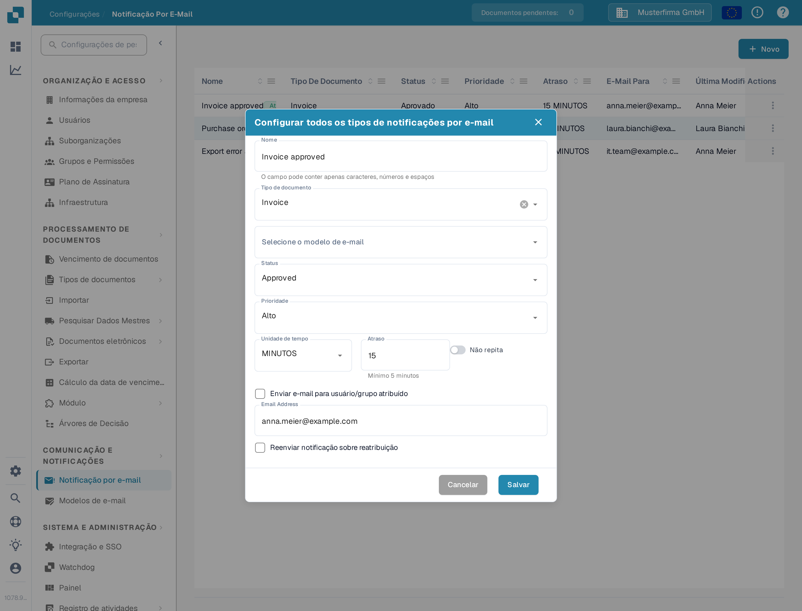
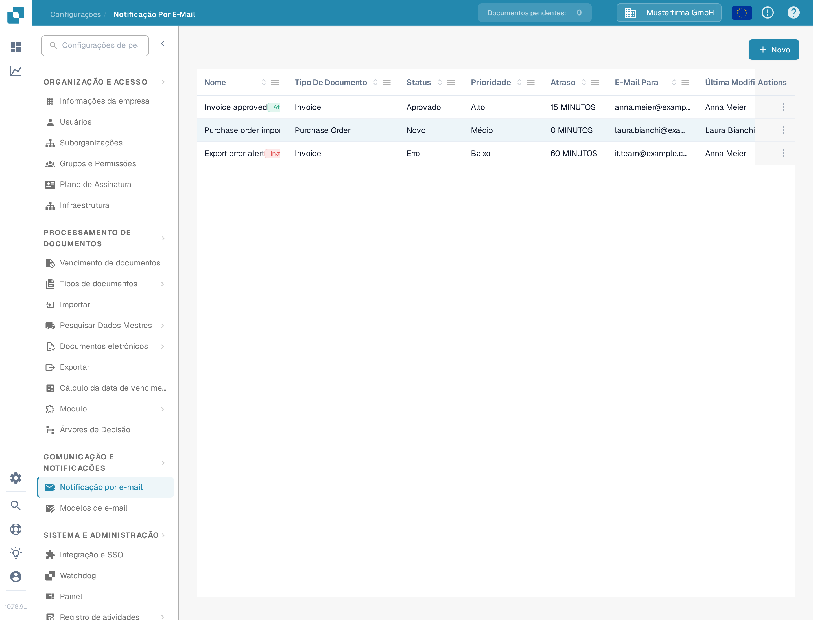
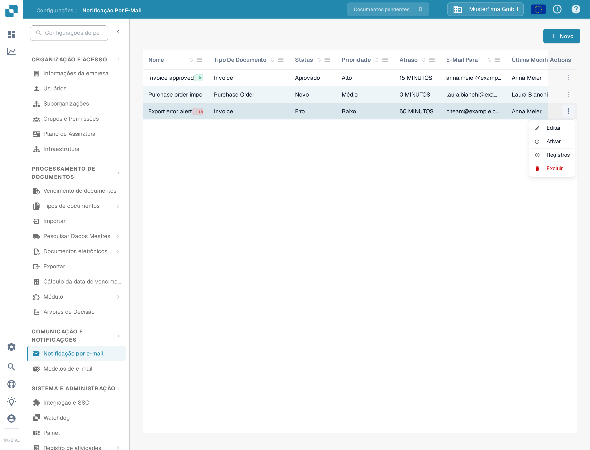
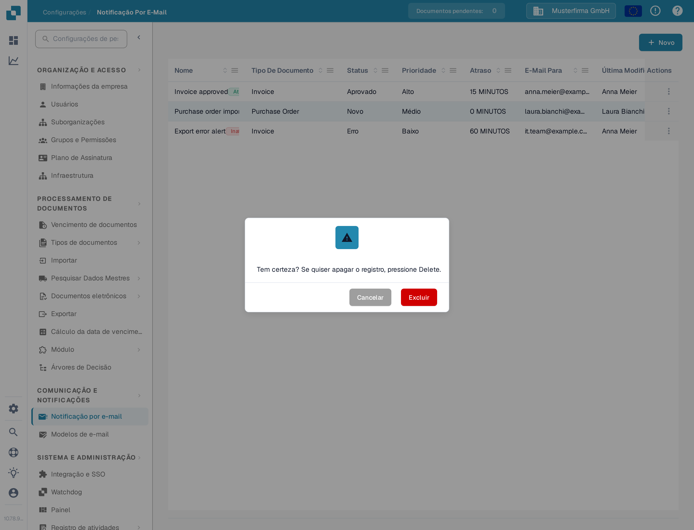
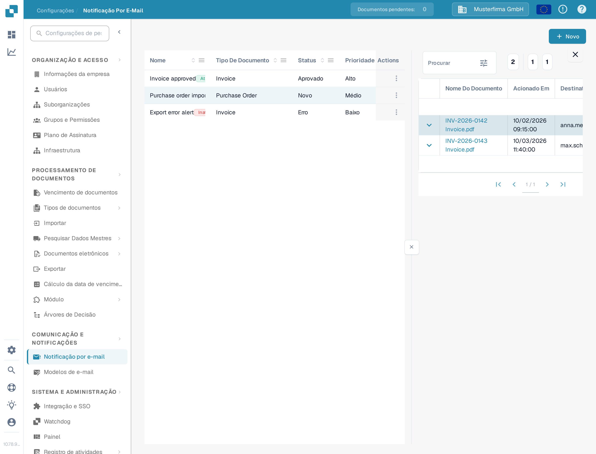

# Gerenciando Notificações

Abra **Configurações → Notificação Por E-Mail** para ver as regras da sua organização. Uma regra liga um status de documento a um modelo de e-mail e a um destinatário. O exemplo abaixo usa uma regra de demonstração para faturas e permanece **inativa** na Sandbox do DocBits.

## Exemplo: uma fatura está pronta para validação

Antes de criar uma regra, prepare um modelo de e-mail para **Invoice** em **Configurações → Modelos de e-mail**. Neste exemplo, o modelo se chama **Docs Demo Invoice Notification**. O modelo fornece o assunto e a mensagem do e-mail.

1. Selecione **Novo** na página **Notificação Por E-Mail**.
2. Digite **Docs Demo Invoice Validation** como nome, selecione **Invoice** como tipo de documento e escolha o modelo de e-mail preparado.
3. Escolha **Ready for validation** como status e **Alto** como prioridade. Defina **Unidade de tempo** como **MINUTOS** e **Atraso** como **10**. O atraso mínimo em minutos é de cinco.
4. Selecione **Enviar e-mail para usuário/grupo atribuído**. Ative **Não repita** se a mensagem deve ser enviada apenas uma vez. Revise o destinatário e o momento do envio e selecione **Salvar**.

<figure><figcaption>
A regra de exemplo salva, aberta para edição. Seus valores mostram quando e para quem a notificação seria enviada.
</figcaption></figure>

A regra agora aparece na lista. O exemplo da documentação foi desativado depois, então seu menu **Actions** oferece **Ativar**; uma regra ativa oferece **Desativar**. Verifique o nome, o tipo de documento, o status, o atraso e o destinatário na sua própria lista antes de ativar uma regra.

<figure><figcaption>
O exemplo salvo dá a você uma regra para encontrar e gerenciar na lista.
</figcaption></figure>

## Editar, ativar ou excluir uma regra

Abra o menu **Actions** da linha. **Editar** abre a regra com seus valores atuais. **Ativar** habilita este exemplo inativo; uma regra ativa oferece **Desativar** em vez disso. **Registros** abre o histórico de notificações da regra. **Excluir** remove a regra após a confirmação. Verifique os destinatários e o momento do envio antes de ativar ou alterar uma regra.

<figure><figcaption>
A regra desativada do exemplo oferece Ativar; uma regra ativa oferece Desativar.
</figcaption></figure>

<figure><figcaption>
A exclusão pede confirmação e não pode ser desfeita depois.
</figcaption></figure>

Em **Registros** você vê, para cada envio, o **Nome Do Documento**, a data em **Acionado Em**, o **Destinatário** e o **Status** da notificação.

<figure><figcaption>
Os registros mostram se cada notificação foi enviada com êxito.
</figcaption></figure>

Se a lista mostrar **No Record Found!**, crie uma regra primeiro. Se a lista de **Tipo de documento** ou de modelos de e-mail estiver vazia, configure um tipo de documento ativo e um modelo correspondente antes de voltar a este formulário.

Para mais informações sobre a configuração inicial, consulte [Configurando Notificações](configurando-notificacoes.md). Se os e-mails não chegarem como esperado, consulte [Solução de Problemas](solucao-de-problemas.md).
