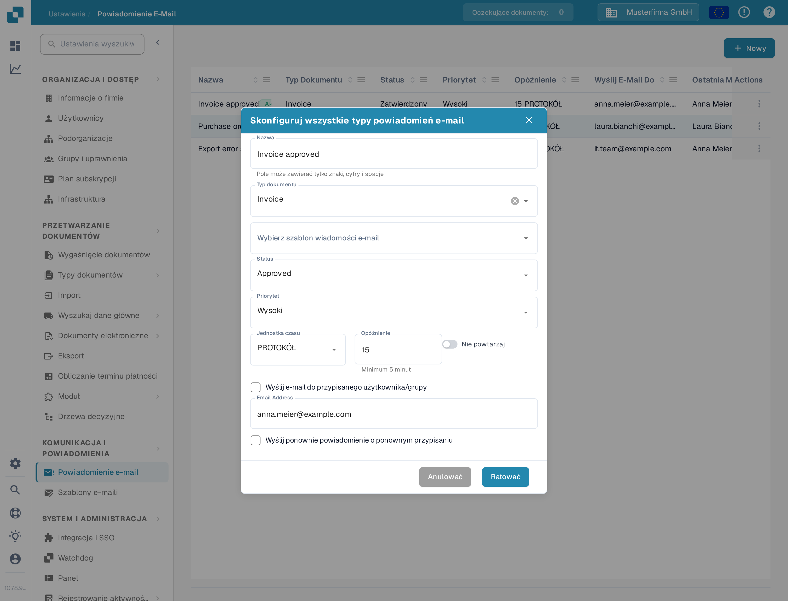
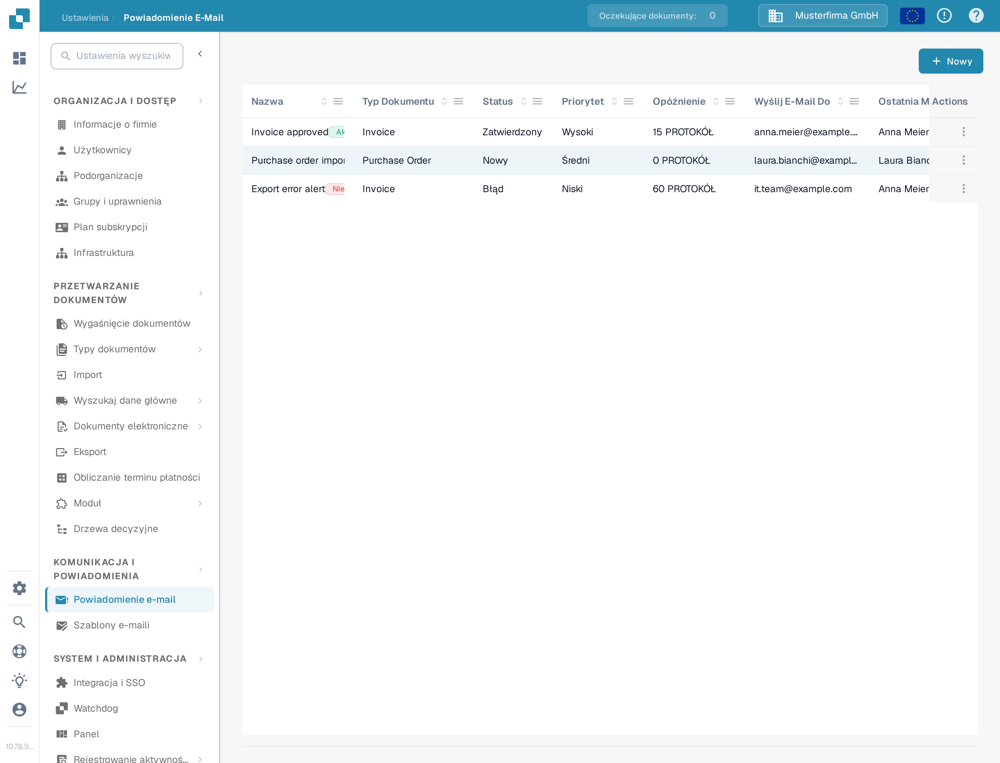
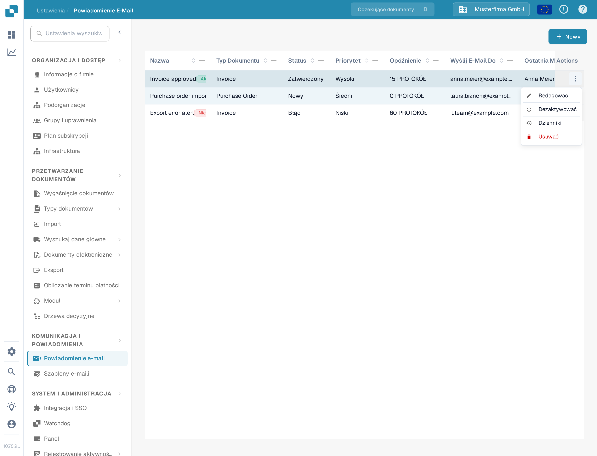

# Zarządzanie powiadomieniami

Otwórz **Ustawienia → Powiadomienie e-mail**, aby zobaczyć reguły swojej organizacji. Reguła łączy status dokumentu z szablonem e-mail i odbiorcą. Poniższy przykład używa reguły demonstracyjnej dla faktur i pozostaje **nieaktywna** w piaskownicy DocBits.

## Przykład: faktura jest gotowa do walidacji

Zanim utworzysz regułę, przygotuj szablon e-mail dla typu **Invoice** w **Ustawienia → Szablony e-maili**. W tym przykładzie szablon nazywa się **Docs Demo Invoice Notification**. Szablon dostarcza temat i treść wiadomości e-mail.

1. Wybierz **+ Nowy** na stronie **Powiadomienie e-mail**.
2. Wpisz **Docs Demo Invoice Validation** jako nazwę, wybierz **Invoice** jako typ dokumentu i wskaż przygotowany szablon e-mail.
3. Wybierz **Ready for validation** jako status i **Wysoki** jako priorytet. Ustaw **Jednostka czasu** na **PROTOKÓŁ** i **Opóźnienie** na **10**. Minimalne opóźnienie dla minut wynosi pięć.
4. Wybierz **Wyślij e-mail do przypisanego użytkownika/grupy**. Włącz **Nie powtarzaj**, jeśli wiadomość ma zostać wysłana tylko raz. Sprawdź odbiorcę i czas, a następnie wybierz **Ratować**.

<figure><figcaption>
Zapisana reguła przykładu otwarta do edycji. Jej wartości pokazują, kiedy i do kogo powiadomienie zostałoby wysłane.
</figcaption></figure>

Reguła pojawia się teraz na liście. Przykład dokumentacyjny został następnie wyłączony, dlatego jego menu **Actions** oferuje **Aktywować**. Przed aktywacją reguły sprawdź w własnej liście nazwę, typ dokumentu, status, opóźnienie i odbiorcę.

<figure><figcaption>
Lista pokazuje zapisane reguły, które możesz znaleźć i zarządzać nimi.
</figcaption></figure>

## Edytuj, aktywuj lub usuń regułę

Otwórz menu **Actions** wiersza. **Redagować** otwiera regułę z jej bieżącymi wartościami. **Aktywować** włącza ten nieaktywny przykład; aktywna reguła oferuje zamiast tego **Dezaktywować**. **Dzienniki** otwiera historię powiadomień reguły. **Usuwać** usuwa regułę po potwierdzeniu. Przed aktywacją lub zmianą reguły sprawdź odbiorców i czas.

<figure><figcaption>
Dostępne działania zależą od tego, czy reguła jest aktywna.
</figcaption></figure>

Jeśli lista pokazuje **No Record Found!**, najpierw utwórz regułę. Jeśli lista **Typ Dokumentu** lub szablonów e-mail jest pusta, skonfiguruj aktywny typ dokumentu i pasujący szablon, zanim wrócisz do tego formularza.

Więcej informacji o początkowej konfiguracji znajdziesz w sekcji [Konfigurowanie powiadomień](konfigurowanie-powiadomien.md). Jeśli e-male nie docierają zgodnie z oczekiwaniami, zobacz [Rozwiązywanie problemów](rozwiazywanie-problemow.md).
