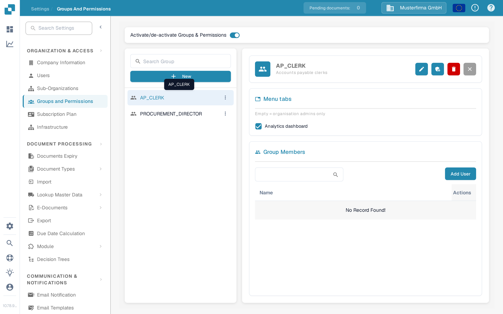

# Groups and Permissions


DocBits Groups & Permissions Tutorial: Set User Roles, Access Rights & Secure Your Workspace


<figure><figcaption>
Groups and Permissions Page
</figcaption></figure>

Groups and Permissions allow you to control which users can access specific document types and what actions they can perform.

## Activate/Deactivate Groups & Permissions

Use the toggle at the top of the page to enable or disable the groups and permissions system. When disabled, the system uses a simpler access model without group-based restrictions.

## Managing Groups in the Navigator

The page is split into two panes. The left pane is the group navigator:

| Element | Description |
|---------|-------------|
| **Search** | Filters the list of groups by name as you type. |
| **+ New** | Creates a new group. See [Adding/Editing Groups](adding-editing-groups.md). |
| **Group entry** | Selects the group and opens its details in the right pane. Until a group is selected, the right pane shows *Select a group to view details*. |

Each group entry carries a **⋮** (more actions) menu:

| Action | Description |
|--------|-------------|
| **Edit** | Opens the group so you can change its name and description. |
| **View Access Control** | Opens the group's permission matrix, where document-type and field-level permissions are configured per group. |
| **Delete** | Removes the group after a confirmation. |

## Menu Tab Access

The group details pane contains a **Menu tabs** section. It defines, for this role, which menu tabs the role's members may see:

* Tick a tab to grant it to this role.
* Clear a tab to take it away from this role.

Every role is configured on its own, so two roles can see different menu tabs. The list only contains tabs that an administrator may hand to a role — currently the **Analytics dashboard**.


**Empty = organisation admins only.** If no tab is ticked for a role, members of that role see none of the gated tabs; only organisation admins keep access to them. The same note is shown as a hint under the **Menu tabs** heading.


<figure><figcaption>
Selecting a group in the navigator opens its details, including the <strong>Menu tabs</strong> section.
</figcaption></figure>

## Configuring Group Permissions

When you open a group (via the group's **⋮** menu → **View Access Control**), a permissions table appears where you can configure access per document type:

| Permission | Description |
|------------|-------------|
| **View** | Permission to see documents of this type. |
| **Update** | Permission to modify documents of this type. |
| **Delete** | Permission to remove documents of this type. |
| **First Approval** | Permission to perform the initial approval. |
| **Second Approval** | Permission to perform a secondary level of approval (if applicable). |

Each row in the permissions table represents a document type (e.g., Invoice, Credit Note, Delivery Note). Check or uncheck the boxes to grant or revoke permissions for that group.

## Creating a New Group

1. Click **+ New** in the top-right corner.
2. Enter a **Group Name** and optional **Description**.
3. Configure the permissions for each document type.
4. Assign users to the group.
5. Click **Save** to apply.
