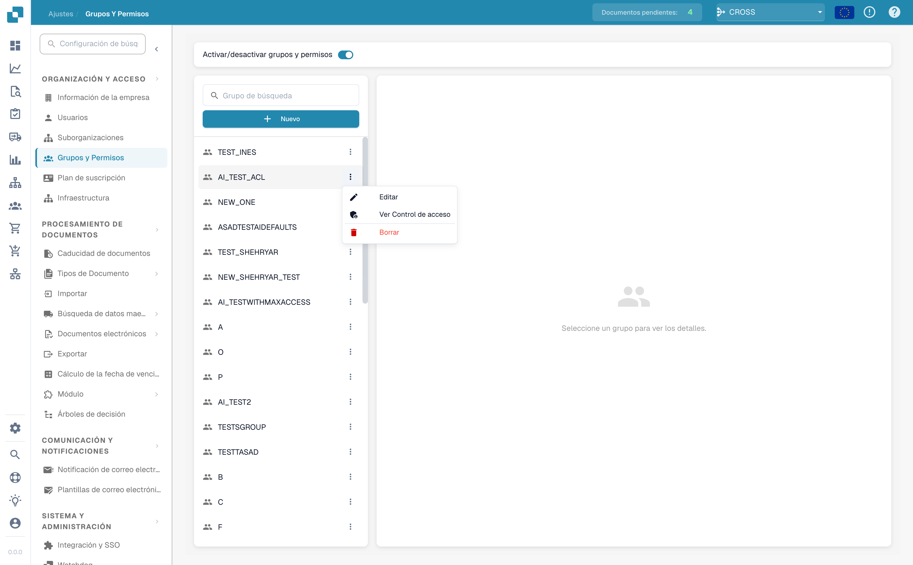
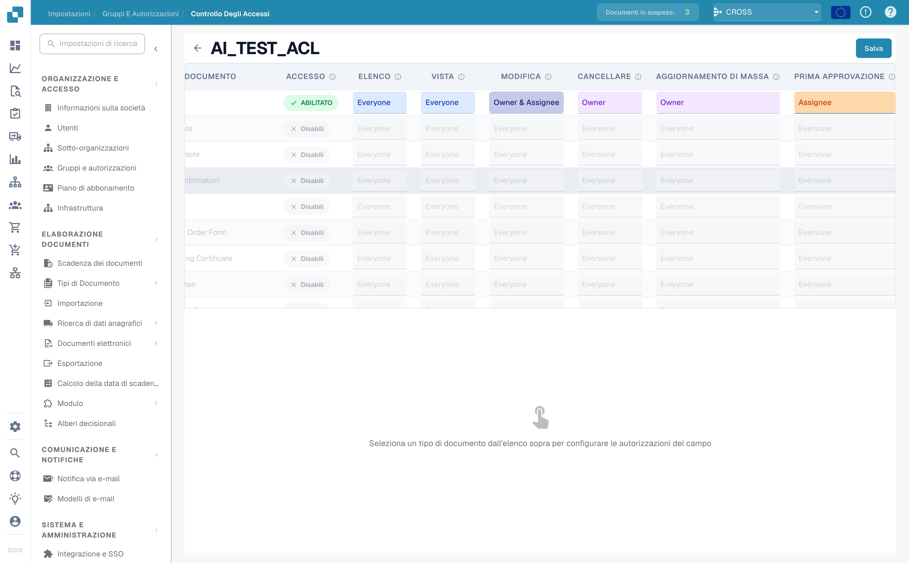
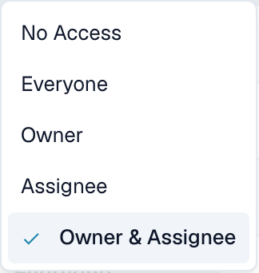
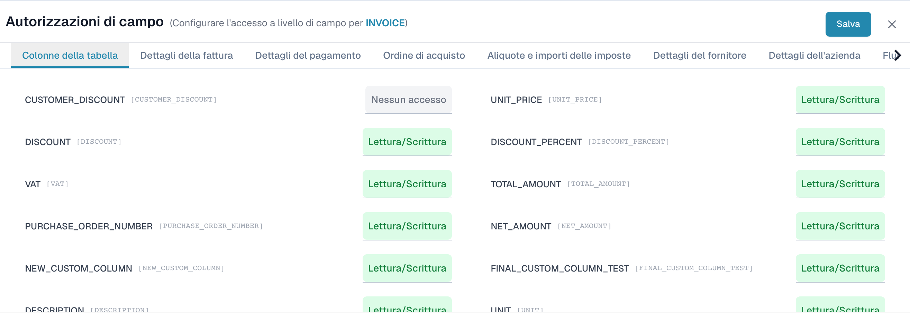

# 访问控制

## 概述

访问控制针对单个**组**（角色）精确定义其成员可以执行的操作，包括**文档类型级别**（他们可以查看哪些文档类型以及可以执行哪些操作）和**字段级别**（他们可以读取或编辑哪些具体字段）。

权限始终按**组**评估。用户会继承其所属所有组的权限。


只有启用 **Groups & Permissions**（组与权限）系统后，才会强制执行访问控制（请参阅[激活权限](activating-permissions.md)）。**管理员始终不受访问控制限制**，无论此页面上的设置如何，都可以查看和执行所有操作。


每个组都可以配置以下内容：

* **文档访问权限** — 该组是否可以使用某种文档类型。
* **操作权限** — 该组可以执行哪些操作（列表、查看、编辑、删除、批量更新、审批），以及*可以对哪些文档*执行这些操作。
* **字段级权限** — 文档类型中的每个字段是可编辑、只读还是隐藏。

## 激活

1. 转到 **Settings**（设置）。
2. 选择 **Document Processing**（文档处理）。
3. 选择 **Module.**（模块）。
4. 启用滑块以激活 **Access Control**（访问控制）。

<figure><figcaption></figcaption></figure>

## 打开组的访问控制

1. 转到 **Settings**（设置）。
2. 转到 **Global Settings.**（全局设置）。
3. 选择 **Groups, Users and Permissions.**（组、用户和权限）。
4. 选择 **Groups and Permissions**（组和权限）。
5. 要管理某个组（例如 PROCUREMENT\_DIRECTOR）的权限，请点击屏幕右侧的三个点。
6. 选择 **Manage Access Control**（管理访问控制）。

<figure><figcaption>
在 Groups and Permissions 页面上，打开某个组的<strong>⋮</strong>菜单，然后选择 <strong>Manage Access Control</strong>。
</figcaption></figure>

## 如何评估权限

用户尝试对文档执行操作时，DocBits 会按以下顺序检查：

1. **Groups & Permissions 系统是否已启用，且用户是否为非管理员？** 如果系统未启用，或者用户是管理员 → 则拥有完全访问权限。
2. **用户所属的某个组是否已启用该文档类型？** 如果未启用 → 用户无法查看或使用该文档类型。
3. **该操作设置了什么访问范围？**（例如，*Edit = Owner*）。系统会根据用户与*此特定文档*的关系匹配范围 — 用户是所有者、受派人、两者都是，还是两者都不是？
4. **字段级权限是什么？** 即使用户可以打开文档，个别字段仍可能被隐藏或锁定。

## 文档类型权限

矩阵中的每一行代表一种文档类型（发票、贷项通知单、采购订单等）。

第一列是**启用 / 禁用**切换开关。将其禁用后，该组将完全无法使用此文档类型 — 此类型会从他们的仪表板中消失。启用后，七个操作列即可编辑。

| 操作 | 控制该组是否可以… |
|--------|----------------------------------|
| **List**（列表） | 在仪表板列表中查看此文档类型。 |
| **View**（查看） | 打开文档并查看其详细信息。 |
| **Edit**（编辑） | 更改文档上的字段值。 |
| **Delete**（删除） | 删除文档。 |
| **Mass Update**（批量更新） | 一次对多个文档应用批量更新。 |
| **First Approval**（首次审批） | 授予第一级审批。 |
| **Second Approval**（二级审批） | 授予第二级审批。 |

<figure><figcaption>
文档类型权限矩阵。此处启用了 <strong>Invoice</strong>（发票）类型，并为其操作设置了不同的访问范围；其他类型均已禁用。
</figcaption></figure>

### 访问范围

每个操作列都是一个下拉菜单。选择的值用于回答以下问题：*“该组可以对哪些文档执行此操作？”*

| 范围 | 允许的用户 | 对文档的影响 |
|-------|----------------|----------------------|
| **No Access**（无访问权限） | 组内无人。 | 该操作对组内所有人均被阻止 — 按钮会被隐藏或禁用。 |
| **Everyone**（所有人） | 组内每位成员。 | 任何组成员都可以对该类型的**任何**文档执行此操作。 |
| **Owner**（所有者） | 仅创建 / 上传该文档的用户。 | 此操作仅适用于该用户自己上传的文档。 |
| **Assignee**（受派人） | 被指派该文档的用户或组。 | 此操作仅适用于当前指派给该用户或其所属组的文档。 |
| **Owner & Assignee**（所有者与受派人） | 所有者**或**受派人。 | 如果用户是上传者*或*受派人，则可以执行此操作。 |


**Owner**（所有者）和 **Assignee**（受派人）取决于*用户与每个具体文档之间的关系*，因此同一组的两名成员对同一张发票可能拥有不同权限 — 请参阅下方的实际示例。


<figure><figcaption>
每个操作列都提供相同的五种访问范围。
</figcaption></figure>

### 审批还需要编辑权限

审批文档时，后台会触发**两个操作**：DocBits 先**保存**文档，然后将其状态更改为已审批。保存步骤需要**编辑**权限，因此这两种权限是关联的。

如果用户只获得 **First Approval**（首次审批）或 **Second Approval**（二级审批）权限，*却没有* **Edit**（编辑）权限，那么保存步骤会触发权限错误，用户也就无法审批该文档。


授予 **First Approval**（首次审批）或 **Second Approval**（二级审批）权限时，也要为同一文档类型授予 **Edit**（编辑）和 **View**（查看）权限。仅授予审批权限是不够的。


## 字段级权限

点击某个文档类型的行，即可在下方打开 **Field Permissions**（字段权限）面板。字段按选项卡分类（例如 *Table columns*（表格列）、*Invoice details*（发票详细信息）、*Payment details*（付款详细信息）、*Tax rates & Amounts*（税率和金额））。每个字段都有自己的访问级别：

| 级别 | 对字段的影响 |
|-------|---------------------|
| **Read/Write**（读写） | 字段可见，**并且**可以编辑。 |
| **Read Only**（只读） | 字段可见，但**无法编辑**（显示为灰色）。 |
| **Approval**（审批） | 字段可以编辑，但更改必须经过**审批工作流**才能应用。 |
| **No Access**（无访问权限） | 字段会被**完全隐藏** — 用户始终看不到该字段。 |


字段级规则对该组的**所有**成员一视同仁 — 不受所有者 / 受派人关系影响。可使用这些规则为整个组隐藏或锁定敏感字段（例如折扣或总金额）。


<figure><figcaption>
Invoice（发票）类型的字段权限面板。<code>CUSTOMER_DISCOUNT</code> 已隐藏（无访问权限），其他字段仍为读写。
</figcaption></figure>

## 实际示例：访问控制对一张真实发票的影响

假设你为应付账款文员创建了一个 **AP_CLERK** 组，并按以下方式配置 **Invoice**（发票）文档类型：

**Invoice（发票）的文档类型权限**

| 操作 | 范围 |
|--------|-------|
| Enabled（已启用） | ✅ 开 |
| List（列表） | Everyone（所有人） |
| View（查看） | Everyone（所有人） |
| Edit（编辑） | Owner & Assignee（所有者与受派人） |
| Delete（删除） | No Access（无访问权限） |
| Mass Update（批量更新） | No Access（无访问权限） |
| First Approval（首次审批） | Assignee（受派人） |
| Second Approval（二级审批） | No Access（无访问权限） |

**Invoice（发票）的字段权限**

| 字段 | 级别 |
|-------|-------|
| `TOTAL_AMOUNT` | Read Only（只读） |
| `CUSTOMER_DISCOUNT` | No Access（无访问权限） |
| *(所有其他字段)* | Read/Write（读写） |

现在来看一份实际文档 — 发票 **INV-4711**。该发票由 **Maria 上传**，并且**指派给了 Maria**。Maria 和她的同事 Tom 都属于 **AP_CLERK** 组。

**Maria（INV-4711 的所有者*和*受派人）：**

* ✅ 在仪表板列表中看到 INV-4711（*List = Everyone*）。
* ✅ 打开该发票（*View = Everyone*）。
* ✅ 编辑供应商名称和行项目（*Edit = Owner & Assignee — 她是所有者*）。
* 🔒 可以看到 `TOTAL_AMOUNT`，但该字段显示为灰色，她无法更改（*Read Only*）。
* 🚫 完全看不到 `CUSTOMER_DISCOUNT` 字段（*No Access*）。
* 🚫 **Delete**（删除）按钮已隐藏（*Delete = No Access — 组内无人可以删除*）。
* ✅ 可以授予**首次审批**（*First Approval = Assignee — 她是受派人*）。

**Tom（同属此组，但他*没有*上传 INV-4711，而且该发票也*没有*指派给他）：**

* ✅ 在列表中看到该发票，并且 ✅ 可以打开（*List & View = Everyone*）。
* 🚫 无法编辑任何内容 — 文档以**只读**方式打开（*Edit = Owner & Assignee — Tom 两者都不是*）。
* 🔒 / 🚫 看到的字段可见性与 Maria 完全相同：`TOTAL_AMOUNT` 已锁定，`CUSTOMER_DISCOUNT` 已隐藏（*字段规则适用于整个组*）。
* 🚫 无法授予首次审批（*First Approval = Assignee — Tom 不是受派人*）。
* 🚫 无法删除（*No Access*）。

**此示例说明**

* **Everyone**（所有人）允许组内所有成员打开文档；**Owner / Assignee**（所有者 / 受派人）则将某项操作限制为与该特定文档有关联的人员。
* **No Access**（无访问权限）会移除某项操作（删除），或为整个组隐藏某个字段（`CUSTOMER_DISCOUNT`）。
* **Read Only**（只读）会保留字段以供查看（`TOTAL_AMOUNT`），但禁止更改。
* **同一组**中的两个人对同一张发票可以拥有**不同权限**，区别完全取决于谁上传了该文档以及文档被指派给谁。
