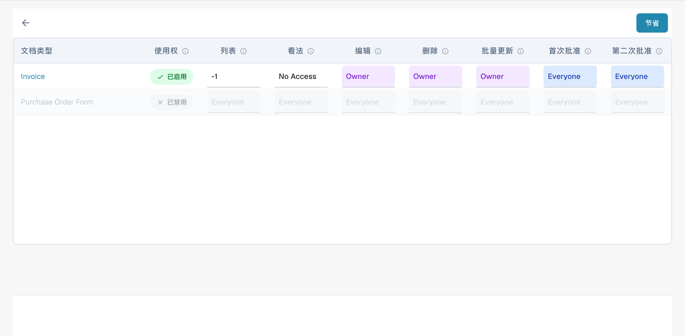
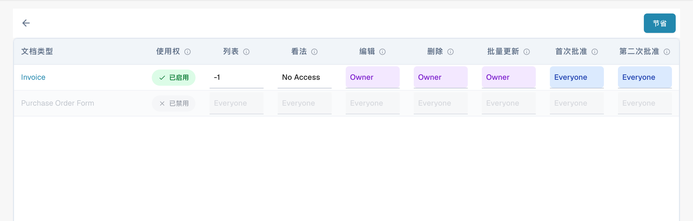

# 激活权限

<figure><figcaption>
按文档类型和操作划分的权限矩阵。 权限值“Owner”“Everyone”“No Access”以及文档类型名称仍为英文，“节省”表示保存。
</figcaption></figure>

<figure><figcaption>
选择群组以查看权限。
</figcaption></figure>

<figure><figcaption>
权限矩阵中各项操作的访问级别。 权限值“Owner”“Everyone”“No Access”以及文档类型名称仍为英文，“节省”表示保存。
</figcaption></figure>


DocBits 群组与权限教程：设置用户角色、访问权限并保护您的工作区


使用开关启用或禁用权限系统，会对 DocBits 中的功能产生多种影响。

## **启用权限系统：**

<figure><figcaption></figcaption></figure>

* 启用权限系统后，系统会应用针对用户和群组设置的访问权限。
* 用户只能访问根据分配的权限明确授权他们访问的资源。
* 管理员可以管理各个用户和群组的权限，确保只有获授权的人员才能查看或编辑数据。

<figure><figcaption></figcaption></figure>

## 仅显示已分配的文档

<figure><figcaption></figcaption></figure>

**仅限指定文件**（仅显示已分配的文档）切换按钮根据用户所属的群组控制其可见的文档。启用后，用户只能查看明确分配给自己或其所属群组的文档。禁用后，拥有相应查看权限的用户可以看到所有文档，无论文档是否已分配。

#### 功能说明

* **关闭状态（默认）**：
  * 关闭此开关时，群组成员只要拥有相应的查看权限，就可以查看所有文档。文档分配情况不会影响可见性。
* **开启状态**：
  * 开启此开关时，用户只能查看明确分配给自己或其所属群组的文档。这样会根据群组分配情况实施更严格的文档可见性控制。

#### 示例场景

1. **默认（关闭状态）**：
   * 属于“Sales”群组的用户可以查看系统中所有其有权查看的文档，即使这些文档并未分配给该用户。
2. **已启用（开启状态）**：
   * “Sales”群组中的用户只能查看分配给自己或“Sales”群组的文档，因此无法访问未分配给他们的文档。

## 禁用权限系统：

<figure><figcaption>
启用权限管理的选项。
</figcaption></figure>

* 禁用权限系统后，所有访问权限都会被移除，用户通常可以不受限制地访问所有资源。
* 如果暂时需要开放协作，不受访问控制限制，此设置会很有用。
* 但是，用户可能会访问其无权查看的敏感信息，从而增加数据泄露或未经授权访问的风险。

是否启用权限系统是一项重要决策，应根据安全要求和组织的运营方式来决定。在隐私和访问控制至关重要的环境中，通常应保持权限系统启用，以确保数据完整性和机密性。在其他情况下，为促进协作可能需要暂时禁用权限系统，但应谨慎操作，以尽量降低潜在的安全风险。

当前界面使用按文档类型和操作划分的权限矩阵。某些访问级别可能仍显示英文。旧版 Only Assigned Documents 控件说明只适用于仍提供该控件的版本。
