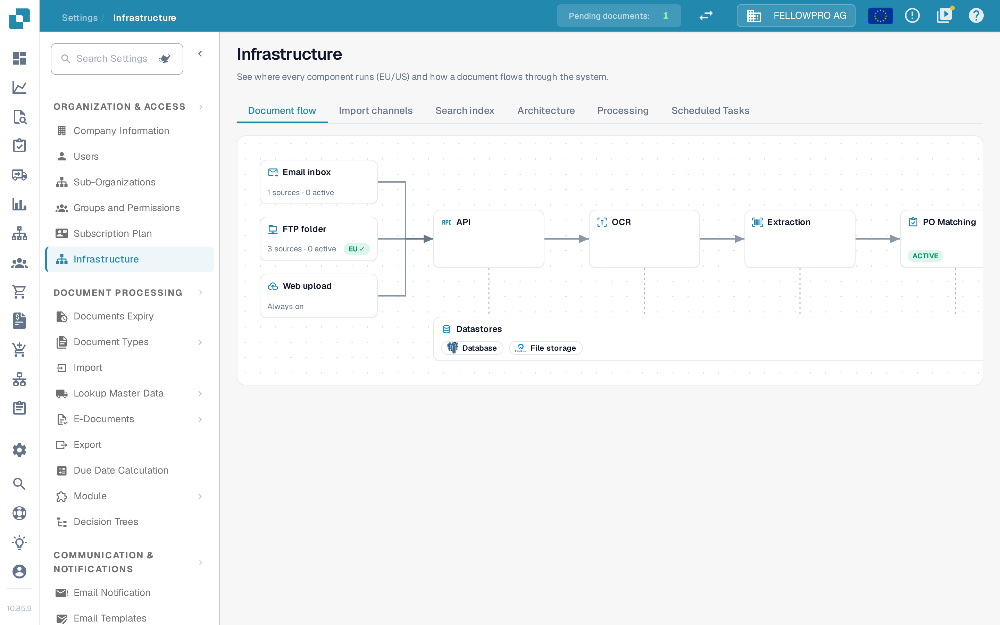
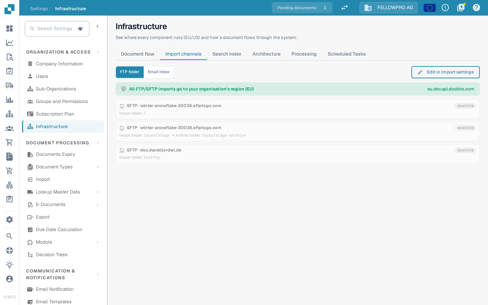
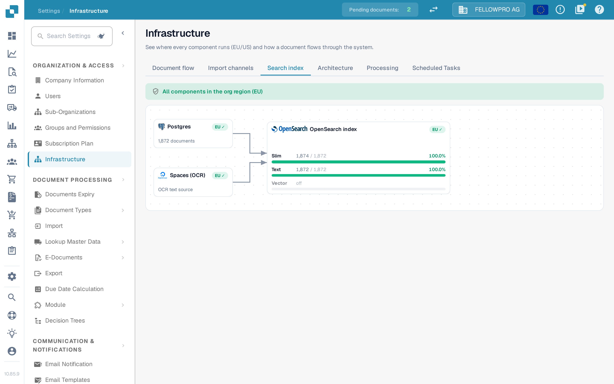
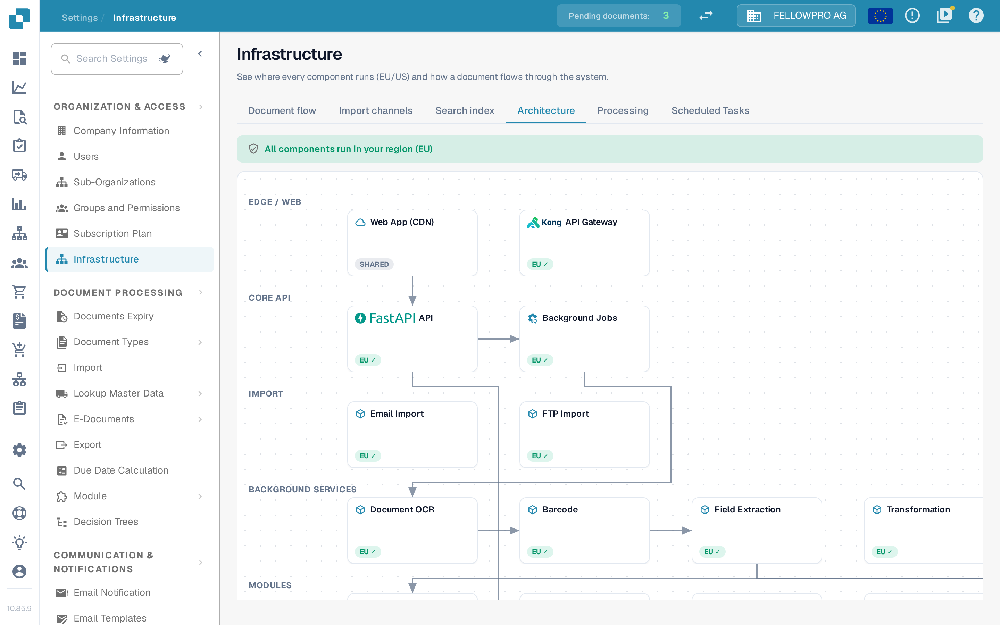
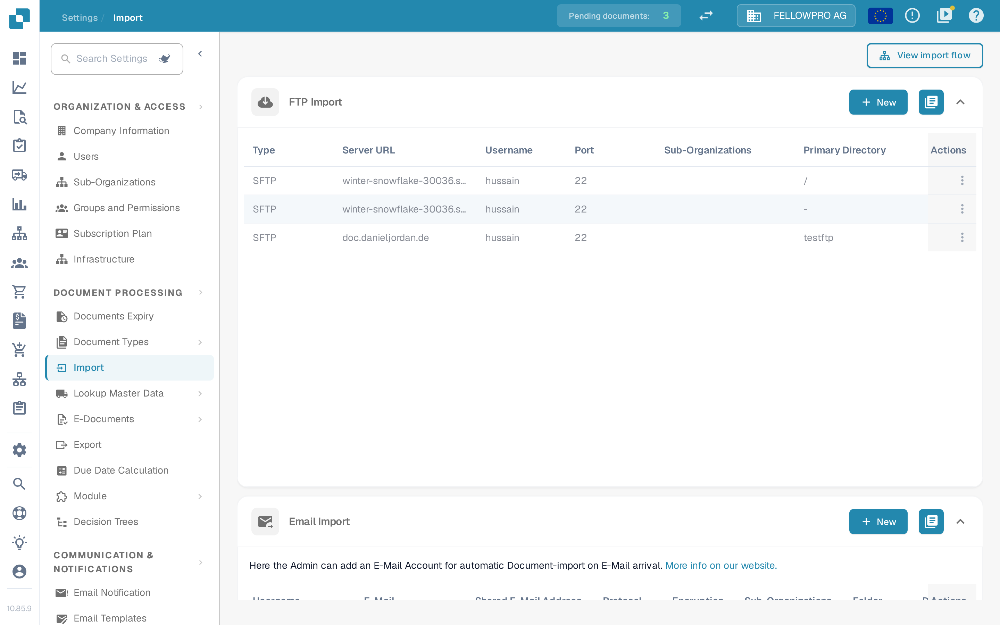

# Infrastructure

The **Infrastructure** page gives administrators a live, at-a-glance view of how documents reach DocBits, where every part of the platform runs (EU or US), and whether background processing is healthy. It is read-only — nothing here is configured; it answers *"is everything running, is my data staying in my region, and where do my documents come from?"*

> **Access:** Infrastructure is an admin-only page. Open **Settings → Organization & Access → Infrastructure**.

All the read-only flow pictures of Settings are collected on this page. The pages that used to show their own diagram — Import and Fulltext — now link here instead.

<figure><figcaption>
The Infrastructure page opens on the Document flow tab.
</figcaption></figure>

The page is split into six tabs:

| Tab | Answers |
|-----|---------|
| **Document flow** | How does a document get in, and which processing steps does it pass? |
| **Import channels** | Which FTP/SFTP sources and mailboxes are configured, and where do they deliver? |
| **Search index** | How does document data reach the search index, and how far has indexing progressed? |
| **Architecture** | Where does each component run, and is it all in my region? |
| **Processing** | Are document-processing steps (OCR, extraction, PO match …) running and up to date? |
| **Scheduled Tasks** | Are the recurring background jobs running on schedule? |

Each tab loads its data the first time you open it, so switching back and forth does not re-fetch everything.

## Document flow

**Document flow** is the overview tab and opens by default. It draws the journey of a document from the channel it arrives on, through the processing steps, to export.

On the left are the three entry channels:

| Channel | What it shows |
|---------|----------------|
| **Email inbox** | The number of configured mailboxes and how many of them are active. |
| **FTP folder** | The number of configured FTP/SFTP sources, how many are active, and the region badge of the DocBits API that receives them. |
| **Web upload** | Always available — marked **Always on**, as it needs no configuration. |

A channel with no sources is greyed out and reads **Not set up**. Select either the Email or the FTP box to jump straight to that channel on the **Import channels** tab.

To the right, the arrows run through the processing steps — **API**, **OCR**, **Extraction**, **PO Matching**, **Auto Accounting** and **Export** — with **Datastores** (Database, File storage) underneath. Optional modules carry an **ACTIVE** or **INACTIVE** badge so you can see at a glance which steps apply to your organisation.

## Import channels

The **Import channels** tab lists the sources behind the Email and FTP boxes of the document flow. Use it to confirm what is configured and where it delivers before opening the full Import settings.

<figure><figcaption>
Each configured source with its protocol, server, state and folders.
</figcaption></figure>

* Switch between **FTP folder** and **Email inbox** at the top of the tab.
* A banner confirms the region: *"All FTP/SFTP imports go to your organisation's region (EU)"*, and names the API host that receives them. If a source delivers to a different region, the banner says so instead.
* Each entry names the protocol and server (for example **SFTP · example.sftp.host**), carries an **ACTIVE** or **INACTIVE** badge, and lists its **Import folder** and, where configured, its **→ Archive folder**.
* When a channel has nothing configured, the tab says so rather than showing an empty list.

This tab is read-only. Use **Edit in Import settings** to open **Settings → Import**, where connections are created, tested, activated and deleted — see [Import](document-processing/import/README.md).

## Search index

The **Search index** tab is the read-only picture of how document data reaches the Fulltext search index. It moved here from Settings → Fulltext, where a link now points to it.

<figure><figcaption>
The sources, the target index and the progress of each indexing phase.
</figcaption></figure>

* **Region banner** — confirms whether all components run in your organisation's region, for example *All components in the org region (EU)*. A component in another region is named in the banner.
* **Sources** — **Postgres** shows the number of documents in the database; **Spaces (OCR)** is the OCR text source. Each box carries its own region label.
* **OpenSearch index** — lists three indexing phases with the indexed count, the total and a percentage: **slim** (documents in the base index), **text** (the OCR text) and **vector** (embeddings for semantic search).
* **vector: off** — the vector phase shows **off** instead of a count while no vector preference is enabled. Turn one on under **Settings → Fulltext Search Settings → Documents** to see it fill. See [Fulltext Search Settings](log-settings/fulltext-search-settings.md).

## Architecture

The **Architecture** tab draws the whole DocBits platform as a static map, grouped into layers — **Edge / Web**, **Core API**, **Import**, **Services**, **Modules**, **Datastores** and **Authentication**. Each box is one component (the Web App/CDN, the API Gateway, the OCR worker, the database, and so on), and the arrows show how they connect.

<figure><figcaption>
Every component is tagged with the region it runs in.
</figcaption></figure>

### Region awareness

Each component carries a region badge so you can confirm your data residency at a glance:

| Badge | Meaning |
|-------|---------|
| **EU ✓** / **US ✓** | The component runs in your organization's region. |
| **SHARED** | A global component (e.g. the CDN) with no single region — this is expected and not an issue. |
| **N/A** | The region of this component is not known. |
| **Region mismatch** | The component runs in a *different* region than your organization. It is highlighted so you can raise it with support. |

The banner at the top summarizes the result: **"All components run in your region (EU)"** when everything matches, or a warning if any critical component is cross-region.

### Optional modules

Components that belong to an optional module (Full-Text Search, DocFlow, Auto-Accounting, DocNet, PO Matching) show an **activated** or **deactivated** badge. Clicking a deactivated module takes you straight to the page where you can switch it on — **Settings → Module** for most modules, or **Document Types** for PO Matching (which is enabled per document type).

## Processing

The **Processing** tab shows the document-processing pipeline for **your organization** — when each step last ran and whether work is flowing or backing up.

| Column | Description |
|--------|-------------|
| **Process** | The processing step — Document Processing, OCR, TR-OCR, Barcode Split, Barcode Extraction, Extraction, PO Match. |
| **Last run** | How long ago the step last ran. Hover for the exact timestamp. *"Never run"* means no document has reached this step yet. |
| **Status** | A traffic-light badge (see below). |

Status badges:

| Badge | Meaning |
|-------|---------|
| **OK** (green) | No recent errors and nothing waiting — the step is healthy. |
| **In progress (N)** (amber) | `N` documents are currently being processed by this step. |
| **Errors (N)** (red) | `N` documents recently failed at this step. |

Errors and *in progress* are independent signals, so a step can show both badges at once — you still see a failure even while other work is running. Use **Refresh** to pull the latest numbers.

## Scheduled Tasks

The **Scheduled Tasks** tab lists the recurring background jobs that keep DocBits running (cache refreshes, status alerts, document timeouts, outbound syncs, and more) and confirms each one is firing on time.

| Column | Description |
|--------|-------------|
| **Task** | The name of the scheduled job. |
| **Last run** | How long ago it last ran. Hover for the exact timestamp; *"Never run"* means it has not fired yet. |
| **Status** | Schedule health (see below). |

Status values:

| Badge | Meaning |
|-------|---------|
| **On schedule** (green) | The task is running at its expected interval. |
| **Delayed** (red) | The task has not run when expected — worth investigating or raising with support. |
| **Unknown** (grey) | Schedule status could not be determined. |

Use **Refresh** to re-check the schedule status on demand.

## Reaching the flows from Import and Fulltext

The pages whose diagrams moved here keep a button that takes you to the matching tab:

<figure><figcaption>
<strong>View import flow</strong> on Settings → Import opens the Import channels tab.
</figcaption></figure>

* **Settings → Import** — **View import flow** opens the **Import channels** tab on the FTP channel.
* **Settings → Fulltext Search Settings** — **View search pipeline** opens the **Search index** tab.
