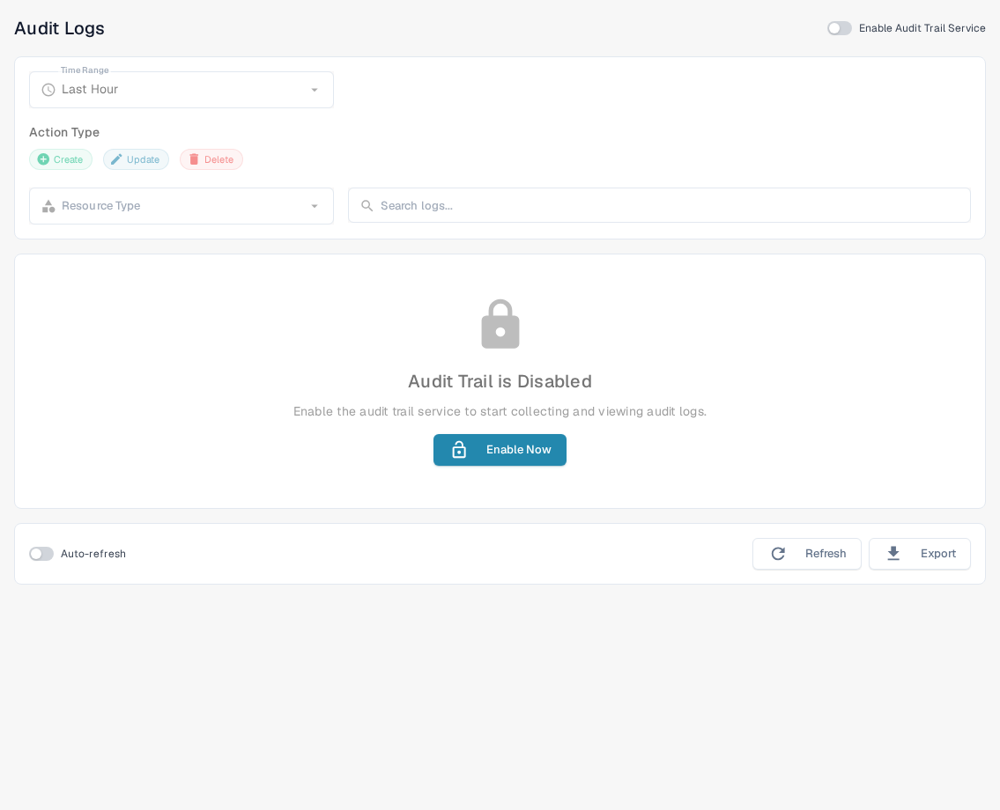

# Access Audit

<figure><figcaption>
Página de Access Audit
</figcaption></figure>

La página Access Audit (Audit Logs) registra todas las acciones de creación, actualización y eliminación realizadas por los usuarios en DocBits. Utilícela para supervisar quién cambió qué y cuándo.

## Enable Audit Trail Service

Utilice el interruptor de la esquina superior derecha para activar o desactivar el registro de auditoría de forma global.

## Filtros

| Filtro | Descripción |
|--------|-------------|
| **Time Range** | Seleccione una ventana de tiempo (p. ej., Last Hour, Today, Last 7 Days). |
| **Action Type** | Filtra por acción: **Create** (verde), **Update** (azul), **Delete** (rojo). |
| **Resource Type** | Filtra por tipo de recurso (p. ej., documentos, ajustes). |
| **Search logs** | Búsqueda de texto libre en las entradas de auditoría. |

## Tarjetas de resumen

| Tarjeta | Descripción |
|------|-------------|
| **Total Actions** | Número total de eventos de auditoría en el período seleccionado. |
| **Created** | Número de acciones de creación. |
| **Updated** | Número de acciones de actualización. |
| **Deleted** | Número de acciones de eliminación. |

## Tabla del registro de auditoría

| Columna | Descripción |
|--------|-------------|
| **Timestamp** | Cuándo se produjo la acción (hora relativa y absoluta). |
| **User** | El usuario que realizó la acción (correo electrónico y avatar). |
| **Action** | Insignia de acción con código de color: Create, Update o Delete. |
| **Resource** | El nombre y el tipo del recurso afectado (p. ej., el nombre de archivo del documento). |
| **Details** | Haga clic en el icono de flecha para ver todos los detalles del cambio. |
