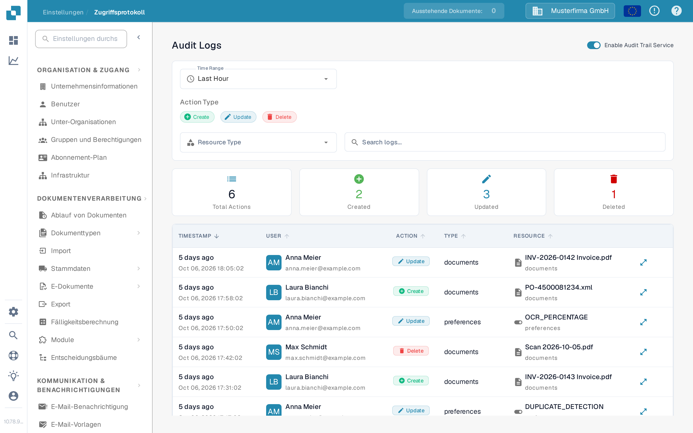
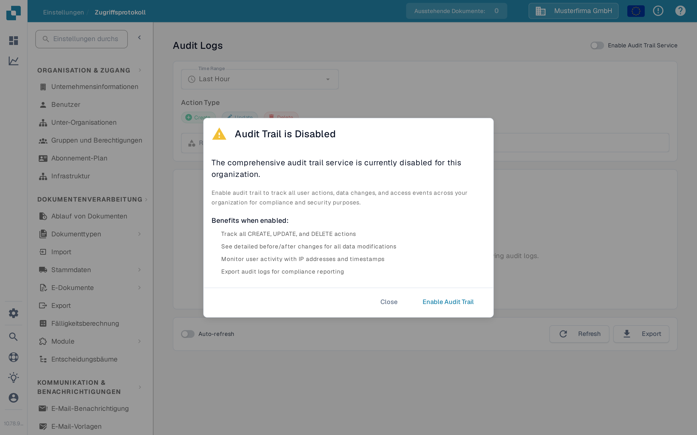

# Zugriffsprotokoll

<figure><figcaption>
Die Seite Zugriffsprotokoll in der Sandbox, bevor die Audit-Protokollierung aktiviert wird.
</figcaption></figure>

Das Zugriffsprotokoll zeichnet auf, wer eine Ressource erstellt, geändert oder gelöscht hat und wann das geschehen ist. Öffnen Sie **Einstellungen → Aktivitätsprotokollierung → Zugriffsprotokoll**, um das Protokoll einzusehen. Aktivieren Sie den Dienst für eine Organisation nur dann, wenn Sie Audit-Ereignisse sammeln möchten.

## Wenn die Audit-Protokollierung ausgeschaltet ist

<figure><figcaption>
Der Dialog erklärt, was aufgezeichnet wird, bevor Sie den Dienst einschalten.
</figcaption></figure>

Beim ersten Besuch in einer Browsersitzung kann **Audit Trail is Disabled** erscheinen. **Close** blendet den Dialog aus; die Audit-Protokollierung bleibt dann ausgeschaltet. **Enable Audit Trail** schaltet sie für die aktuelle Organisation ein. Auf der Seite hinter dem Dialog schalten auch **Enable Now** und der Schalter **Enable Audit Trail Service** den Dienst ein. Diese Steuerelemente ändern die Organisationseinstellung; sie zeigen die Funktion nicht nur als Vorschau.

Solange der Dienst ausgeschaltet ist, können die Filter und die Protokolltabelle keine Ereignisse anzeigen. Der leere Zustand erklärt, wie Sie die Protokollierung aktivieren. Nach dem Aktivieren können Sie den Dienst bei Bedarf über den Schalter wieder ausschalten. Ereignisse stehen nur zur Verfügung, wenn der Dienst eingeschaltet ist und Daten gesammelt hat.

## Ein Ereignis finden

| Steuerelement | Funktion |
|---|---|
| **Time Range** | Beschränkt die Liste auf einen Zeitraum wie Last Hour, Today oder Last 7 Days. |
| **Create**, **Update**, **Delete** | Schließt diese Aktionsarten ein oder aus. |
| **Resource Type** | Beschränkt die Ergebnisse auf einen Ressourcentyp wie Dokumente oder Einstellungen. |
| **Search logs...** | Durchsucht die sichtbaren Protokolleinträge nach Text. |
| **Refresh** | Lädt die neuesten passenden Einträge einmal. |
| **Auto-refresh** | Hält die Liste automatisch aktuell, solange die Seite geöffnet ist. |
| **Export** | Lädt die aktuellen Protokolldaten als JSON-Datei herunter. |

Die Übersichtskarten zeigen die Aktionen gesamt, erstellt, aktualisiert und gelöscht für die gewählten Filter. In der Tabelle zeigt **TIMESTAMP**, wann ein Ereignis stattgefunden hat, **USER** benennt den Akteur, **ACTION** die Änderung und **RESOURCE** das betroffene Element. Öffnen Sie die Detailansicht einer Zeile, um die aufgezeichnete Änderung zu prüfen. Wenn keine Ereignisse erscheinen, prüfen Sie zuerst, ob der Dienst eingeschaltet ist, und erweitern Sie den Zeitraum, bevor Sie die übrigen Filter ändern.
