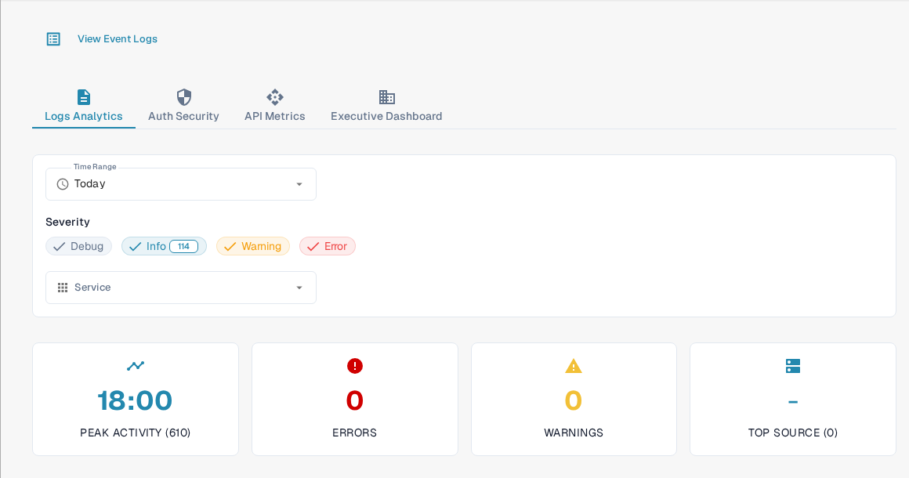

# Analytics

<figure><figcaption>
Página de Analytics
</figcaption></figure>

La página Analytics ofrece paneles visuales para supervisar el estado del sistema, los patrones de los registros y el uso de la API. Enlaza directamente con la página Activity Logging mediante el botón **View Event Logs**.

## Pestañas

| Pestaña | Descripción |
|-----|-------------|
| **Logs Analytics** | Distribución de la gravedad de los registros, gráficos de línea de tiempo y desglose por servicio. |
| **Auth Security** | Eventos de autenticación, intentos de inicio de sesión y métricas relacionadas con la seguridad. |
| **API Metrics** | Volúmenes de solicitudes a la API, tiempos de respuesta y tasas de error. |

## Filtros

| Filtro | Descripción |
|--------|-------------|
| **Time Range** | Seleccione una ventana de tiempo (p. ej., Today, Last 7 Days). |
| **Severity** | Active o desactive los niveles de gravedad: Debug, Info, Warning, Error. Cada uno muestra su recuento actual. |
| **Service** | Filtra por nombre de servicio. |

## Tarjetas de resumen

Debajo de los filtros aparecen cuatro tarjetas de resumen:

| Tarjeta | Descripción |
|------|-------------|
| **Peak Activity** | Hora del día con el mayor volumen de registros y su recuento total. |
| **Errors** | Recuento total de errores del período seleccionado. |
| **Warnings** | Recuento total de advertencias del período seleccionado. |
| **Top Source** | El servicio que genera más registros, con su recuento. |

## Real User Monitoring (RUM)

Debajo de las tarjetas de resumen, las métricas de RUM muestran datos de rendimiento del frontend recopilados de sesiones reales del navegador de los usuarios.

## Gráficos de Analytics

Alterne entre tres vistas de gráficos:

| Vista | Descripción |
|------|-------------|
| **Severity** | Gráfico circular que muestra la distribución de los niveles de registro (Debug, Info, Warning, Error). |
| **Timeline** | Gráfico de líneas que muestra el volumen de registros a lo largo del tiempo. |
| **Service** | Gráfico de barras que desglosa los registros por servicio. |
