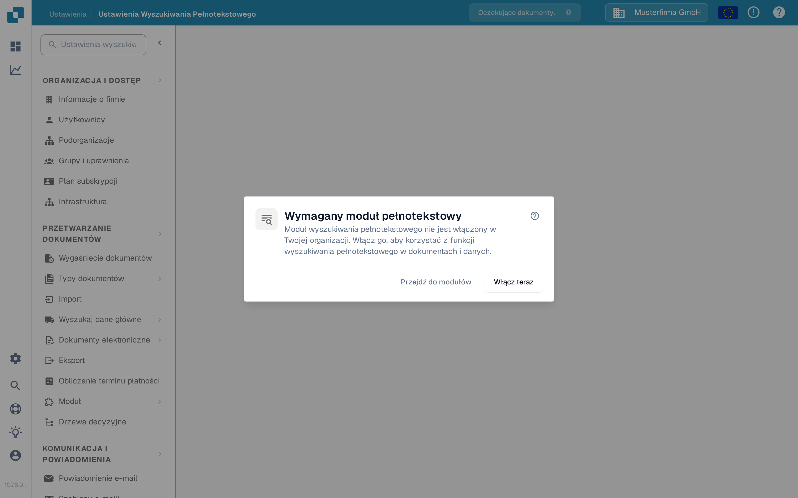

# Ustawienia Wyszukiwania Pełnotekstowego

<figure><figcaption>
Gdy Wyszukiwanie Pełnotekstowe jest wyłączone, to okno wyjaśnia kolejne kroki.
</figcaption></figure>

Ustawienia Wyszukiwania Pełnotekstowego określają, co DocBits indeksuje i jak ta treść staje się przeszukiwalna w dokumentach, danych podstawowych ERP i szablonach. Strona ustawień wyświetla okno wymagania modułu, dopóki **moduł Wyszukiwania Pełnotekstowego** nie zostanie włączony — zobacz [Wyszukiwanie Pełnotekstowe](../document-processing/module/fulltext-search.md), aby poznać język zapytań skierowany do użytkownika.

## Wymagania wstępne

Moduł Wyszukiwania Pełnotekstowego musi być aktywowany w **Ustawienia → Moduł → Dashboards & Analytics → Wyszukiwanie pełnotekstowe**. Jeśli moduł nie jest włączony, okno oferuje trzy działania:

* **Pomoc (?)** — otwiera dokumentację Wyszukiwania Pełnotekstowego w nowej karcie, zanim zmienisz jakiekolwiek ustawienie.
* **Przejdź do modułów** — otwiera ustawienia modułu Dashboards & Analytics, aby przejrzeć konfigurację.
* **Włącz teraz** — otwiera okno subskrypcji. Przejrzyj i potwierdź to okno, zanim moduł zostanie włączony; samo kliknięcie tego przycisku nie włącza modułu.

Strona ustawień sama staje się dostępna, gdy moduł jest aktywny.

## Układ strony

Strona ustawień jest podzielona na trzy zakładki, z których każda obejmuje inny typ treści, który Wyszukiwanie Pełnotekstowe może indeksować.

### Zakładka „Dokumenty”

Zakładka Dokumenty obejmuje wszystko związane z indeksowaniem przetworzonych dokumentów:

* **Statystyki indeksowania** — sumy dokumentów zindeksowanych i oczekujących, odświeżane na żądanie.
* **Preferencje wektorowe** — trzy przełączniki na poziomie organizacji decydujące, czy indeksowanie wektorowe działa równolegle z indeksem tekstowym dla dokumentów. Indeksowanie wektorowe zasila tryb zapytania `vector:` oraz funkcję „Znajdź podobne”.
* **Akcje reindeksacji** — rozpocznij pełną lub przyrostową reindeksację. Podczas trwania reindeksacji widzisz postęp na żywo (dokumenty na minutę, szacowany czas), bieżący stan strumienia oraz ostatni błąd (jeśli wystąpił).
* **Diagnostyka synchronizacji** — diagnostyka na żądanie dla przypadków, gdy indeks wydaje się być niesynchronizowany z bazą dokumentów.

<mark>Reindeksacja nie jest destrukcyjna — istniejące wyszukiwanie nadal działa, podczas gdy nowy indeks jest budowany.</mark>

### Zakładka „ERP”

Zakładka ERP zarządza indeksowaniem danych podstawowych ERP — dostawców, klientów, towarów i podobnych jednostek. Każda jednostka ma własne przełączniki:

* **Indeksowanie** — indeksuje jednostkę tekstowo, dzięki czemu jest przeszukiwalna z pulpitu.
* **Wektor** — indeksuje jednostkę wektorowo, dzięki czemu można ją dopasować zapytaniami semantycznymi.

Akcja **Przełącz wszystko** u góry listy stosuje ten sam stan włączenia/wyłączenia do wszystkich jednostek na raz. Indeksowanie rusza w tle; wskaźnik w każdym wierszu pokazuje, kiedy trwa.

### Zakładka „Szablony”

Zakładka Szablony wymienia wersje szablonów znane indeksowi Wyszukiwania Pełnotekstowego. Użyj tego widoku, aby po ponownym wdrożeniu potwierdzić, że wersje szablonów, od których zależysz, są obecne w indeksie.

## Co jest indeksowane

Po włączeniu i skonfigurowaniu Wyszukiwanie Pełnotekstowe pozwala użytkownikom:

* Wyszukiwać w całej treści dokumentu (nie tylko w polach metadanych).
* Znajdować dokumenty po tekście zawartym w przesłanych plikach.
* Używać zaawansowanych operatorów wyszukiwania do precyzyjnych zapytań.
* Korzystać z wyników wyszukiwania bezpośrednio z pulpitu.
* Używać wyszukiwania semantycznego (prefiks `vector:`), gdy indeksowanie wektorowe jest aktywne dla danego typu treści.

Pełna referencja języka zapytań — w tym zapytania zakresowe, inteligentne filtry i tryb wyszukiwania AI — znajduje się na stronie modułu [Wyszukiwanie Pełnotekstowe](../document-processing/module/fulltext-search.md).
