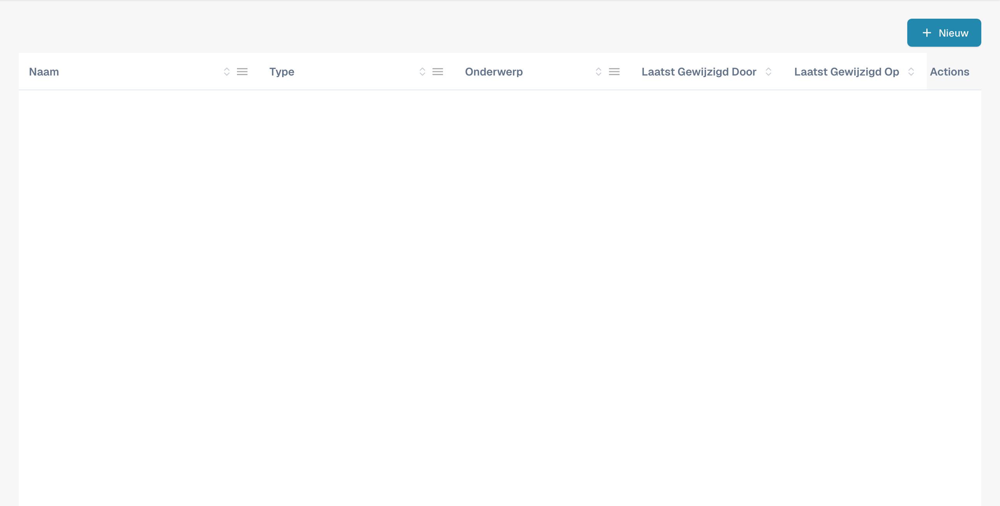
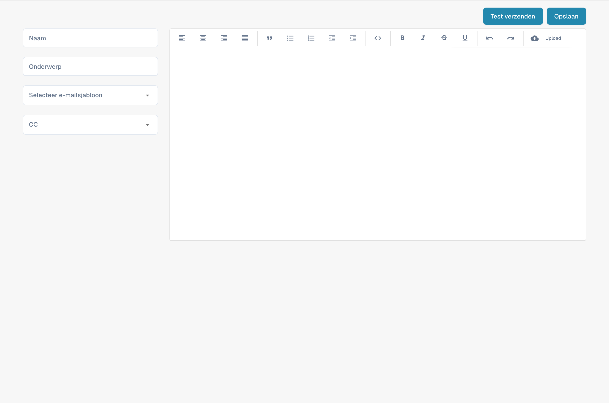

# E-mailsjablonen bewerken

<figure><figcaption><p>Lijst met e-mailsjablonen voor leveranciers.</p></figcaption></figure>

### Overzicht

Met de functie E-mailsjablonen kunnen beheerders e-mailcommunicatie maken en aanpassen die automatisch naar leveranciers wordt verzonden. Een van de belangrijkste elementen in deze sjablonen is de `{{magic_link}}`, die een dynamische link biedt die is afgestemd op elke ontvanger.

#### Wat is `{{magic_link}}`?

De `{{magic_link}}` is een tijdelijke aanduiding die bij het verzenden van de e-mail dynamisch wordt vervangen door een unieke URL. Deze URL leidt de ontvanger meestal naar het voltooien van een actie, zoals registratie, goedkeuring of toegang tot een specifiek deel van het leveranciersportaal.

### E-mailsjablonen bewerken

<figure><figcaption><p>Editor voor een nieuwe e-mailsjabloon voor leveranciers.</p></figcaption></figure>

#### Toegang tot de sjablooneditor

1. **Ga naar E-mailsjablonen**:
   * Ga vanuit het hoofdmenu naar het gedeelte **E-mailsjablonen**.
2. **Selecteer een sjabloon om te bewerken**:
   * Kies het e-mailsjabloon dat u wilt bewerken door op de sjabloonnaam te klikken (bijv. "Supplier Invitation Email").
3. **Bewerk het sjabloon**:
   * In de editor kunt u zowel de HTML-code als het visuele ontwerp van de e-mail aanpassen.
   * U kunt met de beschikbare tabbladen schakelen tussen visueel bewerken en codebewerking.

<figure><figcaption></figcaption></figure>

#### `{{magic_link}}` als link definiëren

Om `{{magic_link}}` als klikbare link in de e-mail te definiëren, moet u ervoor zorgen dat deze correct is opgemaakt in de HTML-code van het sjabloon. Volg deze stappen:

1. **Zoek het linkgedeelte in de HTML-code**:
   * Zoek in de code-editor het gedeelte waar de magic link moet verschijnen. Dit is meestal binnen een `<a>`-tag (anchor).
2.  **Voeg de tijdelijke aanduiding `{{magic_link}}` in**:

    * Vervang het attribuut `href` van de anchor-tag door `{{magic_link}}`.
    * Zorg ervoor dat de link passend is opgemaakt voor het e-mailsjabloon. Hier is een voorbeeld:

    ```html
    <a href="{{magic_link}}" target="_blank" style="
        background-color: #B7184B;
        border-radius: 25px;
        font-family: 'Montserrat', Arial, sans-serif;
        font-size: 14px;
        font-weight: bold;
        padding: 12px 25px;
        color: #FFFFFF;
        text-decoration: none;
        display: inline-block;
        cursor: pointer;">
        Complete Registration
    </a>
    ```

### 3. Pas de linktekst aan:

• Wijzig de tekst tussen de openende \<a>- en sluitende \</a>-tags zodat deze de actie weergeeft die de gebruiker moet uitvoeren. Bijvoorbeeld “Complete Registration” of “Access Your Account”.

4\. Sla het sjabloon op en test het:

• Klik na het aanbrengen van de wijzigingen op de knop Save.

• U kunt de knop Send Test gebruiken om een test-e-mail te verzenden en te controleren of de link werkt zoals verwacht.

## Best practices voor het gebruik van \{{magic\_link\}}

• Plaatsing van de link: Plaats de \{{magic\_link\}} prominent in de e-mail, zodat deze voor ontvangers gemakkelijk toegankelijk is.

• Duidelijke call-to-action: De tekst in de link moet een duidelijke call-to-action zijn, zoals “Complete Registration” of “Confirm Your Email.”

• Opmaak: Zorg ervoor dat de link consistent is opgemaakt met de rest van het e-mailsjabloon en visueel opvalt.

• Testen: Verstuur na het bewerken van het sjabloon altijd een test-e-mail om te controleren of de \{{magic\_link\}} correct wordt omgezet en de opmaak geschikt is.

## Conclusie

Door de \{{magic\_link\}} correct te definiëren in uw e-mailsjablonen, zorgt u ervoor dat ontvangers een gepersonaliseerde en actiegerichte e-mail ontvangen die hen naar de juiste taak in uw leveranciersportaal leidt. Dit verbetert de gebruikerservaring en zorgt voor een soepele onboarding en communicatie.

\

Deze documentatie biedt beheerders stapsgewijze instructies voor het definiëren en gebruiken van de \{{magic\_link\}} in e-mailsjablonen, zodat e-mails zowel functioneel als visueel aantrekkelijk zijn.
