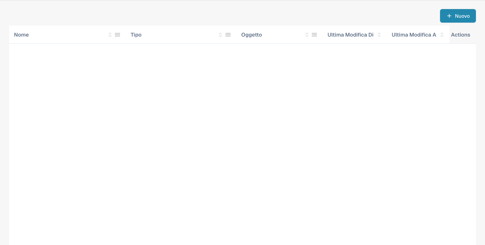
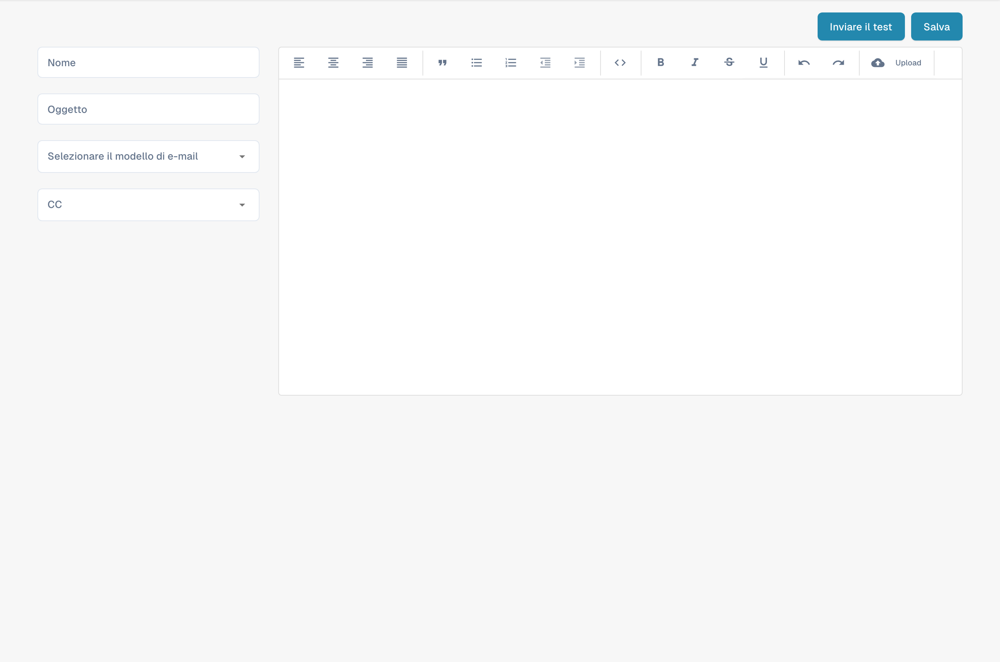

# Modifica dei Modelli di Email

<figure><figcaption><p>Elenco dei modelli di e-mail per i fornitori.</p></figcaption></figure>

### Panoramica

La funzionalità dei Modelli di Email consente agli amministratori di creare e personalizzare comunicazioni email che vengono inviate automaticamente ai fornitori. Uno degli elementi chiave utilizzati in questi modelli è il `{{magic_link}}`, che fornisce un link dinamico personalizzato per ciascun destinatario.

#### Cos'è `{{magic_link}}`?

Il `{{magic_link}}` è un segnaposto che viene sostituito dinamicamente con un URL unico quando l'email viene inviata. Questo URL di solito indirizza il destinatario a completare un'azione, come registrazione, approvazione o accesso a una parte specifica del portale fornitori.

### Modifica dei Modelli di Email

<figure><figcaption><p>Editor di un nuovo modello di e-mail per i fornitori.</p></figcaption></figure>

#### Accesso all'Editor dei Modelli di Email

1. **Naviga ai Modelli di Email**:
   * Vai alla sezione **Modelli di e-mail** dal menu principale.
2. **Seleziona un Modello da Modificare**:
   * Scegli il modello di email che desideri modificare facendo clic sul nome del modello (ad es., "Supplier Invitation Email").
3. **Modifica il Modello**:
   * L'editor ti consente di modificare sia il codice HTML che il design visivo dell'email.
   * Puoi passare tra la modifica visiva e la modifica del codice utilizzando le schede fornite.

<figure><figcaption></figcaption></figure>

#### Definire `{{magic_link}}` come Link

Per definire `{{magic_link}}` come un link cliccabile nell'email, devi assicurarti che sia formattato correttamente nel codice HTML del modello. Segui questi passaggi:

1. **Trova la Sezione del Link nel Codice HTML**:
   * Nell'editor di codice, trova la sezione in cui desideri che appaia il link magico. Questo di solito è all'interno di un tag `<a>` (ancora).
2.  **Inserisci il Segnaposto `{{magic_link}}`**:

    * Sostituisci l'attributo `href` del tag ancora con `{{magic_link}}`.
    * Assicurati che il link sia stilizzato in modo appropriato per il modello di email. Ecco un esempio:

    ```html
    <a href="{{magic_link}}" target="_blank" style="
        background-color: #B7184B;
        border-radius: 25px;
        font-family: 'Montserrat', Arial, sans-serif;
        font-size: 14px;
        font-weight: bold;
        padding: 12px 25px;
        color: #FFFFFF;
        text-decoration: none;
        display: inline-block;
        cursor: pointer;">
        Complete Registration
    </a>
    ```

### 3. Personalizza il Testo del Link:

• Modifica il testo tra i tag di apertura \<a> e chiusura \</a> per riflettere l'azione che desideri che l'utente compia. Ad esempio, “Complete Registration” o “Access Your Account”.

4\. Salva e Testa il Modello:

• Dopo aver apportato le modifiche, fai clic sul pulsante Save.

• Puoi utilizzare il pulsante Send Test per inviare un'email di prova per assicurarti che il link funzioni come previsto.

## Best Practice per l'Utilizzo di \{{magic\_link\}}

• Posizionamento del Link: Posiziona il \{{magic\_link\}} in modo prominente nell'email per garantire che sia facilmente accessibile ai destinatari.

• Chiamata all'Azione Chiara: Il testo all'interno del link dovrebbe essere una chiara chiamata all'azione, come “Complete Registration” o “Confirm Your Email.”

• Stile: Assicurati che il link sia stilizzato in modo coerente con il resto del modello di email e si distingua visivamente.

• Test: Invia sempre un'email di prova dopo aver modificato il modello per verificare che il \{{magic\_link\}} si risolva correttamente e che lo stile sia appropriato.

## Conclusione

Definendo correttamente il \{{magic\_link\}} nei tuoi modelli di email, puoi garantire che i destinatari ricevano un'email personalizzata e azionabile che li guidi verso il compito appropriato all'interno del tuo portale fornitori. Questo migliora l'esperienza dell'utente e assicura processi di onboarding e comunicazione fluidi.

\

Questa documentazione fornisce istruzioni passo-passo per gli amministratori su come definire e utilizzare il \{{magic\_link\}} nei modelli di email, assicurando che le email siano sia funzionali che visivamente attraenti.
