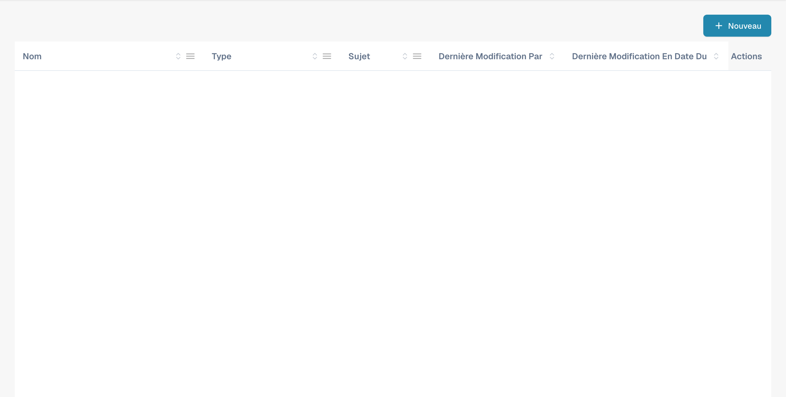
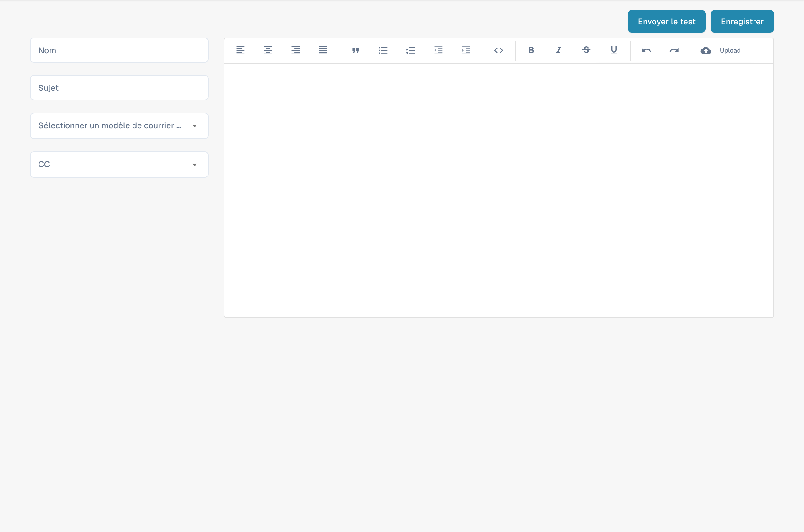

# Modification des modèles d'e-mails

<figure><figcaption><p>Liste des modèles de courriel fournisseur.</p></figcaption></figure>

### Aperçu

La fonctionnalité Email Templates permet aux administrateurs de créer et de personnaliser les e-mails envoyés automatiquement aux fournisseurs. L'un des éléments clés utilisés dans ces modèles est le `{{magic_link}}`, qui fournit un lien dynamique adapté à chaque destinataire.

#### Qu'est-ce que `{{magic_link}}` ?

Le `{{magic_link}}` est un espace réservé qui est remplacé dynamiquement par une URL unique lors de l'envoi de l'e-mail. Cette URL dirige généralement le destinataire vers une action à effectuer, comme l'inscription, l'approbation ou l'accès à une partie précise du portail fournisseur.

### Modification des modèles d'e-mails

<figure><figcaption><p>Éditeur d’un nouveau modèle de courriel fournisseur.</p></figcaption></figure>

#### Accès à l'éditeur de modèles d'e-mails

1. **Accédez à Email Templates** :
   * Allez dans la section **Modèles d'e-mails** depuis le menu principal.
2. **Sélectionnez un modèle à modifier** :
   * Choisissez le modèle d'e-mail que vous souhaitez modifier en cliquant sur son nom (par exemple « Supplier Invitation Email »).
3. **Modifiez le modèle** :
   * L'éditeur vous permet de modifier à la fois le code HTML et la conception visuelle de l'e-mail.
   * Vous pouvez passer de l'édition visuelle à l'édition du code grâce aux onglets prévus à cet effet.

<figure><figcaption></figcaption></figure>

#### Définir `{{magic_link}}` comme lien

Pour définir `{{magic_link}}` comme lien cliquable dans l'e-mail, vous devez vous assurer qu'il est correctement formaté dans le code HTML du modèle. Suivez ces étapes :

1. **Repérez la section du lien dans le code HTML** :
   * Dans l'éditeur de code, trouvez l'endroit où vous souhaitez faire apparaître le lien magique. Il se trouve généralement dans une balise `<a>` (ancre).
2.  **Insérez l'espace réservé `{{magic_link}}`** :

    * Remplacez l'attribut `href` de la balise d'ancre par `{{magic_link}}`.
    * Veillez à ce que le lien soit mis en forme de manière appropriée pour le modèle d'e-mail. Voici un exemple :

    ```html
    <a href="{{magic_link}}" target="_blank" style="
        background-color: #B7184B;
        border-radius: 25px;
        font-family: 'Montserrat', Arial, sans-serif;
        font-size: 14px;
        font-weight: bold;
        padding: 12px 25px;
        color: #FFFFFF;
        text-decoration: none;
        display: inline-block;
        cursor: pointer;">
        Complete Registration
    </a>
    ```

### 3. Personnaliser le texte du lien :

• Modifiez le texte entre les balises ouvrante \<a> et fermante \</a> pour refléter l'action que vous souhaitez voir effectuer par l'utilisateur. Par exemple « Complete Registration » ou « Access Your Account ».

4\. Enregistrer et tester le modèle :

• Après avoir effectué les modifications, cliquez sur le bouton Save.

• Vous pouvez utiliser le bouton Send Test pour envoyer un e-mail de test et vérifier que le lien fonctionne comme prévu.

## Bonnes pratiques pour l'utilisation de \{{magic\_link\}}

• Emplacement du lien : placez le \{{magic\_link\}} de manière bien visible dans l'e-mail afin qu'il soit facilement accessible aux destinataires.

• Appel à l'action clair : le texte du lien doit être un appel à l'action clair, tel que « Complete Registration » ou « Confirm Your Email ».

• Mise en forme : veillez à ce que le lien soit mis en forme de manière cohérente avec le reste du modèle d'e-mail et ressorte visuellement.

• Test : envoyez toujours un e-mail de test après avoir modifié le modèle afin de vérifier que le \{{magic\_link\}} est correctement résolu et que la mise en forme est appropriée.

## Conclusion

En définissant correctement le \{{magic\_link\}} dans vos modèles d'e-mails, vous vous assurez que les destinataires reçoivent un e-mail personnalisé et exploitable qui les guide vers la tâche appropriée dans votre portail fournisseur. Cela améliore l'expérience utilisateur et garantit des processus d'intégration et de communication fluides.

\

Cette documentation fournit aux administrateurs des instructions pas à pas pour définir et utiliser le \{{magic\_link\}} dans les modèles d'e-mails, afin que les e-mails soient à la fois fonctionnels et visuellement attrayants.
