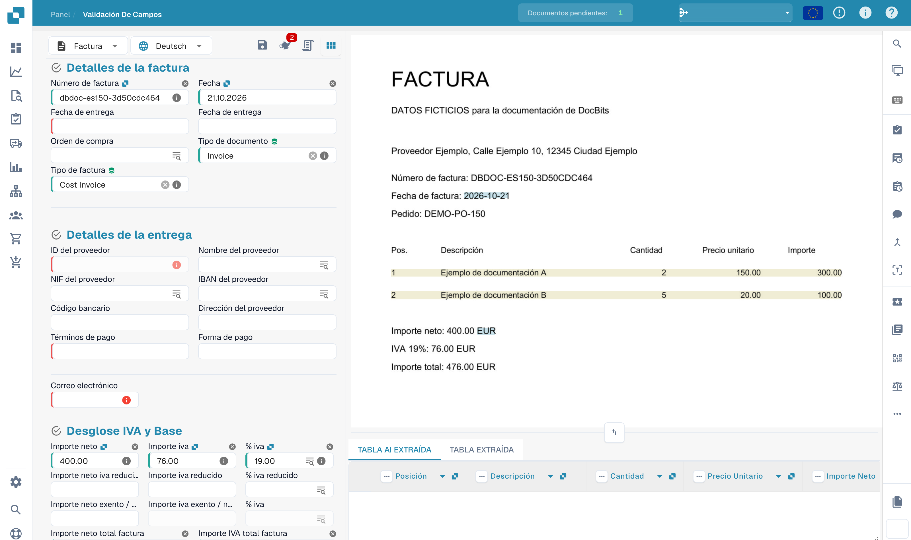

# Campos de Encabezado de Entrenamiento

Después de cargar su documento, será llevado a la pantalla de validación. Algunos campos pueden estar ya completados, esto es gracias a la inteligencia colectiva de DocBits. Sin embargo, otros campos podrían permanecer vacíos. Esto suele significar que el tipo de documento aún no ha sido completamente entrenado, por lo que DocBits aún no sabe de dónde extraer esa información.

Puede ayudar a entrenar a DocBits para reconocer estos campos identificando manualmente los datos correctos. **Por favor, tenga en cuenta:** si un campo permanece vacío, podría ser simplemente porque la información no está presente en el documento cargado.

<figure><figcaption>
Validación de una factura ficticia antes del entrenamiento de campos.
</figcaption></figure>

### Para entrenar un campo:

1. Haga clic en el campo que desea entrenar.
2. Luego, ya sea:
   * **Haga doble clic** en los datos relevantes dentro del documento, o
   * **Dibuje un cuadro de selección** alrededor de los datos usando su cursor.

<figure><figcaption>
Selección del número de factura como punto de partida del entrenamiento.
</figcaption></figure>

Repita este proceso para todos los campos requeridos. Una vez que todos los campos necesarios hayan sido completados, **haga clic en "Guardar Reglas"** para almacenar el entrenamiento. Esto asegura que DocBits aprenda dónde encontrar cada pieza de información para documentos similares en el futuro.

Después de guardar, su documento estará listo para ser exportado, y la próxima vez, DocBits extraerá automáticamente los campos entrenados.

Después de guardar un entrenamiento previsto, pruébelo con otros documentos del mismo proveedor. La posibilidad de exportar depende también de la validación y del flujo configurado.
