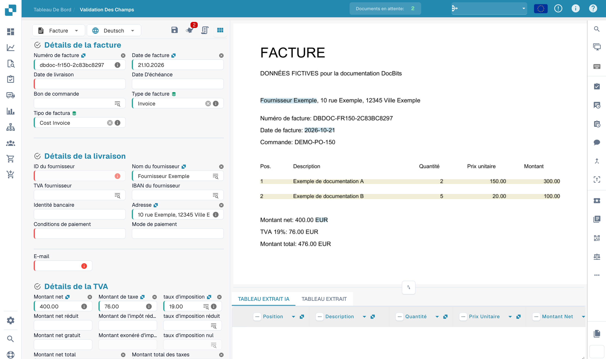

# Champs d'en-tête de formation

Après avoir téléchargé votre document, vous serez redirigé vers l'écran de validation.\
Certains champs peuvent déjà être pré-remplis — ceci est grâce à l'intelligence collective de DocBits. Cependant, d'autres champs pourraient rester vides. Cela signifie généralement que le type de document n'a pas encore été entièrement formé, donc DocBits ne sait pas encore d'où extraire ces informations.

Vous pouvez aider à former DocBits à reconnaître ces champs en identifiant manuellement les données correctes.\
**Veuillez noter :** si un champ reste vide, cela pourrait simplement signifier que l'information n'est pas présente dans le document téléchargé.

<figure><figcaption>
Validation d’une facture fictive avant l’entraînement des champs d’en-tête.
</figcaption></figure>

### Pour former un champ :

1. Cliquez sur le champ que vous souhaitez former.
2. Puis soit :
   * **Double-cliquez** sur les données pertinentes dans le document, ou
   * **Dessinez une zone de sélection** autour des données en utilisant votre curseur.

<figure><figcaption>
Sélection du numéro de facture comme point de départ de l’entraînement.
</figcaption></figure>

Répétez ce processus pour tous les champs requis.\
Une fois que tous les champs nécessaires ont été pré-remplis, **cliquez sur "Enregistrer les règles"** pour sauvegarder la formation. Cela garantit que DocBits apprend où trouver chaque information pour des documents similaires à l'avenir.

Après avoir sauvegardé, votre document est prêt à être exporté — et la prochaine fois, DocBits extraira automatiquement les champs formés.

Après l’enregistrement d’un entraînement prévu, testez d’autres documents du même fournisseur. L’export dépend aussi de la validation et du workflow configuré.
