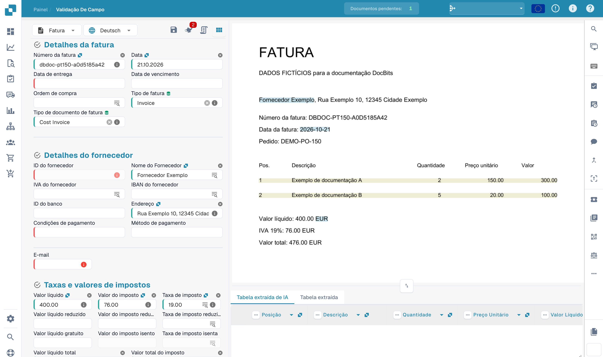

# Campos de Cabeçalho de Treinamento

Após carregar seu documento, você será levado para a tela de validação.\
Alguns campos podem já estar preenchidos — isso é graças à inteligência coletiva do DocBits. No entanto, outros campos podem permanecer vazios. Isso geralmente significa que o tipo de documento ainda não foi totalmente treinado, então o DocBits ainda não sabe de onde extrair essas informações.

Você pode ajudar a treinar o DocBits para reconhecer esses campos identificando manualmente os dados corretos.\
**Por favor, observe:** se um campo permanecer vazio, pode ser simplesmente porque a informação não está presente no documento carregado.

<figure><figcaption>
Validação de uma fatura fictícia antes de treinar campos do cabeçalho.
</figcaption></figure>

### Para treinar um campo:

1. Clique no campo que deseja treinar.
2. Em seguida, faça o seguinte:
   * **Clique duas vezes** nos dados relevantes dentro do documento, ou
   * **Desenhe uma caixa de seleção** ao redor dos dados usando seu cursor.

<figure><figcaption>
Seleção do número da fatura como ponto inicial do treino.
</figcaption></figure>

Repita este processo para todos os campos necessários.\
Uma vez que todos os campos necessários tenham sido preenchidos, **clique em "Salvar Regras"** para armazenar o treinamento. Isso garante que o DocBits aprenda onde encontrar cada informação para documentos semelhantes no futuro.

Após salvar, seu documento estará pronto para ser exportado — e na próxima vez, o DocBits extrairá automaticamente os campos treinados.

Após guardar o treino pretendido, teste outros documentos do mesmo fornecedor. A exportação também depende da validação e do fluxo configurado.
