# Advanced Settings

In some documents, table structures can be complex—spanning multiple lines, containing grouped information, or including unnecessary extra rows. The _Advanced Settings_ in training mode allow you to fine-tune table extraction for such cases, improving accuracy and consistency.

To access these settings, activate **Training Mode** and click the **Settings** gear icon in the top action bar:

<figure>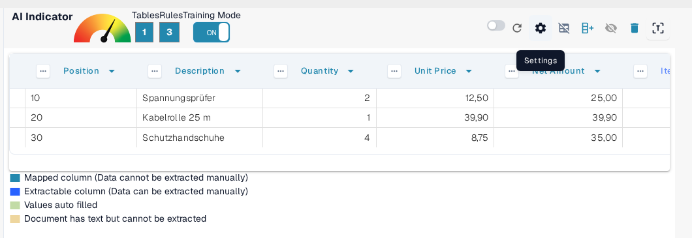<figcaption>
The Settings gear in the training mode action bar opens the Advanced Settings.
</figcaption></figure>

The Settings dialog holds every option described on this page. Expand the **Advanced Settings** section to reach the grouping options, which stay collapsed until you open them:

<figure>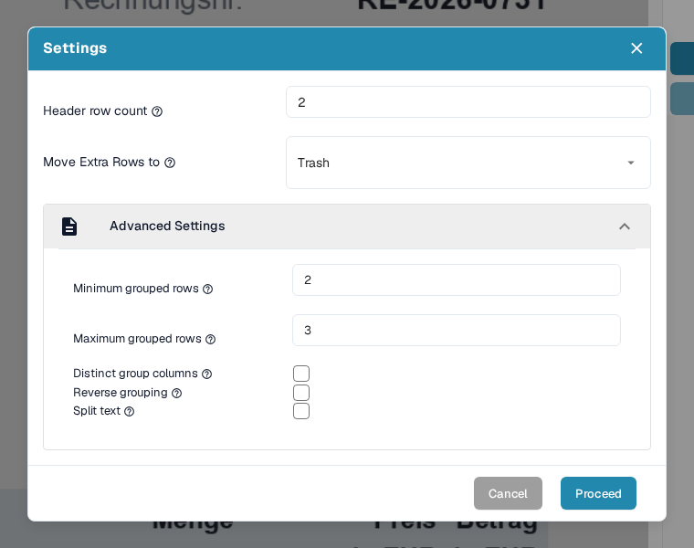<figcaption>
The Advanced Settings section with all grouping options.
</figcaption></figure>

Each option is described in its own section below, together with the effect it has on the extracted table.

### Header Row Count

**Use this setting to define how many lines make up the table header.**

Some tables have multi-line headers. For example, this table’s header spans two lines:

<figure>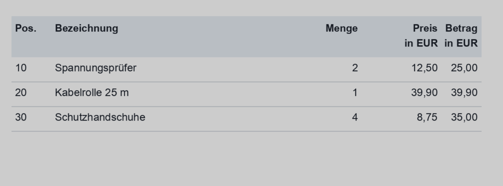<figcaption>
A table header that spans two lines.
</figcaption></figure>

Set the **Header row count** to match:

<figure><figcaption>
Header row count set to 2 in the Settings dialog.
</figcaption></figure>

#### Why is this important?

If you don’t set this, DocBits may treat the second line as data instead of part of the header, leading to extraction errors:

**Before:**

<figure>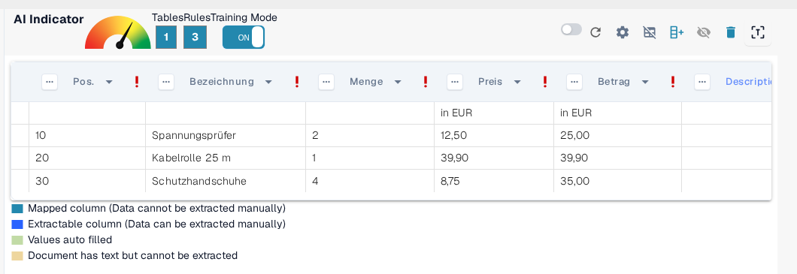<figcaption>
Before: the second header line is treated as data.
</figcaption></figure>

After:

<figure>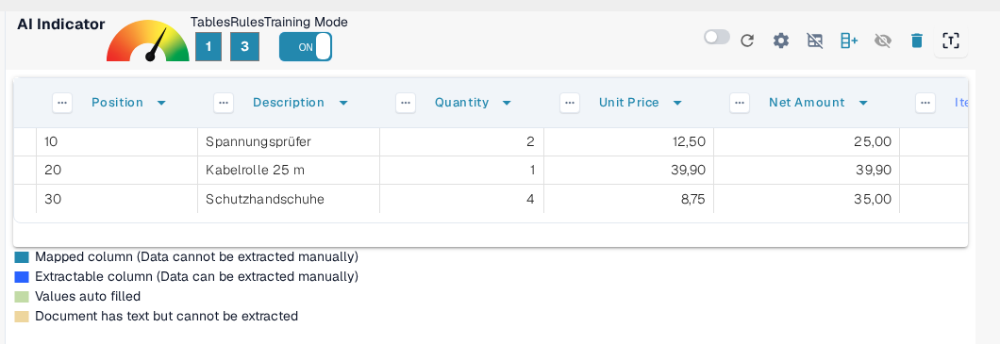<figcaption>
After: header and data rows are separated correctly.
</figcaption></figure>

### Move Extra Rows to Trash

**Use this to discard unwanted multi-line entries, such as overflow descriptions.**

In this example, the description spills into multiple rows, but only the first line is relevant:

<figure>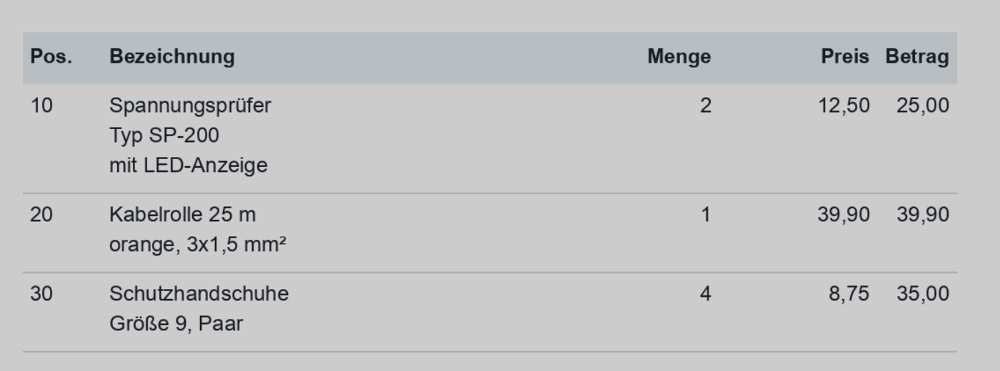<figcaption>
The description spills into several lines of which only the first is relevant.
</figcaption></figure>

Set **Move Extra Rows to** to **Trash** to remove the overflow:

<figure>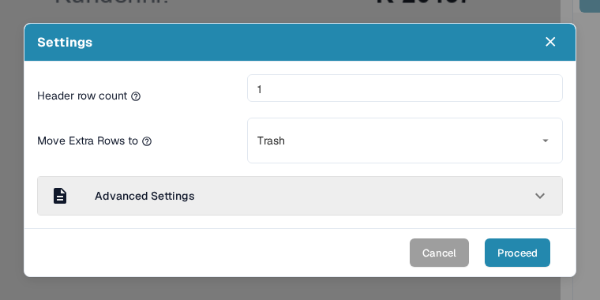<figcaption>
Move Extra Rows to set to Trash.
</figcaption></figure>

**Result after mapping:**

<figure>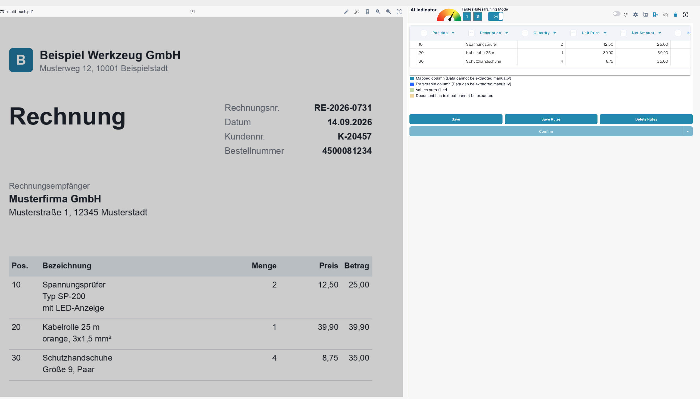<figcaption>
Result after mapping: the overflow lines are gone and only the relevant rows remain.
</figcaption></figure>

### Minimum Grouped Rows

**Use this when rows need to be grouped together under one main row (e.g. line items with multiple sub-lines).**

Here, only three out of six rows are relevant. Two key columns are mapped (e.g. Position, Description), while others are treated as custom fields.

Start by setting **Header row count** and the **Minimum grouped rows** — the smallest number of rows that must belong to a group before DocBits merges them:

<figure>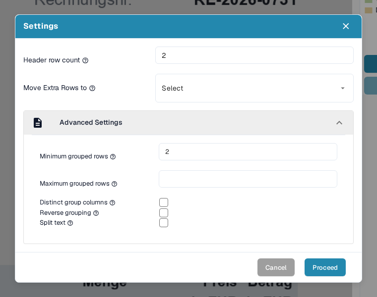<figcaption>
Header row count and Minimum grouped rows set in the Settings dialog.
</figcaption></figure>

Also set **Move Extra Rows to** to **Trash** to clean up irrelevant data:

<figure><figcaption>
Move Extra Rows to set to Trash in addition.
</figcaption></figure>

Then define the grouping key column, e.g. _Position_, by opening the column menu of that column and choosing **Group rows**:

<figure>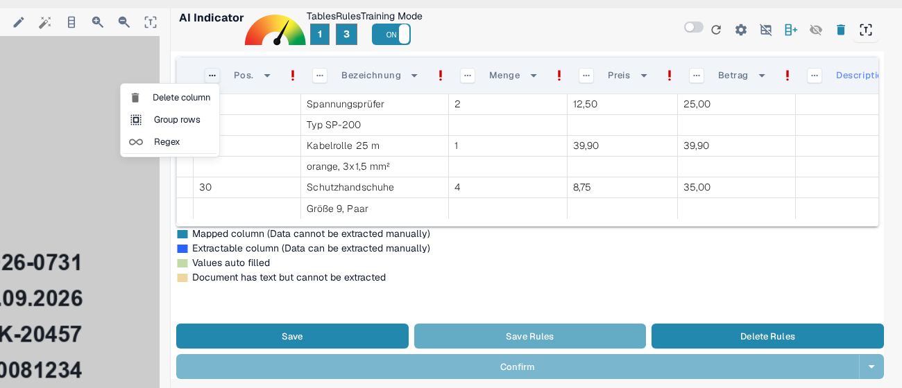<figcaption>
Choose Group rows in the column menu of the grouping key column (Position).
</figcaption></figure>

Grouping itself, and the other column tools that work together with it (manual row selection, column mapping and regex), are covered step by step in [Structuring and Improving Table Extraction in DocBits](improving-table-extraction-with-regex.md).

**Result:**

<figure>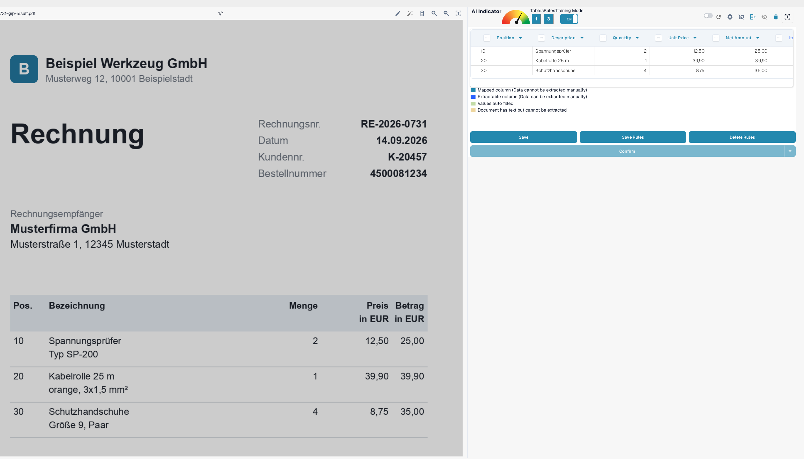<figcaption>
Result: the six physical rows are grouped into three line items.
</figcaption></figure>

#### Maximum Grouped Rows

**Use this to cap how many rows one group may contain.** Its tooltip asks: _How many rows does your grouped column maximum have?_ It is the counterpart to Minimum grouped rows: a group that would need more rows than this number is not merged.

Leave it empty when groups may be any size. Set it when a document contains items with many sub-lines and you want DocBits to leave unusually large blocks ungrouped so you can inspect them yourself.

You set it in the same dialog area as Minimum grouped rows, directly below it:

<figure><figcaption>
Maximum grouped rows (here 3) sits directly below Minimum grouped rows.
</figcaption></figure>

#### Distinct Group Columns

**Use this to keep only unique values in the grouping key column.**

The option's own tooltip in the app asks: _Do you want only unique values for your grouped column?_ Switch it on when several groups would carry the same value in the grouping key column and you want DocBits to keep that value only once, so the repeated groups show an empty key instead of the duplicate value.

It is a checkbox in the same section as Minimum grouped rows:

<figure>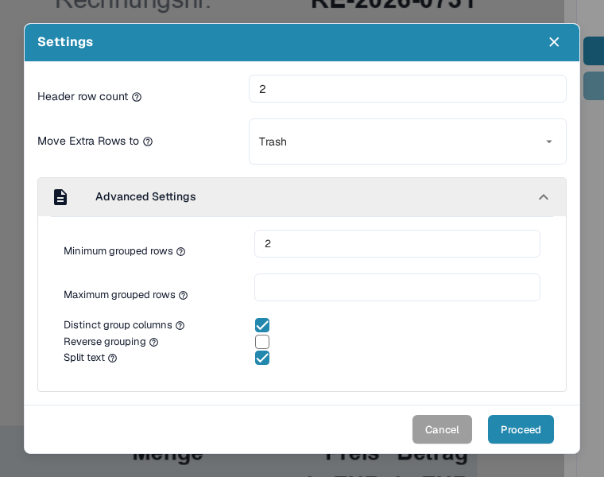<figcaption>
Distinct group columns is the checkbox below Maximum grouped rows.
</figcaption></figure>

#### Reverse Grouping

**Use this when the grouping row appears&#x20;**_**after**_**&#x20;the rows it should group.**

The option's tooltip asks: _Do you want to combine all the rows above the grouped attribute?_ Enable it when the row that carries the grouping key (for example the position or amount) stands _below_ its continuation lines, so DocBits merges the rows above the key into the group instead of the rows below it:

<figure>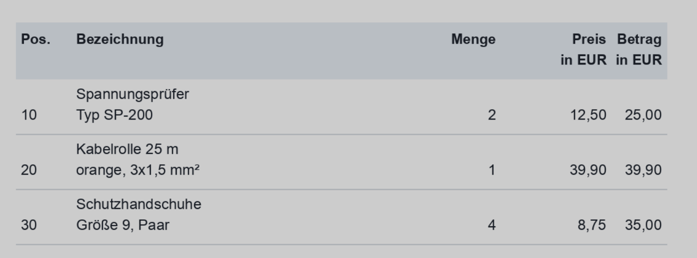<figcaption>
The grouping row appears after the rows it should group.
</figcaption></figure>

Enable **Reverse grouping**, group by a main column (e.g. Net amount), and set **Move Extra Rows to Trash** if needed:

<figure>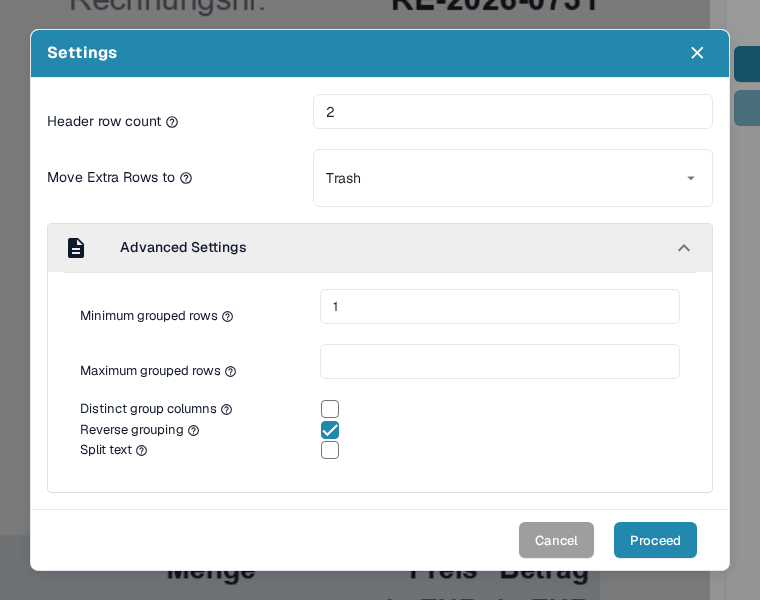<figcaption>
Reverse grouping enabled together with Move Extra Rows to Trash.
</figcaption></figure>

**Final result:**

<figure>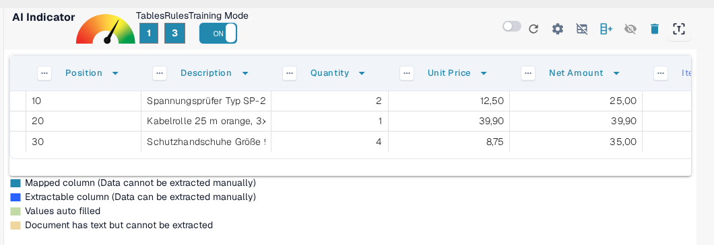<figcaption>
Final result with reverse grouping.
</figcaption></figure>

#### Split Text

**Use this to split cell text exactly at the column separator.**

The option's tooltip asks: _Do you want to split the text exactly at the column separator?_ Switch it on when one extracted cell contains the text of two columns that the table separator did not separate. DocBits then re-extracts the table and cuts each value at the separator position you defined, instead of storing both values in one cell.

Because the split re-runs the extraction, DocBits asks you to confirm before it runs: the confirmation appears as soon as you tick the checkbox, and the split is applied only after you click **Proceed**.

The checkbox is the last option in the Advanced Settings section:

<figure><figcaption>
Split text is the last checkbox of the section.
</figcaption></figure>

<figure>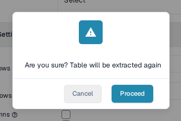<figcaption>
Ticking Split text opens this confirmation; only Proceed applies the split.
</figcaption></figure>

### Summary

Use the _Advanced Settings_ to teach DocBits how to accurately handle more complex or inconsistent table structures. These settings improve extraction precision by accounting for:

* Multi-line headers
* Multi-row descriptions
* Grouped line items
* Reverse order of grouped data
* Text that needs to be split at a column separator

Enabling these options during training ensures DocBits remembers the correct layout for future documents from the same supplier. Once the extraction looks right, store the configuration with the **Save Rules** action described in [Save and Delete Rules](save-and-delete-rules.md).
