# Defining Tables and Columns

Use this guide to manually define tables and columns for line-item extraction in DocBits. This is especially useful when automatic detection doesn't fully capture the table structure, or when you need to add custom fields.

### 1. Access the Table Extraction View

Open the document in the Field Validation view and click the table-extraction button in the footer on the right (its tooltip reads **“Go to table extraction view”**) to enter the table extraction view.

<figure>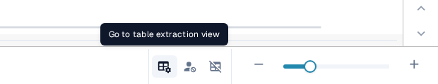<figcaption>
The table extraction button in the footer of the Field Validation view.
</figcaption></figure>

### 2. Activate Training Mode

To manually define or modify tables and columns, switch on the **“Training Mode”** toggle in the header on the right.

<figure>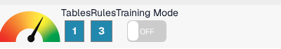<figcaption>
The Training Mode toggle in the table extraction header.
</figcaption></figure>

### 3. Define the Table Area

After entering Training Mode, you can define where the table is on the document. You have two options:

#### Option 1: Use Auto-Detect

Click the **“Autodetect tables”** button to let DocBits try to identify the table area on its own.

<figure>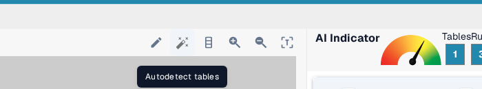<figcaption>
The Autodetect tables button in the image panel toolbar.
</figcaption></figure>

If detection is successful, the table outline will be displayed automatically. You can then proceed to define the columns.

#### Option 2: Define Table Manually

If auto-detection fails or is inaccurate, you can manually define the table:

1. Click the **“Edit”** button to activate table selection mode.
2. Draw a rectangle around the table area on the left-hand document view.

<figure>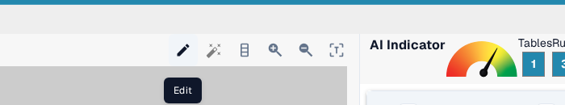<figcaption>
The Edit button switches the image panel into table selection mode.
</figcaption></figure>

While table selection mode is active, the header shows the banner **“Table selection mode: On”**. Click **“Save”** when the rectangle covers the whole table.

### 4. Add and Define Columns

Once the tables are defined you can manually define the columns with the **“Add Column”** button in the image panel toolbar. The header then shows the banner **“Column add mode: On”**.

<figure>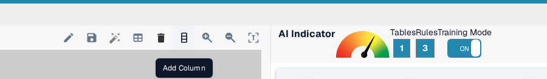<figcaption>
The Add Column button starts column add mode.
</figcaption></figure>

Define and sort the columns via drag and drop on the document. Repeat this for the tables on the other pages as well. As an alternative, if the tables are equal on each page, you can use the **“Use same columnn for all”** button to use the same columns for all tables defined in the document. This functionality copies the columns that you have defined to all other pages as well:

<figure>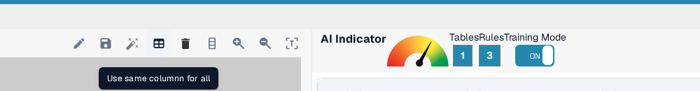<figcaption>
The button that copies the defined columns to every page of the document.
</figcaption></figure>

Use the **zoom** feature (**“Zoom in”** and **“Zoom out”**) to better define columns on cluttered or complex documents, for example, when a lot of information is close together and this makes it difficult to define the columns:

<figure>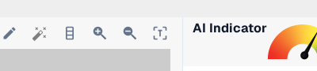<figcaption>
The Zoom in and Zoom out buttons in the image panel toolbar.
</figcaption></figure>

If you defined a column by mistake, it can be selected by clicking it and deleted with the **“Delete selected column”** button:

<figure>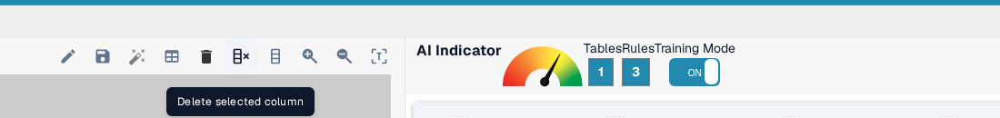<figcaption>
The Delete selected column button in the image panel toolbar.
</figcaption></figure>

<mark style="color:red;">**Note**</mark>: The button is only visible if the column is selected.

If you are done defining all tables and all columns on your document, use the **“Save”** button to activate your changes and to extract the data from the document:

<figure>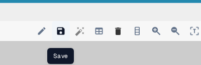<figcaption>
The Save button applies the defined tables and columns.
</figcaption></figure>

The data of all defined areas will be extracted and shown on the right side:

<figure>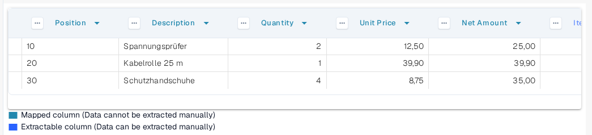<figcaption>
The extracted column data shown in the right-hand panel.
</figcaption></figure>

### 5. Review the Extracted Columns

The right-hand panel lists every column that was extracted from the trained table. Check that all columns you defined appear there before you continue; a missing column means the table rectangle or the column boundaries have to be corrected on the document. The available tuning options are described in [Advanced Settings](advanced-settings.md), and irregular layouts are covered in [Structuring and Improving Table Extraction in DocBits](improving-table-extraction-with-regex.md).

### 6. Save and Extract

Click **“Save Rules”** once all tables and columns have been defined.

<figure>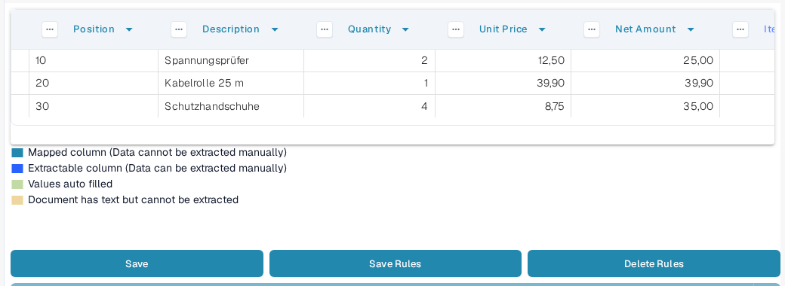<figcaption>
The Save Rules and Delete Rules buttons below the extracted columns.
</figcaption></figure>

* This tells DocBits where to find table data for this specific supplier.
* The next time a document from the same supplier is uploaded, DocBits will automatically extract the table using the saved rules.

<mark style="color:red;">**Note**</mark>: This training is supplier-specific. It will not apply to documents from other suppliers.

To remove the trained rules again, use the **“Delete Rules”** button next to **“Save Rules”**; see [Save and Delete Rules](save-and-delete-rules.md) for details.
