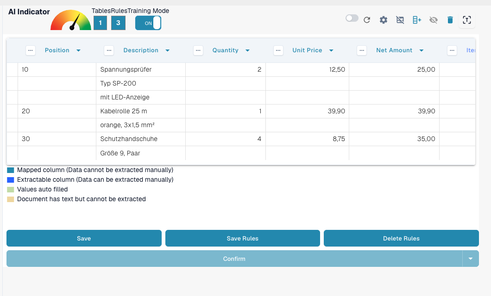
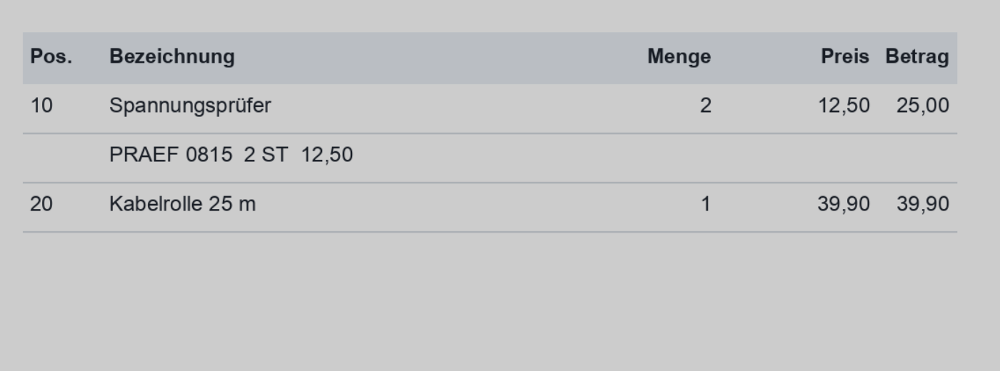
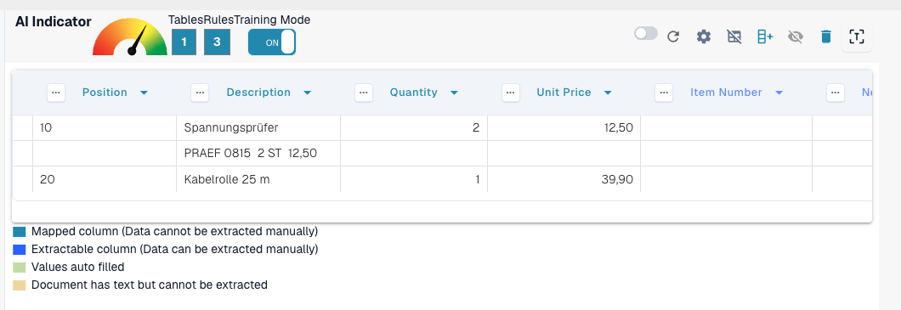
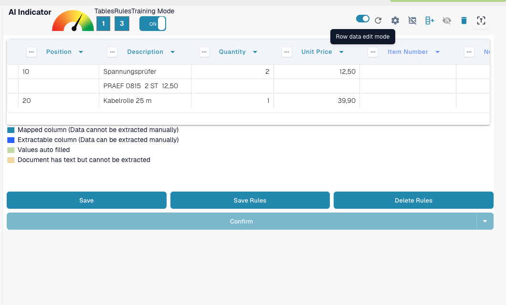
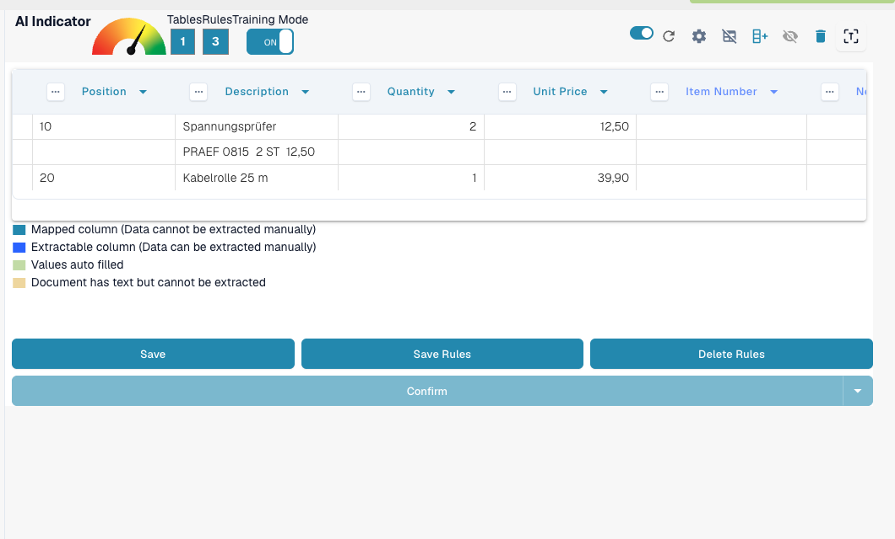
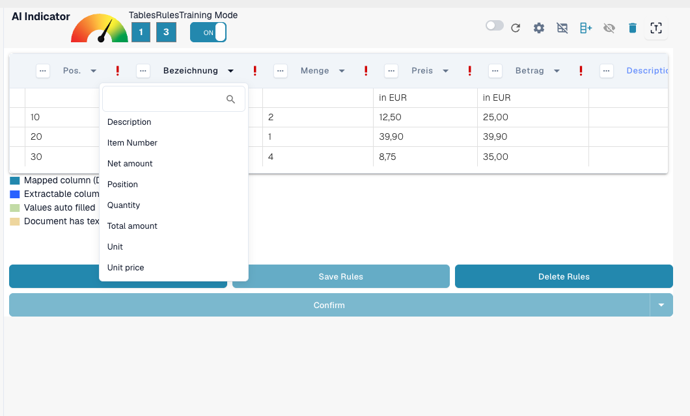

# 在 DocBits 中组织和改进表格提取

完成表格提取和初始列映射后，您可以使用多种内置工具提升数据的质量和结构。本指南将介绍：

* 对行进行分组
* 手动选择行
* 列映射
* 使用正则表达式优化表头

处理复杂或不一致的文档版式时，这些工具尤其有用。

### 1. 对行进行分组

发票或订单确认书等文档中的表格条目通常会出现这种情况：一列（例如描述）跨多行，而其他列（例如数量或价格）只占一行。

以下是一个德国发票示例，其中“Bezeichnung”（描述）列跨越多行：

<figure><figcaption>
描述列跨越多行。
</figcaption></figure>

最初，DocBits 会将每一行分别提取：

<figure><figcaption>
DocBits 首先分别提取每一行。
</figcaption></figure>

然后，您可以**根据某一列对行进行分组**，例如“Position”。这样会将相关行合并为一个结构化条目：

<figure><figcaption>
按 Position 分组后，相关行会组成一个条目。
</figcaption></figure>

### 2. 手动选择行

有时，文档中的文本会分散在同一行的多个列中，因此难以自动分配。

以下示例中，“PRAEF”行与**Bezeichnung**、**Menge**、**ME**和**Preis in EUR**列重叠：

<figure><figcaption>
PRAEF 行与列结构不对齐。
</figcaption></figure>

#### 🔧 如何手动分配值：

1.  **启用 Training Mode**

    <figure><figcaption>
Training Mode 已启用。
</figcaption></figure>
2.  **启用行编辑模式**

    <figure><figcaption>
行编辑模式已启用。
</figcaption></figure>
3.  **选择并映射文本**\
    点击正确的文本片段，并将其分配给**蓝色**列标题。

    <figure><figcaption>
可以手动填写蓝色列标题。
</figcaption></figure>

> 注意：紫色列已由系统映射，无法手动编辑。

### 3. 映射列

列映射会将提取的数据关联到预期的列标题，以确保数据一致并可供导出。

要映射或重新映射列：

1. 在提取视图中点击列标题。
2. 从下拉菜单中选择正确的目标列。

<figure><figcaption>
在表头下拉菜单中选择目标列。
</figcaption></figure>

您可以根据需要随时调整映射。

### 4. 从上方/下方提取

有些文档的结构会导致相关表格值与其他数据不在同一行。在这种情况下，DocBits 允许您控制**从何处提取数据**：

* **Extract from Above**：当当前行的值出现在**上一行**时使用此选项。
* **Extract from Below**：当当前行的值出现在**下一行**时使用此选项。

**在哪里可以找到此选项**

1. 进入**Training Mode**。
2. 点击列标题上的三点图标（⋯）。
3. 在**“Extract From”**选项下，根据文档版式选择 `Above` 或 `Below`。

### 5. 金额格式

某些列（例如**Quantity**或**Unit Price**）包含数字或日期值，其格式可能因文档来源或区域设置而异。DocBits 允许您指定这些值应采用的格式，以确保准确提取和解读。

**金额格式选项：**

* 为列指定预期的数字或日期格式，例如美国格式（MM/DD/YYYY，使用点号作为小数分隔符）、波兰格式（DD.MM.YYYY，使用逗号作为小数分隔符）、德国格式等。
* 即使文档使用不同的区域格式，这也有助于 DocBits 正确解析并标准化值。

**在哪里可以找到此选项**

1. 进入**Training Mode**。
2. 点击受支持列（例如 Quantity、Unit Price）表头上的三点图标（⋯）。
3. 在**Amount Format**选项下，选择与文档区域设置相符的所需格式。

### 6. 使用正则表达式改进表格提取

### **功能说明**

此功能允许您为每个表头定义正则表达式，从而提高提取准确性并确保结果正确。

### **使用方法**

1. 打开一份来自您要为其定义正则表达式的供应商的文档。
2.  转到**Table Extraction**视图。\\

    <figure><figcaption></figcaption></figure>
3. 启用**Training Mode**。
4.  选择要优化的表头，然后选择**Regex**。\\

    <figure><figcaption></figcaption></figure>
5.  此时会弹出窗口，您可以在其中输入并定义正则表达式。\\

    <figure><figcaption></figcaption></figure>
6.  点击**Validate**检查正则表达式，然后点击**Save Changes**应用它。\\

    <figure><figcaption></figcaption></figure>
7. **保存规则并确认**以应用更改。

### 何时使用各项功能

使用这些工具可以提高提取准确性并减少手动工作：

* **分组**：当描述或其他列跨越多行，需要合并以便清晰呈现时使用。
* **手动选择行**：当行结构不规整，且部分内容落入错误列时使用。
* **列映射**：当自动检测的列名与您的结构不匹配，或需要优化时使用。
* **正则表达式规则**：当同一供应商的不同文档中的表头略有差异，或 OCR 识别导致不一致时使用。
