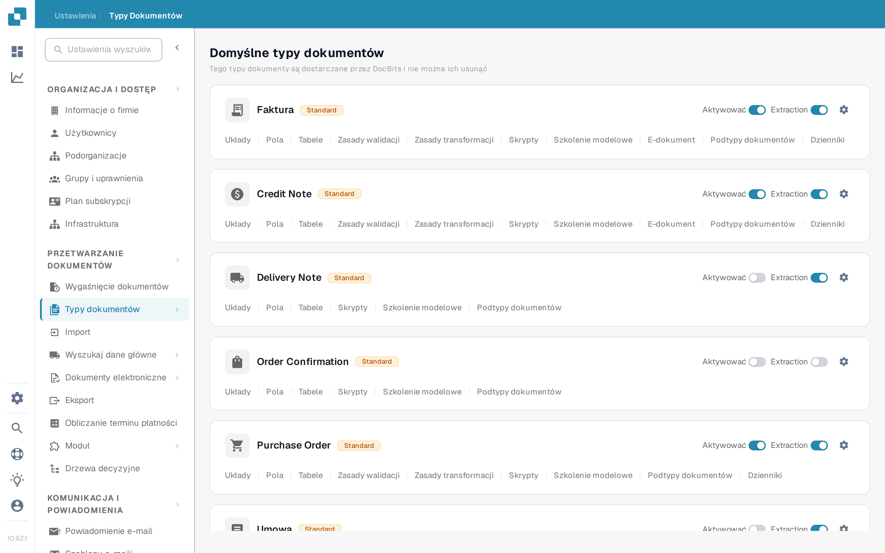
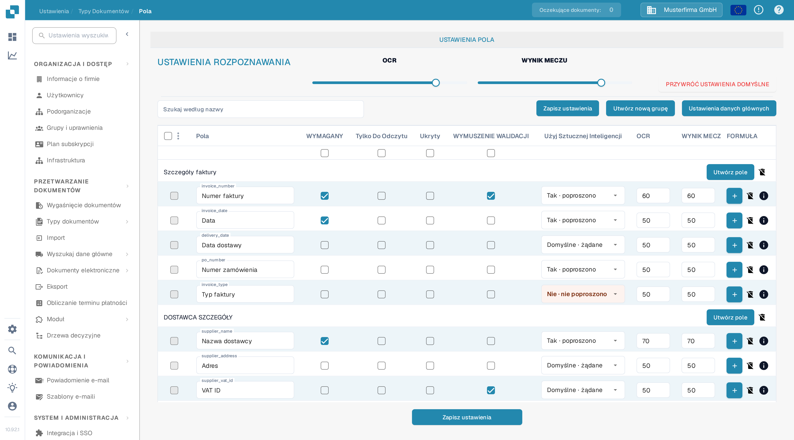
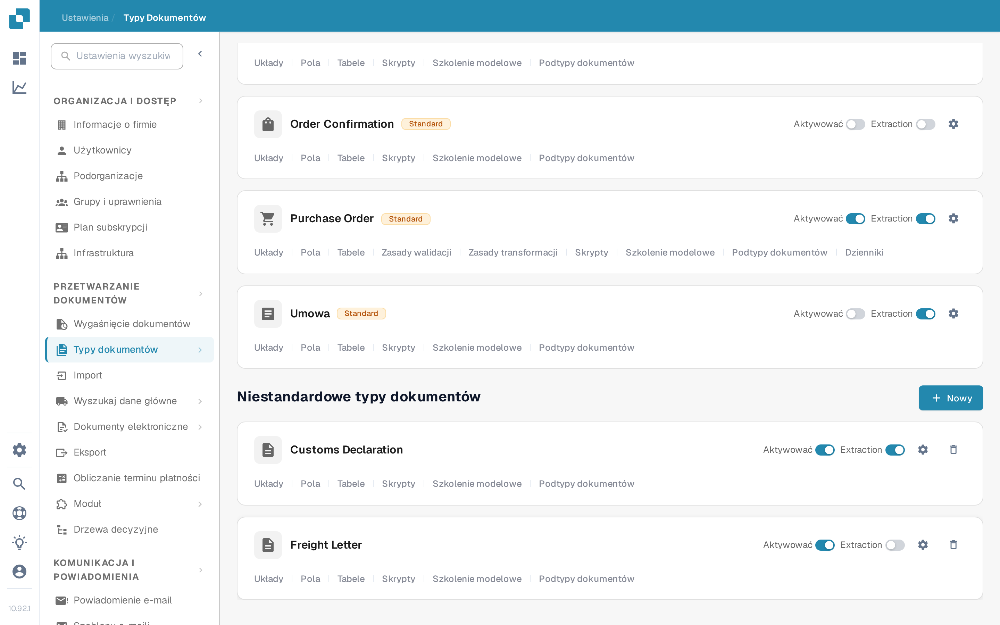

# Typy Dokumentów

Typy dokumentów informują DocBits, z jakimi rodzajami dokumentów pracuje Twoja organizacja. Administrator znajdzie je w sekcji **Ustawienia → Typy Dokumentów**, w części **PRZETWARZANIE DOKUMENTÓW** menu ustawień.

Strona pokazuje najpierw **Domyślne typy dokumentów**, które udostępnia DocBits i których nie można usunąć, a następnie **Niestandardowe typy dokumentów** utworzone dla Twojej organizacji. Każdy typ ma własną kartę.

<figure><figcaption>
Wybierz kartę typu dokumentu, aby skonfigurować ten typ.
</figcaption></figure>

## Co można zrobić na karcie

| Element | Co robi |
| --- | --- |
| **Aktywować** | Udostępnia ten typ dokumentu w Twojej organizacji albo go ukrywa. Niebieski przełącznik oznacza włączony, szary — wyłączony. |
| **Extraction** | Wybiera tryb ekstrakcji: **Flex**, gdy przełącznik jest włączony, albo **Fix**, gdy jest wyłączony. Nie służy po prostu do włączania i wyłączania ekstrakcji. Najedź kursorem na przełącznik, aby zobaczyć bieżący tryb. |
| **Ustawienia** (ikona koła zębatego) | Otwiera dodatkowe ustawienia tego typu. Rozwiń tam kategorię, aby zobaczyć jej opcje. Kategorie zależą od typu dokumentu. |
| **Układy** | Otwiera konfigurację układów. Kolejne kroki opisuje [Konstruktor Układów](layout-builder.md). |
| **Pola** | Otwiera ustawienia pól i rozpoznawania dla tego typu. Sposób konfiguracji opisuje [Pola](../../settings/global-settings/document-types/fields/README.md). |
| **Tabele** | Otwiera konfigurację kolumn tabeli dla tego typu. |
| **Skrypty** | Otwiera skrypty przetwarzania, jeśli ta funkcja jest dostępna. |
| **Szkolenie modelowe** | Otwiera szkolenie modelu dla tego typu. |
| **E-dokument** | Otwiera ustawienia dokumentów elektronicznych, jeśli ten typ je obsługuje. |
| **Podtypy dokumentów** | Otwiera podtypy tego typu dokumentu. |

W zależności od funkcji dostępnych w Twojej organizacji możesz zobaczyć więcej linków, na przykład do zasad walidacji albo zasad transformacji. Wybierz link na karcie typu, który chcesz zmienić.

## Edycja pól i ustawień rozpoznawania

Kliknij **Pola** na karcie, aby zobaczyć grupy pól tego typu. W górnej części tej strony **OCR** i **WYNIK MECZU** ustawiają progi rozpoznawania, **PRZYWRÓĆ USTAWIENIA DOMYŚLNE** przywraca te progi do wartości domyślnych, a **Szukaj według nazwy** znajduje pole. Użyj **Utwórz nową grupę**, aby uporządkować pola, oraz **Utwórz pole** w grupie, aby dodać nowe pole. **Ustawienia danych głównych** otwiera powiązaną konfigurację danych podstawowych.

Każdy wiersz pola ma elementy sterujące, takie jak **WYMAGANY**, **Tylko Do Odczytu**, **Ukryty**, **WYMUSZENIE WALIDACJI**, **Użyj Sztucznej Inteligencji**, OCR, WYNIK MECZU i FORMUŁA. Przed zmianą poszczególnych wartości zapoznaj się z [przewodnikiem po polach](../../settings/global-settings/document-types/fields/README.md). Kliknij **Zapisz ustawienia** na stronie Pola, aby zachować zmiany.

<figure><figcaption>
Strona Pola ma własny przycisk Zapisz ustawienia.
</figcaption></figure>

## Tworzenie niestandardowego typu dokumentu

Przewiń do sekcji **Niestandardowe typy dokumentów** i kliknij **Nowy**. Aby skonfigurować nowy typ, postępuj zgodnie z [Dodawanie/Edycja Typów Dokumentów](../../settings/global-settings/document-types/adding-editing-document-types.md).

<figure><figcaption>
Użyj przycisku Nowy w sekcji Niestandardowe typy dokumentów, aby rozpocząć tworzenie typu.
</figcaption></figure>
