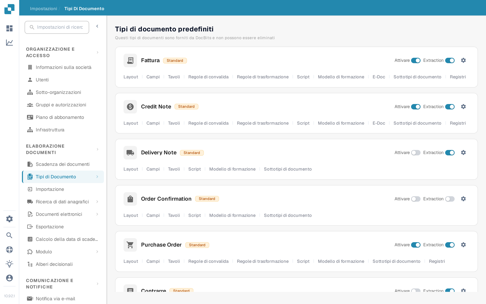
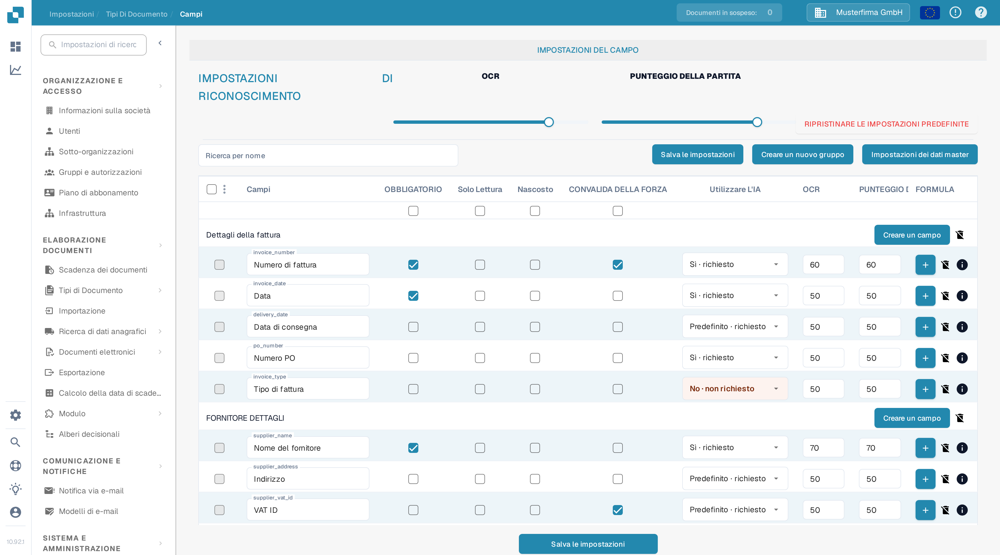
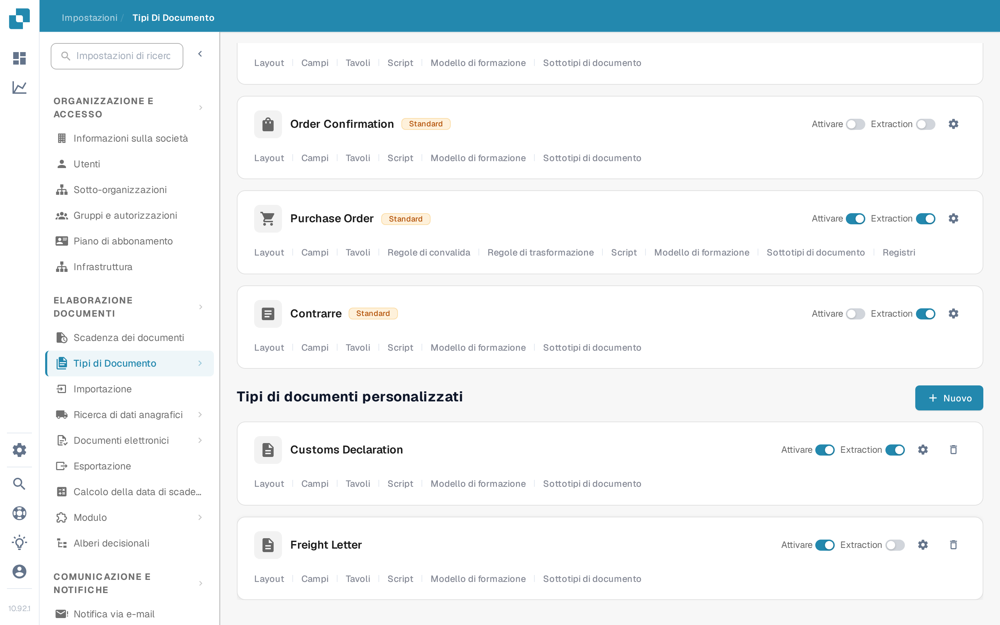

# Tipi di Documento

I tipi di documento indicano a DocBits con quali tipi di documenti lavora la tua organizzazione. Un amministratore li trova in **Impostazioni → Tipi di Documento** nella sezione **Elaborazione Documenti** del menu delle impostazioni.

La pagina mostra i **Tipi di documento predefiniti**, che DocBits mette a disposizione e che non puoi eliminare, seguiti dai **Tipi di documenti personalizzati** creati per la tua organizzazione. Ogni tipo ha una propria scheda.

<figure><figcaption>
Scegli la scheda di un tipo di documento per configurare quel tipo.
</figcaption></figure>

## Cosa puoi fare su una scheda

| Controllo | Cosa fa |
| --- | --- |
| **Attivare** | Rende questo tipo di documento disponibile o non disponibile nella tua organizzazione. Un interruttore blu è attivo; un interruttore grigio è disattivato. |
| **Extraction** | Sceglie la modalità di estrazione: **Flex** se attivo o **Fix** se disattivo. Non attiva né disattiva semplicemente l'estrazione. Passa il mouse sull'interruttore per vedere la modalità corrente. |
| **Impostazioni** (ingranaggio) | Apre le impostazioni aggiuntive per questo tipo. Espandi una categoria per visualizzarne le opzioni. Le categorie dipendono dal tipo di documento. |
| **Layout** | Apre la configurazione dei layout. Consulta [Costruttore di Layout](layout-builder.md) per i passaggi successivi. |
| **Campi** | Apre i campi e le impostazioni di riconoscimento per questo tipo. Consulta [Fields](../../settings/global-settings/document-types/fields/README.md) per sapere come configurarli. |
| **Tavoli** | Apre la configurazione delle colonne della tabella per questo tipo. |
| **Script** | Apre gli script di elaborazione quando questa funzione è disponibile. |
| **Modello di formazione** | Apre l'allenamento del modello per questo tipo. |
| **E-Doc** | Apre le impostazioni dei documenti elettronici quando il tipo le supporta. |
| **Sottotipi di documento** | Apre i sottotipi di questo tipo di documento. |

A seconda delle funzionalità della tua organizzazione, potresti vedere altri link sulla scheda, ad esempio **Regole di convalida** o **Regole di trasformazione**. Scegli il link sulla scheda del tipo che vuoi modificare.

## Modificare campi e impostazioni di riconoscimento

Clicca su **Campi** su una scheda per visualizzarne i gruppi di campi. In alto nella pagina, **OCR** e **Punteggio della partita** impostano le soglie di riconoscimento, **Ripristinare le impostazioni predefinite** ripristina tali soglie e **Ricerca per nome** trova un campo. Usa **Creare un nuovo gruppo** per organizzare i campi e **Creare un campo** all'interno di un gruppo per aggiungerne uno. **Impostazioni dei dati master** apre la relativa configurazione dei dati anagrafici.

Ogni riga di campo ha controlli come **OBBLIGATORIO**, **Solo Lettura**, **Nascosto**, **CONVALIDA DELLA FORZA**, **Utilizzare L'IA**, OCR, **PUNTEGGIO DELLA PARTITA** e **FORMULA**. Consulta la [guida ai Campi](../../settings/global-settings/document-types/fields/README.md) prima di modificare i singoli valori. Clicca su **Salva le impostazioni** nella pagina Campi per conservare le modifiche.

<figure><figcaption>
La pagina Campi ha un proprio pulsante Salva le impostazioni.
</figcaption></figure>

## Creare un tipo di documento personalizzato

Scorri fino a **Tipi di documenti personalizzati** e clicca su **Nuovo**. Segui [Aggiungere/Modificare Tipi di Documenti](../../settings/global-settings/document-types/adding-editing-document-types.md) per configurare il nuovo tipo.

<figure><figcaption>
Usa Nuovo sotto Tipi di documenti personalizzati per iniziare a creare un tipo.
</figcaption></figure>
