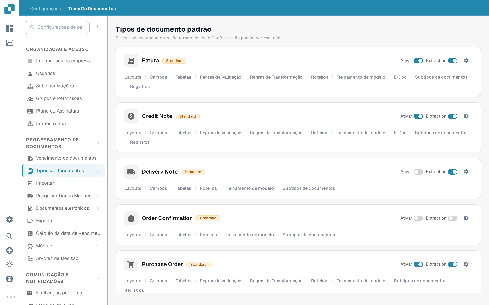
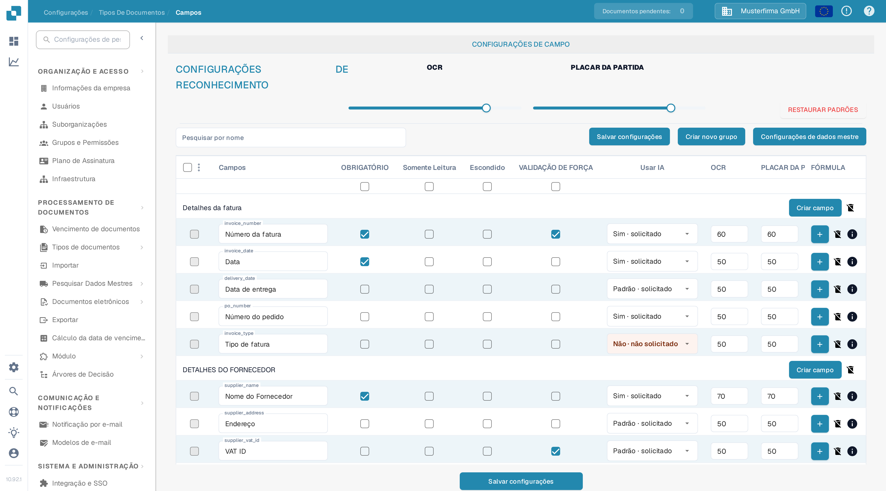
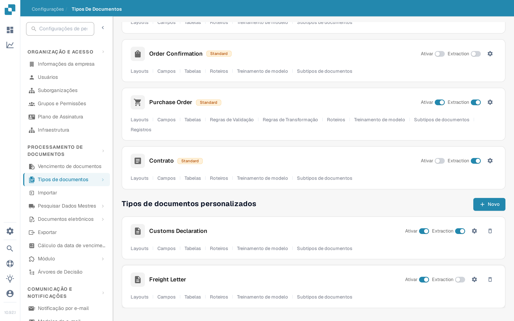

# Tipos de Documento

Os tipos de documento informam ao DocBits com quais tipos de documentos a sua organização trabalha. Um administrador os encontra em **Configurações → Tipos de documentos**, na seção **Processamento de documentos** do menu de configurações.

A página mostra os **Tipos de documento padrão**, que o DocBits fornece e que você não pode excluir, seguidos dos **Tipos de documentos personalizados** criados para a sua organização. Cada tipo tem o seu próprio cartão.

<figure><figcaption>
Escolha o cartão de um tipo de documento para configurar esse tipo.
</figcaption></figure>

## O que você pode fazer em um cartão

| Controle | O que faz |
| --- | --- |
| **Ativar** | Torna este tipo de documento disponível ou indisponível na sua organização. Um interruptor azul está ligado; um interruptor cinza está desligado. |
| **Extraction** | Escolhe o modo de extração: **Flex** quando ligado ou **Fix** quando desligado. Ele não simplesmente liga ou desliga a extração. Passe o mouse sobre o interruptor para ver o modo atual. |
| **Configurações** (engrenagem) | Abre **Mais Configurações** para este tipo. Expanda uma categoria ali para ver suas opções. As categorias dependem do tipo de documento. |
| **Layouts** | Abre a configuração de layouts. Consulte [Layout Builder](layout-builder.md) para os próximos passos. |
| **Campos** | Abre as configurações de campos e de reconhecimento deste tipo. Consulte [Campos](../../settings/global-settings/document-types/fields/README.md) para saber como configurá-los. |
| **Tabelas** | Abre a configuração das colunas de tabela deste tipo. |
| **Roteiros** | Abre os roteiros de processamento quando este recurso está disponível. |
| **Treinamento de modelo** | Abre o treinamento de modelo para este tipo. |
| **E-Doc** | Abre as configurações de documentos eletrônicos quando o tipo as suporta. |
| **Subtipos de documentos** | Abre os subtipos deste tipo de documento. |

Você pode ver mais links, como **Regras de Validação** ou **Regras de Transformação**, dependendo dos recursos da sua organização. Escolha o link no cartão do tipo que você deseja alterar.

## Edite os campos e as configurações de reconhecimento

Clique em **Campos** em um cartão para ver seus grupos de campos. Na parte superior dessa página, **OCR** e **PLACAR DA PARTIDA** definem os limites de reconhecimento, **RESTAURAR PADRÕES** redefine esses limites e **Pesquisar por nome** encontra um campo. Use **Criar novo grupo** para organizar os campos e **Criar campo** dentro de um grupo para adicionar um. **Configurações de dados mestre** abre a configuração de dados mestres relacionada.

Cada linha de campo tem controles como **OBRIGATÓRIO**, **Somente Leitura**, **Escondido**, **VALIDAÇÃO DE FORÇA**, **Usar IA**, OCR, **PLACAR DA PARTIDA** e **FÓRMULA**. Revise o [guia de Campos](../../settings/global-settings/document-types/fields/README.md) antes de alterar valores individuais. Clique em **Salvar configurações** na página de Campos para manter suas alterações.

<figure><figcaption>
A página de Campos tem o seu próprio botão Salvar configurações.
</figcaption></figure>

## Crie um tipo de documento personalizado

Role até **Tipos de documentos personalizados** e clique em **Novo**. Siga [Adicionando/Editando Tipos de Documentos](../../settings/global-settings/document-types/adding-editing-document-types.md) para configurar o novo tipo.

<figure><figcaption>
Use Novo em Tipos de documentos personalizados para começar a criar um tipo.
</figcaption></figure>
