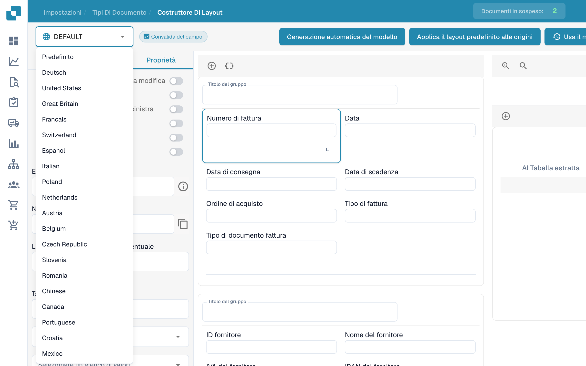
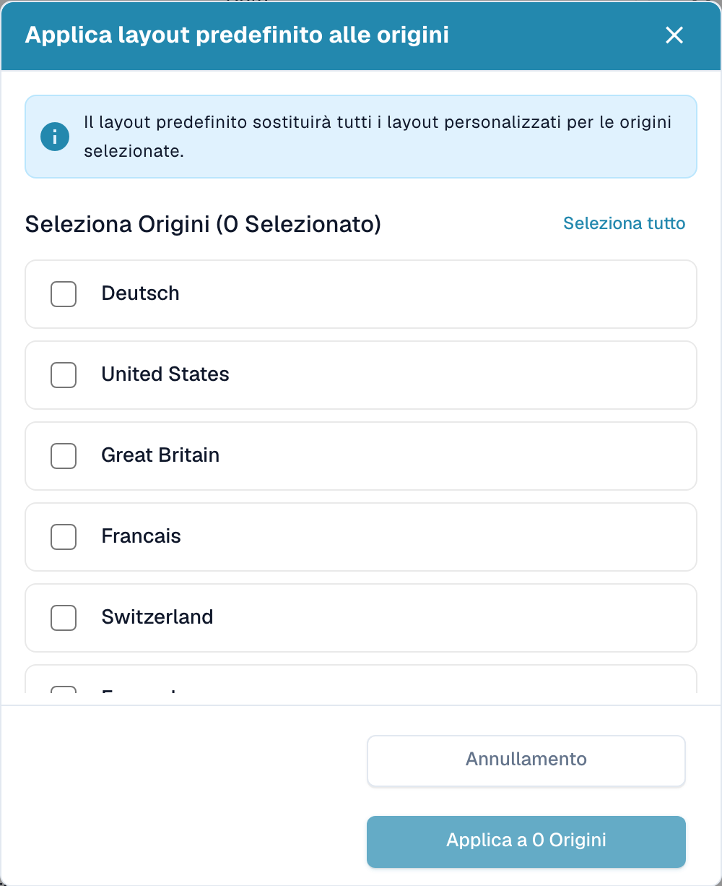

# Layout per origine


Impostazione Origin di DocBits spiegata: Standard nazionali per formati di data e numero


DocBits eccelle nell'adattare i layout dei documenti in base alle loro origini geografiche, standardizzando al contempo elementi come i formati di valuta in base alle impostazioni del browser dell'utente. Esploriamo come puoi sfruttare il Layout Builder per personalizzare i layout per diverse origini, come gli Stati Uniti e la Germania.

<figure><figcaption>
Generatore di layout con i comandi in italiano.
</figcaption></figure>

## **Comprendere la personalizzazione basata sull'origine**

* Standardizzazione di valuta e formato: Indipendentemente dalla valuta o dal formato del documento originale, DocBits converte questi elementi in un formato ISO standardizzato sul server, in linea con le impostazioni del browser dell'utente.
* Personalizzazione del layout geografico: Il sistema consente la personalizzazione dei layout dei documenti in base alla loro origine geografica. Ciò significa che puoi definire campi e formati specifici per documenti provenienti da diversi paesi.

## **Esempio: Layout USA vs Germania**

* Layout USA: Per una fattura statunitense, potresti includere campi per la tassa comunale (city tax), in linea con la struttura fiscale comune negli Stati Uniti.
* Layout Germania: Al contrario, un layout di fattura tedesca può omettere il campo della tassa comunale, poiché non è un addebito standard in Germania.

## **Utilizzo del Layout Builder**

* Selezionare l'Origin Layout: Nel Layout Builder, scegli il layout di base corrispondente all'origine del documento.
* Personalizzare i campi: Adatta il layout aggiungendo o rimuovendo campi. Ad esempio, includi 'City Tax' per un layout USA.
* Applicare e testare: Una volta personalizzato, applica il layout ai tuoi documenti e verifica per garantire l'accuratezza.

## **Suggerimenti per una personalizzazione efficace**

* Comprendere le differenze regionali: Familiarizza con le sfumature fiscali e di formato delle diverse regioni.
* Aggiornamenti coerenti: Aggiorna regolarmente i tuoi layout per riflettere eventuali cambiamenti nelle normative regionali.
* Feedback degli utenti: Utilizza il feedback degli utenti di diverse regioni per perfezionare ulteriormente i layout.

## Applicare il layout predefinito a più Origins

Quando desideri applicare il layout predefinito a più origini, premi **Applica il layout predefinito alle origini**.

<figure><figcaption>
Selezione dell’origine; i nomi delle origini configurate restano invariati.
</figcaption></figure>

Apparirà un popup dove puoi selezionare le origini a cui desideri applicare il layout predefinito. Puoi usare **Seleziona tutto** o **Deseleziona tutto** per gestire rapidamente la tua selezione. Il popup mostra il numero di origini attualmente selezionate.

<figure><figcaption>
Finestra per applicare il layout predefinito alle origini.
</figcaption></figure>

Dopo aver effettuato la selezione, fai clic su **Applica alle origini**. Un messaggio di successo confermerà che le origini sono state aggiornate.
