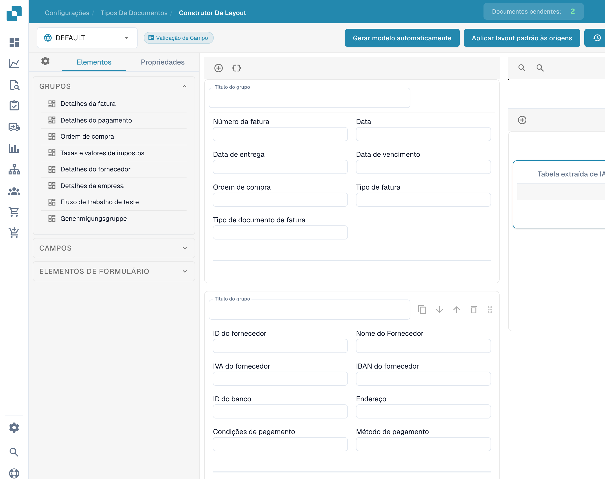
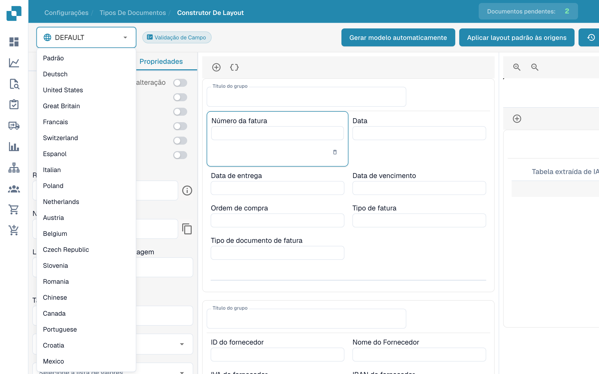
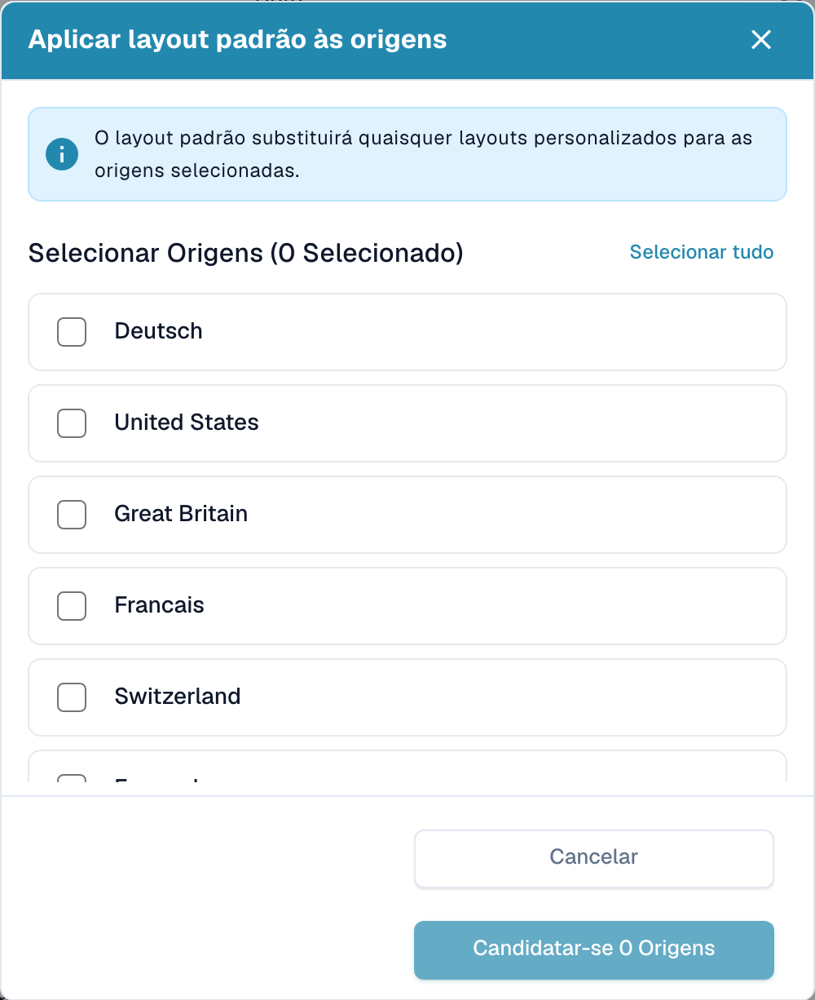

# Layouts por origem


Configuração de Origin do DocBits explicada: Padrões de país para formatos de data e número


O DocBits se destaca na adaptação de layouts de documentos de acordo com suas origens geográficas, enquanto padroniza elementos como formatos de moeda com base nas configurações do navegador do usuário. Vamos explorar como você pode aproveitar o Layout Builder para personalizar layouts para diferentes origens, como EUA e Alemanha.

<figure><figcaption>
Construtor de layouts com controlos em português.
</figcaption></figure>

## **Entendendo a personalização baseada em origem**

* Padronização de moeda e formato: Independentemente da moeda ou formato do documento original, o DocBits converte esses elementos em um formato ISO padronizado no servidor, de acordo com as configurações do navegador do usuário.
* Personalização de layout geográfico: O sistema permite a personalização de layouts de documentos com base em sua origem geográfica. Isso significa que você pode definir campos e formatos específicos para documentos de diferentes países.

## **Exemplo: Layouts EUA vs. Alemanha**

* Layout EUA: Para uma fatura americana, você pode incluir campos para imposto municipal (city tax), alinhando-se com a estrutura tributária comum nos EUA.
* Layout Alemanha: Em contraste, um layout de fatura alemã pode omitir o campo de imposto municipal, pois não é uma cobrança padrão na Alemanha.

## **Usando o Layout Builder**

* Selecionar Origin Layout: No Layout Builder, escolha o layout base correspondente à origem do documento.
* Personalizar campos: Adapte o layout adicionando ou removendo campos. Por exemplo, inclua 'City Tax' para um layout dos EUA.
* Aplicar e testar: Uma vez personalizado, aplique o layout aos seus documentos e teste para garantir a precisão.

## **Dicas para personalização eficaz**

* Entender as diferenças regionais: Familiarize-se com as nuances tributárias e de formato de diferentes regiões.
* Atualizações consistentes: Atualize regularmente seus layouts para refletir quaisquer mudanças nas regulamentações regionais.
* Feedback dos usuários: Utilize o feedback de usuários em diferentes regiões para refinar ainda mais os layouts.

## Aplicar layout padrão a múltiplas Origins

Quando você deseja aplicar o layout padrão a múltiplas origens, pressione **Aplicar layout padrão às origens**.

<figure><figcaption>
Seleção da origem; nomes configurados das origens permanecem inalterados.
</figcaption></figure>

Um popup aparecerá onde você pode selecionar as origens às quais deseja aplicar o layout padrão. Você pode usar **Selecionar tudo** ou **Desmarcar tudo** para gerenciar rapidamente sua seleção. O popup exibe o número de origens atualmente selecionadas.

<figure><figcaption>
Janela para aplicar o layout predefinido às origens. O botão Candidatar-se aplica o layout às origens; não é uma candidatura.
</figcaption></figure>

Após fazer sua seleção, clique em **Aplicar às origens**. Uma mensagem de sucesso confirmará que as origens foram atualizadas.
