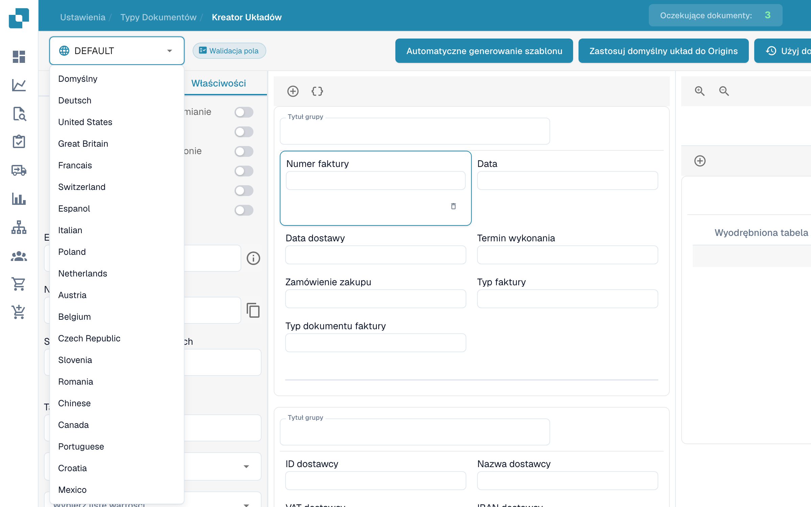
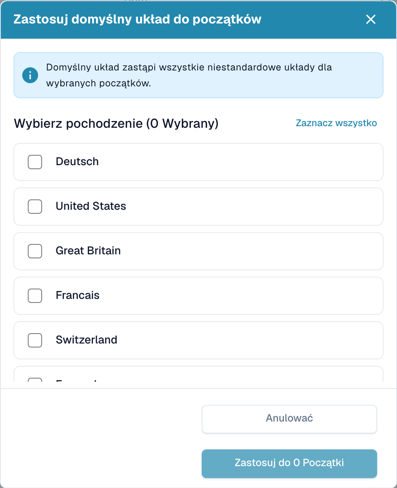

# Układy według źródła


Ustawienie Origin w DocBits wyjaśnione: Standardy krajowe dla formatów dat i liczb


DocBits doskonale radzi sobie z dostosowywaniem układów dokumentów zgodnie z ich pochodzeniem geograficznym, jednocześnie standaryzując elementy takie jak formaty walut na podstawie ustawień przeglądarki użytkownika. Przyjrzyjmy się, jak można wykorzystać Layout Builder do dostosowania układów dla różnych pochodzeń, takich jak USA i Niemcy.

<figure><figcaption>
Kreator układów z polskimi elementami sterowania.
</figcaption></figure>

## **Zrozumienie dostosowania opartego na pochodzeniu**

* Standaryzacja waluty i formatu: Niezależnie od waluty lub formatu oryginalnego dokumentu, DocBits konwertuje te elementy na standardowy format ISO na serwerze, zgodnie z ustawieniami przeglądarki użytkownika.
* Dostosowanie układu geograficznego: System umożliwia dostosowanie układów dokumentów na podstawie ich pochodzenia geograficznego. Oznacza to, że możesz definiować określone pola i formaty dla dokumentów z różnych krajów.

## **Przykład: Układy USA vs. Niemcy**

* Układ USA: Dla faktury amerykańskiej możesz uwzględnić pola dla podatku miejskiego (city tax), zgodnie z powszechną strukturą podatkową w USA.
* Układ Niemcy: W przeciwieństwie do tego, niemiecki układ faktury może pomijać pole podatku miejskiego, ponieważ nie jest to standardowa opłata w Niemczech.

## **Korzystanie z Layout Builder**

* Wybierz Origin Layout: W Layout Builder wybierz podstawowy układ odpowiadający pochodzeniu dokumentu.
* Dostosuj pola: Dostosuj układ, dodając lub usuwając pola. Na przykład dodaj 'City Tax' dla układu USA.
* Zastosuj i przetestuj: Po dostosowaniu zastosuj układ do swoich dokumentów i przetestuj, aby zapewnić dokładność.

## **Wskazówki dotyczące skutecznego dostosowania**

* Zrozum różnice regionalne: Zapoznaj się z niuansami podatkowymi i formatowymi różnych regionów.
* Konsekwentne aktualizacje: Regularnie aktualizuj swoje układy, aby odzwierciedlać wszelkie zmiany w przepisach regionalnych.
* Opinie użytkowników: Wykorzystuj opinie użytkowników z różnych regionów, aby dalej udoskonalać układy.

## Zastosuj domyślny układ do wielu Origins

Gdy chcesz zastosować domyślny układ do wielu pochodzeń, naciśnij **Zastosuj domyślny układ do Origins**.

<figure><figcaption>
Wybór pochodzenia; skonfigurowane nazwy pozostają bez zmian.
</figcaption></figure>

Pojawi się okno popup, w którym możesz wybrać pochodzenia, do których chcesz zastosować domyślny układ. Możesz użyć **Zaznacz wszystko** lub **Odznacz wszystko**, aby szybko zarządzać swoim wyborem. Okno popup wyświetla liczbę aktualnie wybranych pochodzeń.

<figure><figcaption>
Okno zastosowania układu domyślnego do pochodzeń. Etykieta początki oznacza tutaj pochodzenia dokumentów.
</figcaption></figure>

Po dokonaniu wyboru kliknij **Zastosuj do pochodzeń**. Komunikat o sukcesie potwierdzi, że pochodzenia zostały zaktualizowane.
