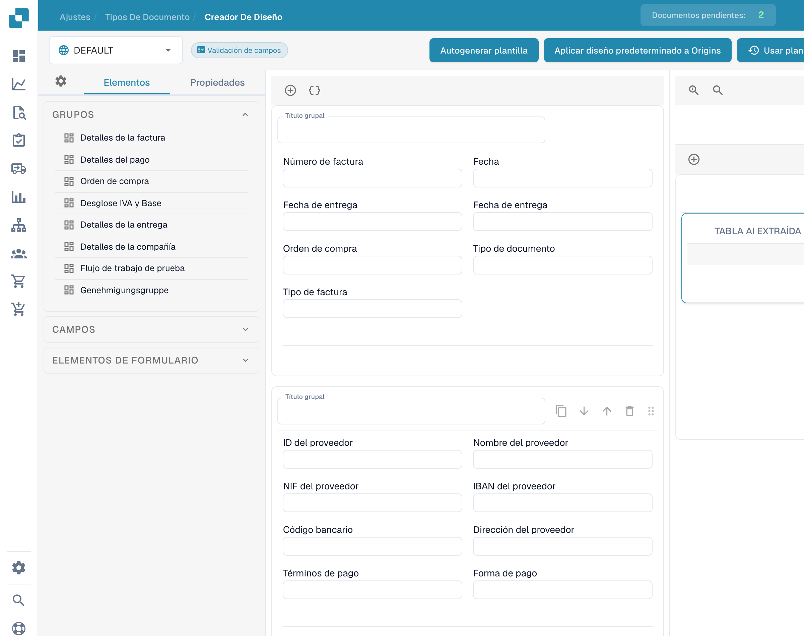
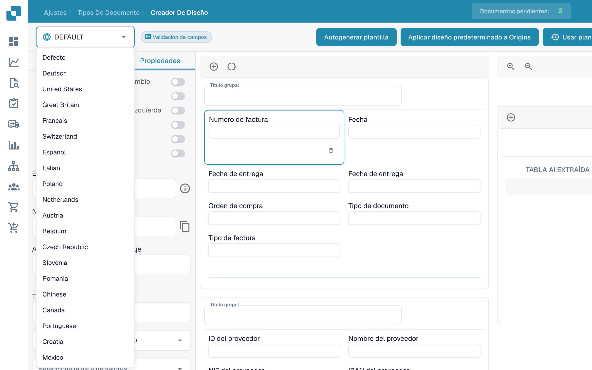
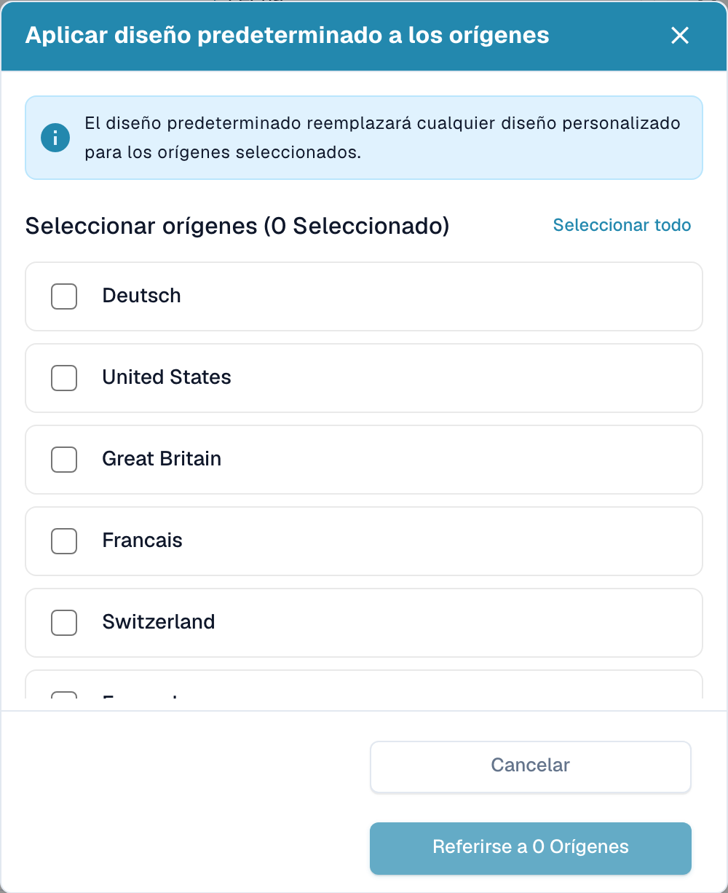

# Diseños por origen


Configuración de Origin en DocBits explicada: Estándares de país para formatos de fecha y número


DocBits se destaca en adaptar diseños de documentos según sus orígenes geográficos mientras estandariza elementos como formatos de moneda basándose en la configuración del navegador del usuario. Exploremos cómo puede aprovechar el Layout Builder para personalizar diseños para diferentes orígenes, como EE.UU. y Alemania.

<figure><figcaption>
Editor de diseños con controles en español.
</figcaption></figure>

## **Entendiendo la personalización basada en origen**

* Estandarización de moneda y formato: Independientemente de la moneda o formato original del documento, DocBits convierte estos elementos a un formato ISO estandarizado en el servidor, de acuerdo con la configuración del navegador del usuario.
* Personalización de diseño geográfico: El sistema permite la personalización de diseños de documentos basándose en su origen geográfico. Esto significa que puede definir campos y formatos específicos para documentos de diferentes países.

## **Ejemplo: Diseños de EE.UU. vs. Alemania**

* Diseño de EE.UU.: Para una factura estadounidense, podría incluir campos para el impuesto de ciudad (city tax), alineándose con la estructura fiscal común en EE.UU.
* Diseño de Alemania: En contraste, un diseño de factura alemana puede omitir el campo de impuesto de ciudad, ya que no es un cargo estándar en Alemania.

## **Usando el Layout Builder**

* Seleccionar Origin Layout: En el Layout Builder, elija el diseño base correspondiente al origen del documento.
* Personalizar campos: Adapte el diseño agregando o eliminando campos. Por ejemplo, incluya 'City Tax' para un diseño de EE.UU.
* Aplicar y probar: Una vez personalizado, aplique el diseño a sus documentos y pruebe para asegurar la precisión.

## **Consejos para una personalización efectiva**

* Entender las diferencias regionales: Familiarícese con los matices fiscales y de formato de diferentes regiones.
* Actualizaciones consistentes: Actualice regularmente sus diseños para reflejar cualquier cambio en las regulaciones regionales.
* Comentarios de usuarios: Utilice los comentarios de usuarios en diferentes regiones para refinar aún más los diseños.

## Aplicar diseño predeterminado a múltiples Origins

Cuando desee aplicar el diseño predeterminado a múltiples orígenes, presione **Aplicar diseño predeterminado a Origins**.

<figure><figcaption>
Selección de origen; los nombres configurados se mantienen.
</figcaption></figure>

Aparecerá un popup donde puede seleccionar los orígenes a los que desea aplicar el diseño predeterminado. Puede usar **Seleccionar todo** o **Deseleccionar todo** para gestionar rápidamente su selección. El popup muestra el número de orígenes actualmente seleccionados.

<figure><figcaption>
Diálogo para aplicar el diseño predeterminado a los orígenes seleccionados.
</figcaption></figure>

Después de hacer su selección, haga clic en **Aplicar a Origins**. Un mensaje de éxito confirmará que los orígenes fueron actualizados.
