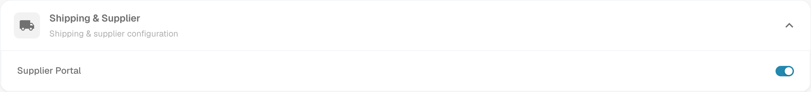

# Supplier portal: previous guide

This previous guide has been replaced by the current documentation. Use the new introduction for administrator setup and the separate registration guide for suppliers.

## Find the current setting

Open **Settings → Module → Document Integration**, then expand **Shipping & Supplier** to find **Supplier Portal**. Check with an administrator before changing the setting for your organization.

<figure><figcaption>
The Supplier Portal switch is in Shipping &amp; Supplier. This example shows it enabled; your organization's setting can differ.
</figcaption></figure>

## Continue with the current guides

- [Supplier Portal](supplier-portal/README.md)
- [Supplier registration guide](supplier-portal/supplier-registration.md)
