# Supplier Portal

The Supplier Portal lets invited suppliers use DocBits to follow their purchase orders and invoices. Administrators use the **Supplier Dashboard** to find suppliers, review registration status and send invitations.

## Find the portal setting

1. Open **Settings → Document Processing → Module → Document Integration**.
2. Expand **Shipping & Supplier** and find **Supplier Portal**. Turn it on if your organisation has access to the feature. Follow any subscription prompt shown by DocBits.

<figure>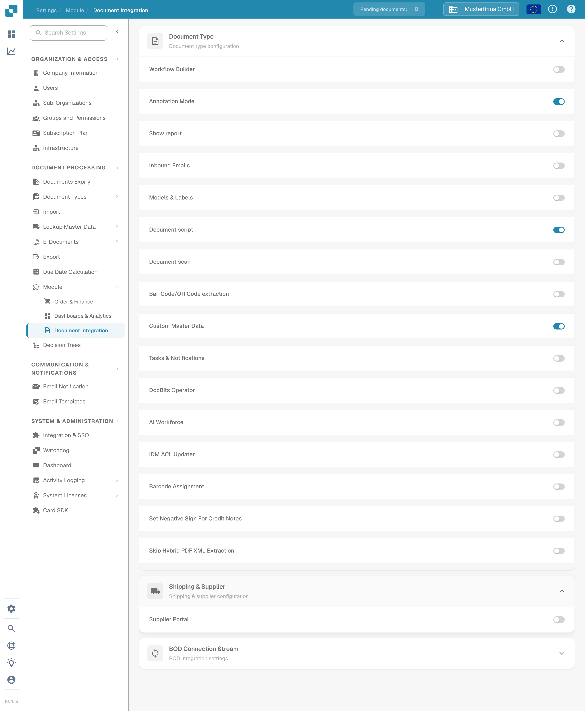<figcaption>The switch is off in this example organisation; the image shows where to find it.</figcaption></figure>

When the feature is enabled, **Supplier Settings** provide more configuration. Start with [Supplier General Settings](../../settings/supplier-setting/supplier-general-settings.md) for branding and legal documents, [Email Templates](../../settings/supplier-setting/editing-email-templates.md) for invitations, [Supplier Layout](../../settings/supplier-setting/supplier-layout.md) for registration fields, and [Supplier Permissions](../../settings/supplier-setting/supplier-permissions.md) for access. The [Supplier Settings overview](../../settings/supplier-setting/) links to the remaining options, including Infor M3 export configuration.

## Find suppliers

Open **Supplier Dashboard** from the left navigation. The top tabs show **All Supplier**, **Pending Approval** and **Pending Registration** with their current counts. The table shows each supplier's name, number, group, status and responder details. Select a supplier row to open its details; use the **Actions** menu for an invitation.

<figure>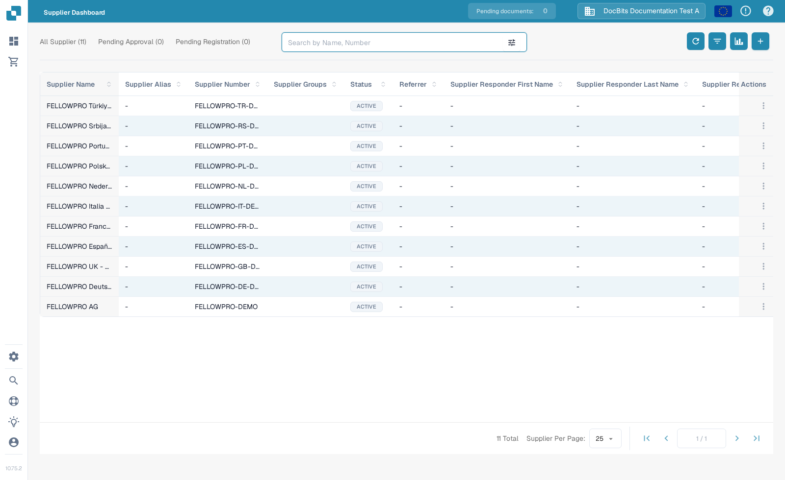<figcaption>The dashboard in the English Sandbox example.</figcaption></figure>

The status badge describes the supplier's current state. For example, the sample suppliers here show **ACTIVE**. The available states can depend on the registration and approval flow configured for your organisation; use the two pending tabs to focus on registrations or approvals that need attention.

### Search and filter

Type a supplier **name or number** in the search field. Select the filter icon inside the field to narrow the list by **Supplier Groups**, **Status** or **Created On**, or to change **Supplier Per Page**. Select **Clear filters** to start again. You can also sort by a table heading and use the pagination controls at the bottom.

<figure>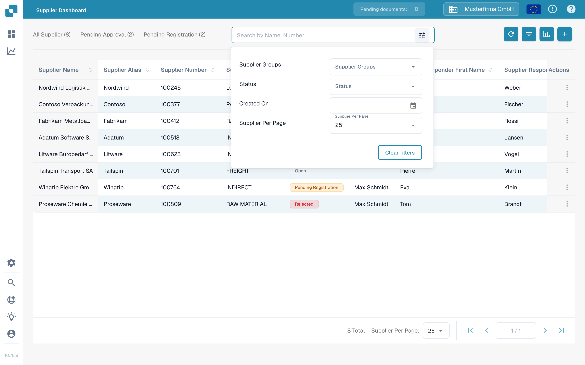<figcaption>The current supplier filters. They do not contain purchase-order amount or delivery-number filters.</figcaption></figure>

### Dashboard controls

The four buttons to the right of the search box are, from left to right:

* **Refresh** reloads the list and current status counts.
* **Columns settings** chooses the visible table columns. Move selected columns between the lists, drag visible columns into the order you want, then select **Done**.
* **Analytics** shows supplier expiry categories above the list; select a category to narrow the results.
* **Add Supplier** opens the invitation form.

<figure>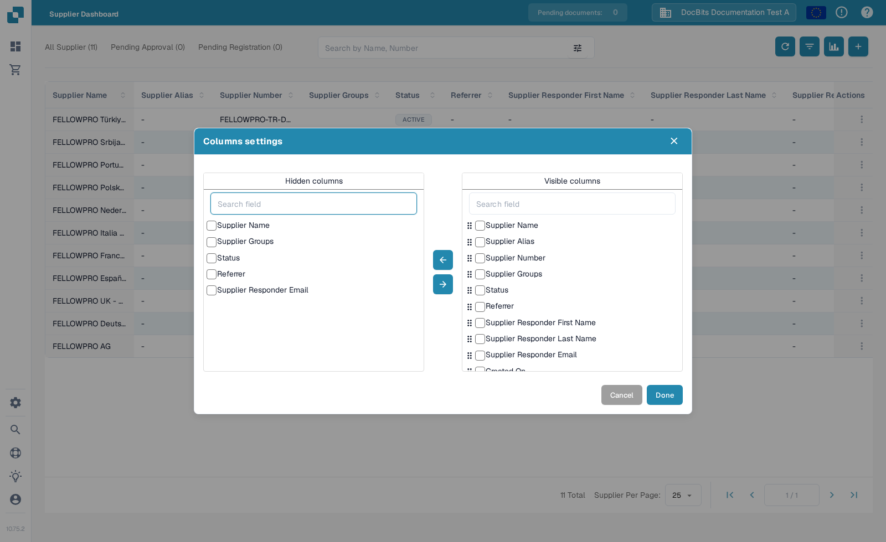<figcaption>Choose which supplier details appear in the dashboard.</figcaption></figure>

<figure>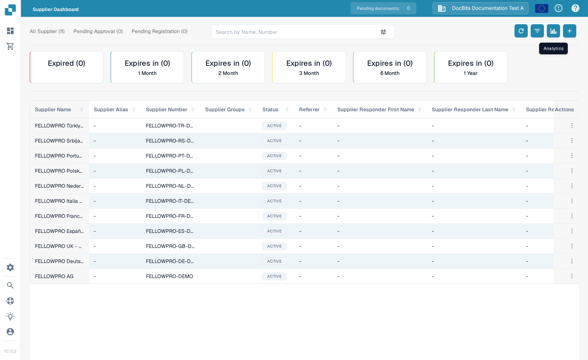<figcaption>Analytics adds expiry categories above the supplier list.</figcaption></figure>

## Invite a supplier

To add a new supplier, select **+** in the dashboard. In **Add Supplier**, choose a **Supplier Group** and enter the supplier name plus the responder's first name, last name and email address. Review the email address before selecting **Save**: saving sends the invitation through the portal. Your organisation may show additional fields in this form.

<figure>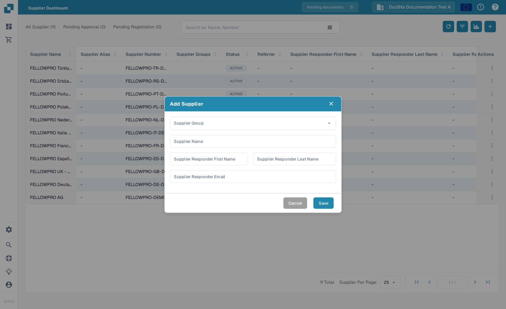<figcaption>The invitation form; this example was opened without saving or sending.</figcaption></figure>

To invite an existing supplier again, open the row's three-dot **Actions** menu and choose **Magic Link**. Check the supplier and responder details, then select **Send**. The supplier can follow the link to continue registration; see the [supplier registration guide](supplier-registration.md) for their steps.

* **Supplier Groups**
* **Status**
* **Created On**

You can also specify how many suppliers should be displayed per page.

<figure>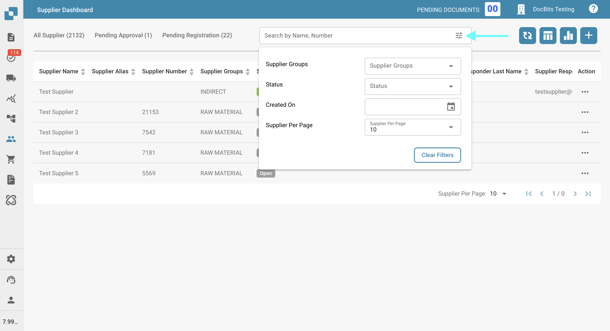<figcaption></figcaption></figure>

Additionally, you can quickly filter by the statuses **Pending Approval** or **Pending Registration** by clicking the corresponding category to the left of the filter ba&#x72;**.**

<figure>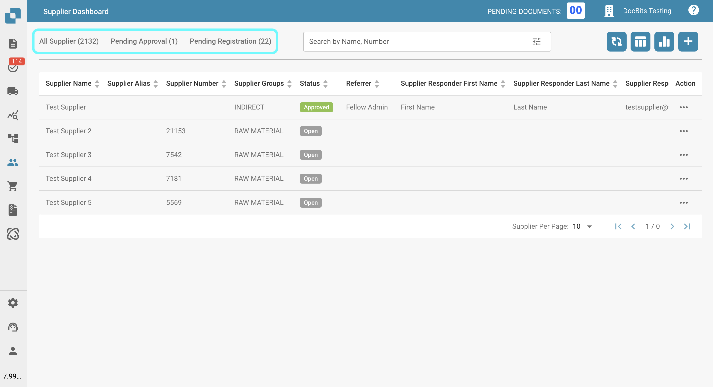<figcaption></figcaption></figure>

## Supplier Details (internal view)

Click a supplier's row in the **Supplier Dashboard** to open the **Supplier Details** view for that supplier. This internal view shows the same six sections that the supplier fills in during registration — **Supplier Details**, **Address Data**, **Supplier Contact**, **Supplier Financial**, **Supplier Purchase** and **Supplier Certificates** — together with the supplier's current **status** badge.

Use this view to review a supplier's profile, correct or complete missing data, and prepare the approval decision. For a description of each section, see [Supplier Registration](supplier-registration.md). The back button at the top of the view returns you to the **Supplier Dashboard**.

## Supplier Status

If you're using the **Supplier Portal**, it's important to understand the different statuses that suppliers can have. Below is a list of all possible supplier statuses and their meanings:

* **Open**: Existing supplier who has not yet been invited to the portal.
* **Pending Registration**: Supplier has been invited but has not yet completed the registration process.
* **Pending Supplier Input**: Registration is complete, but further input or changes are required from the supplier.
* **Pending Approval**: Supplier has completed registration and is awaiting the first approval.
* **Pending AP Approval**: Supplier has received the first approval and is awaiting a second (Accounts Payable) approval.
* **Approved**: Supplier has completed the process and has been fully approved.
* **Rejected**: The supplier’s registration or approval has been rejected.

## Tools in the Supplier Dashboard

To the right of the search bar, you'll find several tools that help you interact with and manage the dashboard more efficiently.

### Refresh table 

<figure><figcaption></figcaption></figure>

Click this button to refresh the dashboard and load the most up-to-date data and statuses.

### Set table columns for organization 

<figure>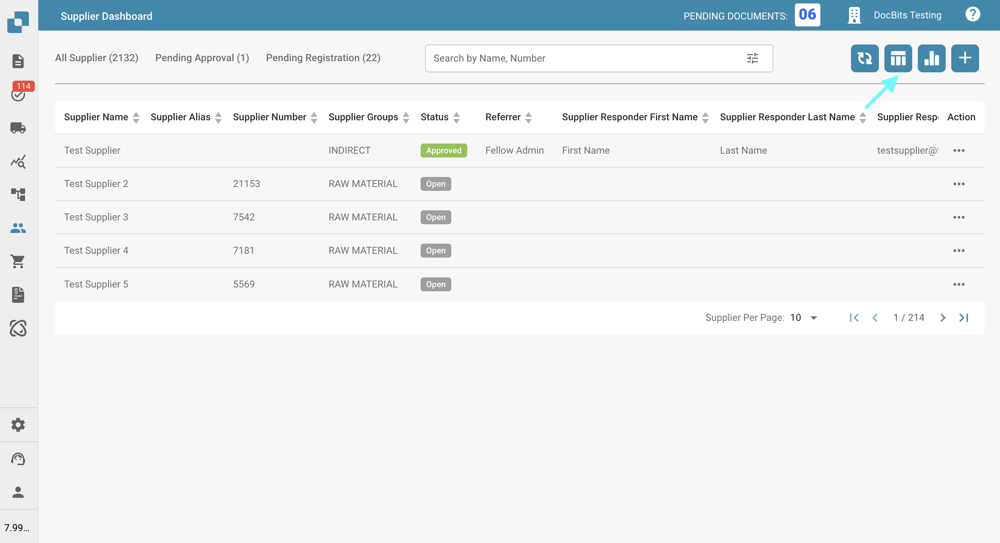<figcaption></figcaption></figure>

Click this button to open a menu where you can manage the visibility of columns in the purchase order table. Use the checkboxes and arrow buttons to move columns between the visible and hidden sections. You can also reorder columns by dragging and dropping the column names. Click **Done** to save your changes.

<figure>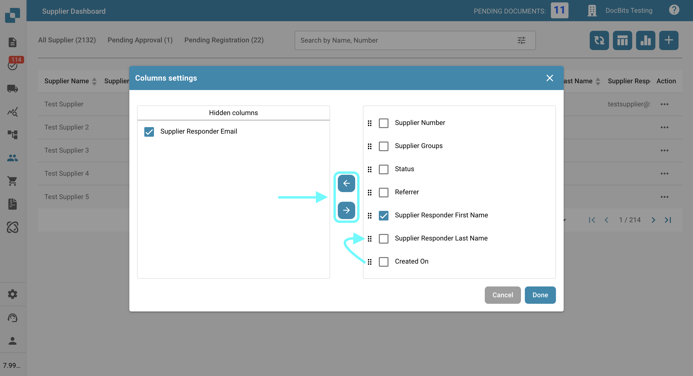<figcaption></figcaption></figure>

### Analytics 

<figure>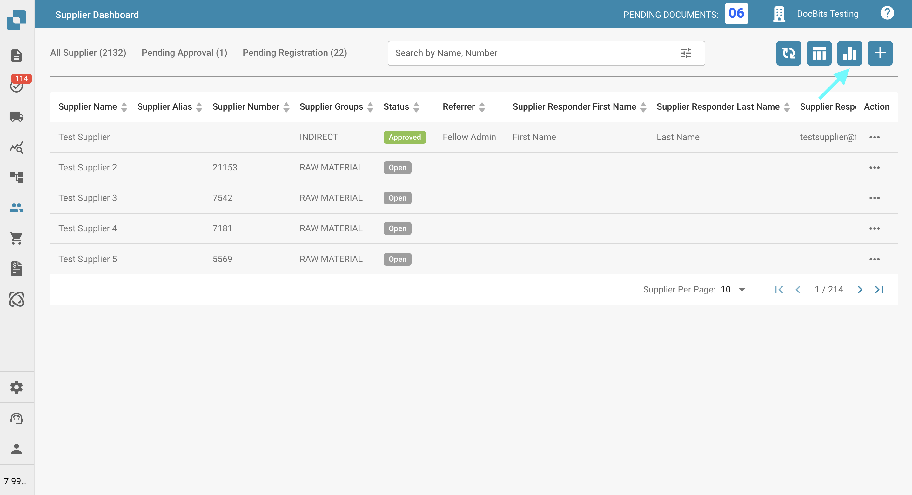<figcaption></figcaption></figure>

Clicking this button will open a new section showing how many suppliers are set to expire and when.\
Click on any category to apply a filter and view only those suppliers.

<figure>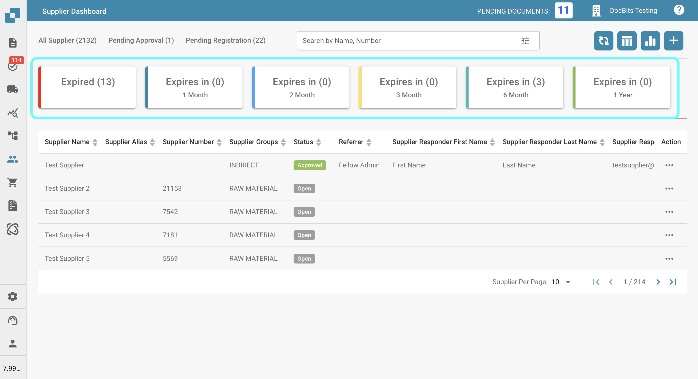<figcaption></figcaption></figure>

## Create Supplier and Send Registration Email

### **To create a new supplier:**

1.  Click the plus (+) icon in the top right corner.

    <figure><figcaption></figcaption></figure>
2.  Fill in the required fields, then click **Save**.

    <figure>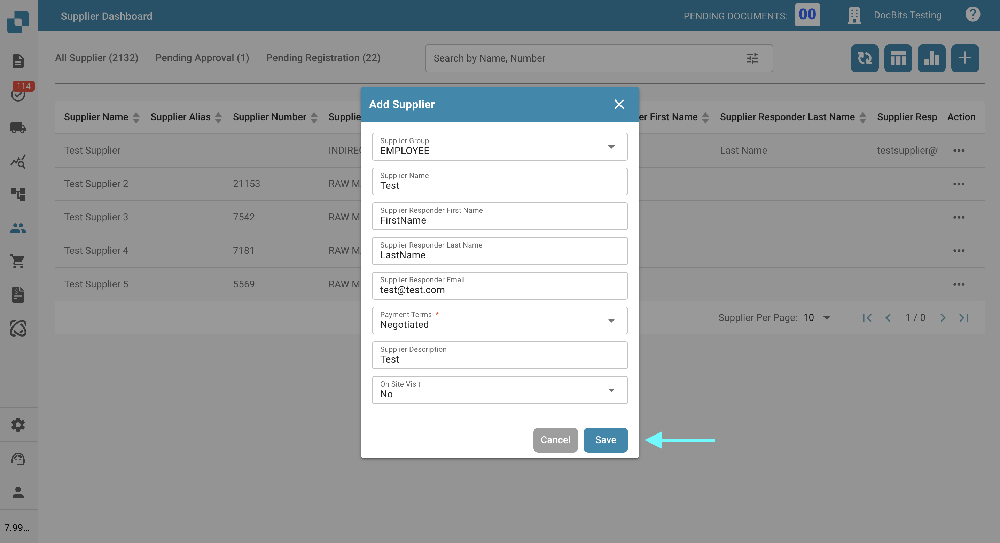<figcaption></figcaption></figure>
3. The supplier will automatically receive an email with a link to create their account.

### **To send a registration email to an existing supplier:**

1. Locate the supplier in the **Supplier Dashboard**.
2. Click the three-dot menu in the **Actions** column.
3.  Select **Magic Link**.

    <figure>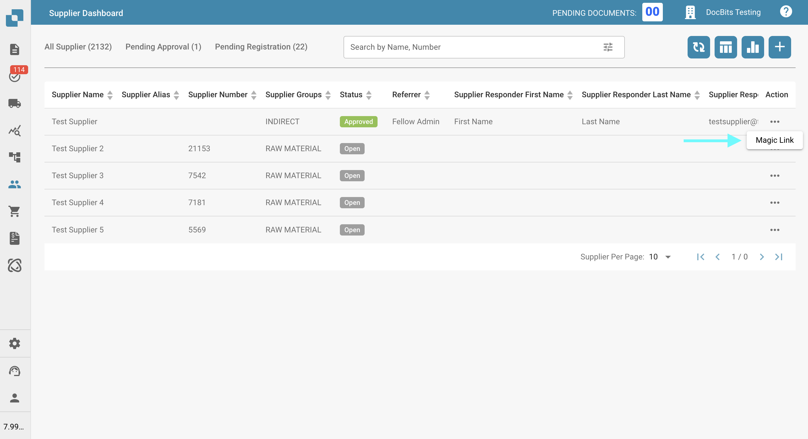<figcaption></figcaption></figure>
4. Verify the supplier’s details.
5.  Click **Send** to email the registration link.

    <figure>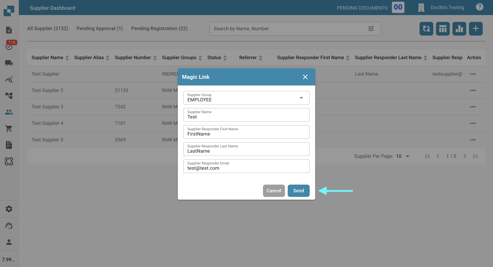<figcaption></figcaption></figure>

## How Does the Registration Process Work for the Supplier?

After an invitation email is sent, the supplier must complete the registration process to access the **Supplier Portal**.

A detailed step-by-step guide on the registration process can be found [here](supplier-registration.md).
