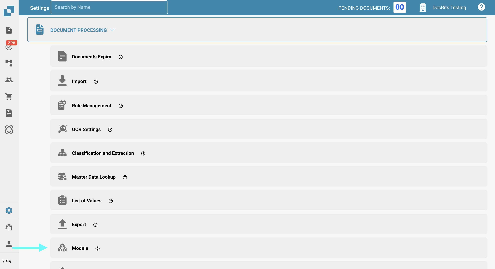
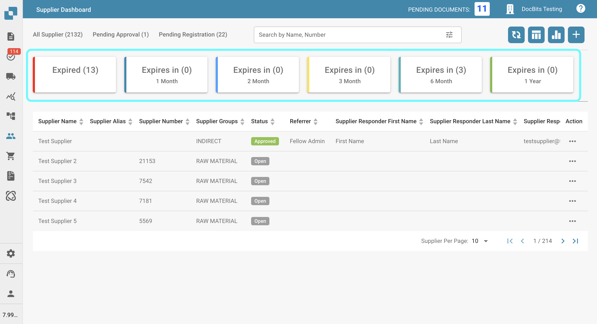
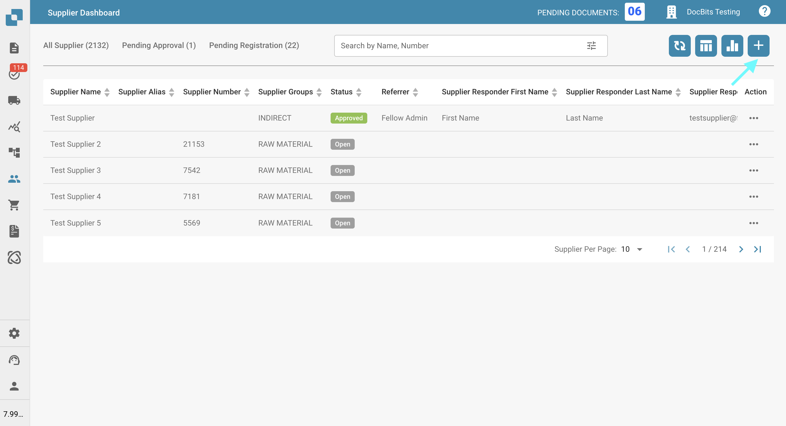
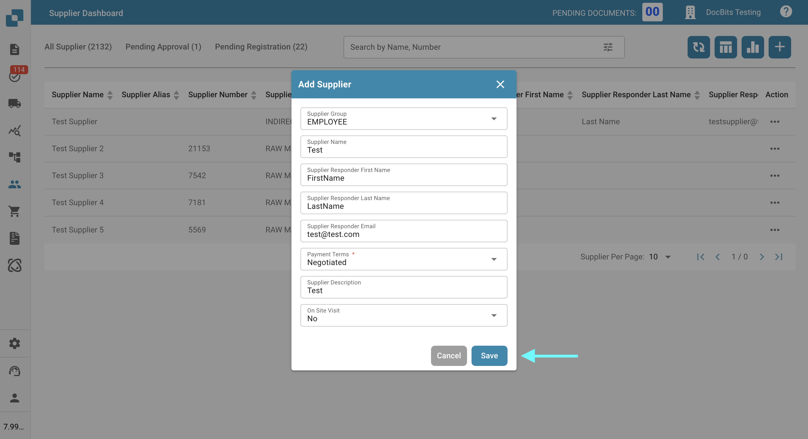

# 供应商门户

## 概述

本页介绍如何启用和使用**供应商门户**，以及如何找到所有相关设置。供应商门户允许您邀请供应商加入 **DocBits**。获得访问权限后，供应商可以直接在 **DocBits** 中登录并查看其**采购订单**和**发票**的状态。

## 如何启用供应商门户

1.  前往 **Settings → Document Processing → Module**。

    <figure><figcaption></figcaption></figure>
2.  在 **Shipping & Supplier** 部分中，启用 **Supplier Portal** 选项。

    <figure><figcaption></figcaption></figure>

## 供应商设置

启用**供应商门户**功能后，**设置**菜单底部会显示新的 **Supplier Settings** 部分。

<figure><figcaption></figcaption></figure>

[**Supplier General Settings**](../../settings/supplier-setting/supplier-general-settings.md)：在这里，您可以上传公司徽标来自定义**供应商门户**。徽标会显示在所有电子邮件模板的页眉中。您还可以管理法律文件，例如使用条款和隐私政策。

[**Email Templates**](../../settings/supplier-setting/editing-email-templates.md)**：**在这里，您可以创建并测试要发送给受邀供应商的邀请邮件模板。

[**Supplier Layout**](../../settings/supplier-setting/supplier-layout.md)**：**在这里，您可以创建和管理布局，以定义新供应商在注册过程中必须提供哪些信息。

[**Export Configuration**](../../settings/supplier-setting/export-configuration-for-supplier-portal-for-m3.md)：在这里，您可以使用 ION 和 IDM 映射文件定义**供应商门户**与 **Infor M3** 系统之间的数据映射和同步方式。

[**Supplier Permissions**](../../settings/supplier-setting/supplier-permissions.md)：在这里，您可以配置供应商在**供应商门户**中的权限。您还可以对供应商进行分组，以便更轻松地管理多个供应商的访问权限和设置。

所有供应商设置的详细指南请参见[此处](../../settings/supplier-setting/)。

## 供应商仪表板 

您可以通过左侧菜单访问**供应商仪表板**，如下所示。

<figure><figcaption></figcaption></figure>

这里会显示您创建的所有供应商。

## 筛选供应商

您可以按供应商**姓名**或**编号**搜索，也可以使用高级筛选条件缩小结果范围：

* **供应商组**
* **状态**
* **创建时间**

您还可以指定每页显示的供应商数量。

<figure><figcaption></figcaption></figure>

此外，您可以点击筛选栏左侧的相应类别，快速筛选**待审批**或**待注册**状态的供应商。

<figure><figcaption></figcaption></figure>

## 供应商详情（内部视图）

在**供应商仪表板**中点击供应商所在行，即可打开该供应商的**供应商详情**视图。此内部视图会显示供应商在注册过程中填写的相同六个部分——**供应商详情**、**地址数据**、**供应商联系人**、**供应商财务信息**、**供应商采购信息**和**供应商证书**——以及供应商当前的**状态**徽标。

您可以在此视图中查看供应商资料、更正或补充缺失信息，并为审批决策做准备。有关各部分的说明，请参见[供应商注册](supplier-registration.md)。点击视图顶部的返回按钮即可返回**供应商仪表板**。

## 供应商状态

如果您使用**供应商门户**，了解供应商可能处于的不同状态很重要。以下列出了所有可能的供应商状态及其含义：

* **未开放**：现有供应商，尚未收到门户邀请。
* **待注册**：供应商已收到邀请，但尚未完成注册流程。
* **待供应商补充信息**：注册已完成，但仍需供应商补充信息或进行更改。
* **待审批**：供应商已完成注册，正在等待首次审批。
* **待应付账款审批**：供应商已通过首次审批，正在等待第二次（应付账款）审批。
* **已批准**：供应商已完成流程并通过全部审批。
* **已拒绝**：供应商的注册或审批未获通过。

## 供应商仪表板中的工具

在搜索栏右侧，您会看到几个工具，可帮助您更高效地使用和管理仪表板。

### 刷新表格 

<figure><figcaption></figcaption></figure>

点击此按钮可刷新仪表板，加载最新的数据和状态。

### 设置表格列以便整理 

<figure><figcaption></figcaption></figure>

点击此按钮可打开菜单，管理采购订单表格中列的显示情况。使用复选框和箭头按钮可在显示和隐藏区域之间移动列。您还可以拖放列名称来调整列的顺序。点击 **Done** 保存更改。

<figure><figcaption></figcaption></figure>

### 分析 

<figure><figcaption></figcaption></figure>

点击此按钮会打开一个新部分，显示即将到期的供应商数量及其到期时间。\
点击任意类别可应用筛选，仅查看符合条件的供应商。

<figure><figcaption></figcaption></figure>

## 创建供应商并发送注册邮件

### **创建新供应商：**

1.  点击右上角的加号（+）图标。

    <figure><figcaption></figcaption></figure>
2.  填写必填字段，然后点击 **Save**。

    <figure><figcaption></figcaption></figure>
3. 系统会自动向供应商发送一封包含账户创建链接的电子邮件。

### **向现有供应商发送注册邮件：**

1. 在**供应商仪表板**中找到该供应商。
2. 点击 **Actions** 列中的三点菜单。
3.  选择 **Magic Link**。

    <figure><figcaption></figcaption></figure>
4. 核实供应商信息。
5.  点击 **Send**，通过电子邮件发送注册链接。

    <figure><figcaption></figcaption></figure>

## 供应商的注册流程是怎样的？

发送邀请邮件后，供应商必须完成注册流程才能访问**供应商门户**。

注册流程的详细分步指南请参见[此处](supplier-registration.md)。
