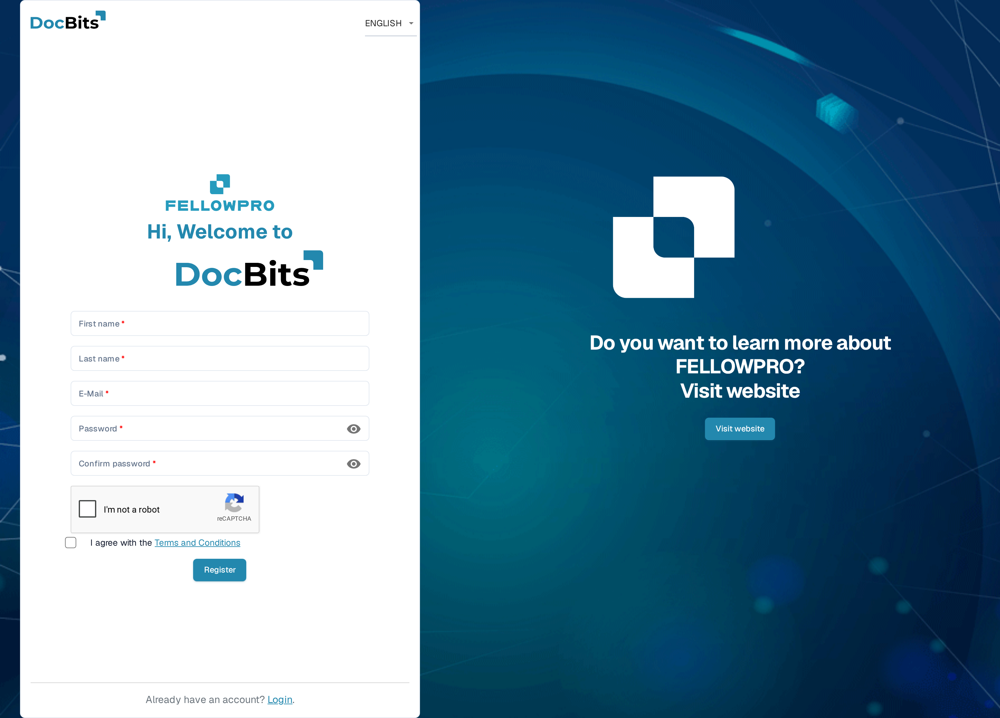
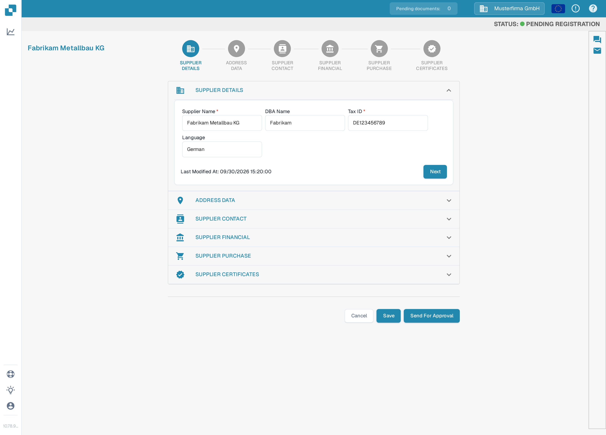
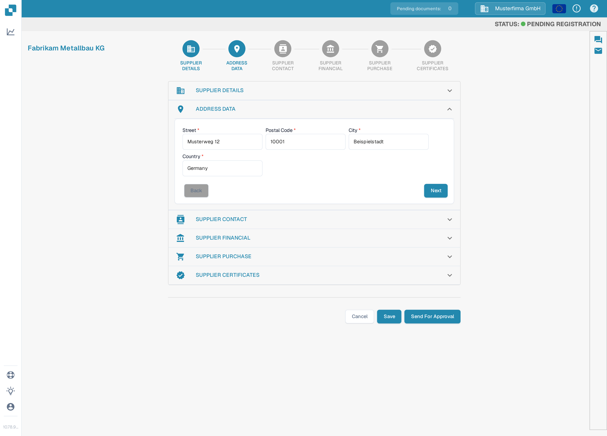
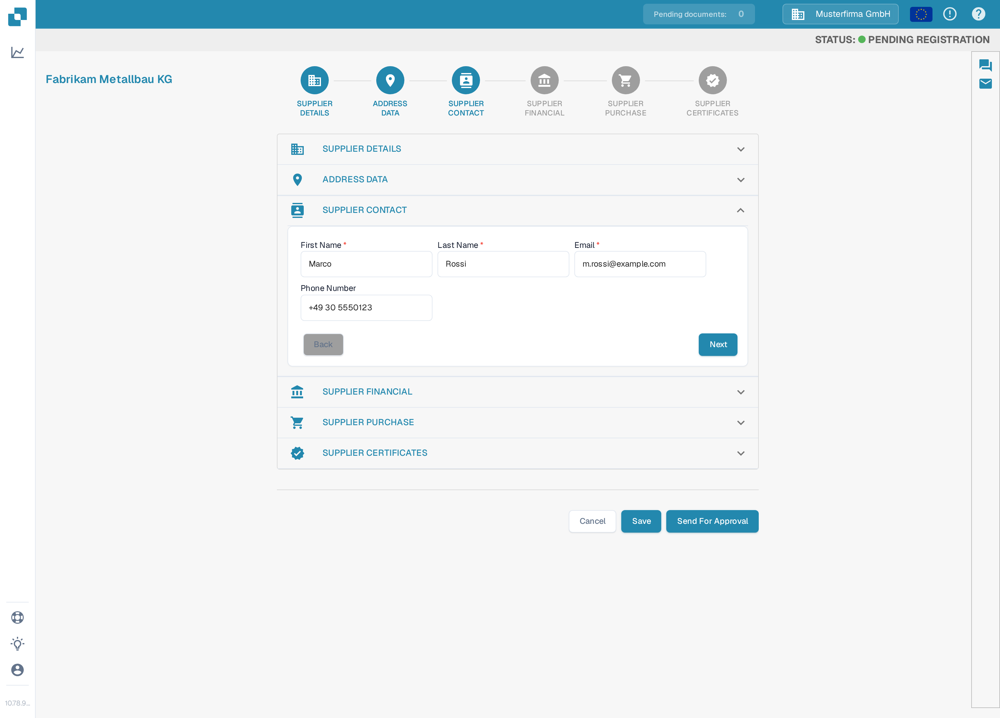
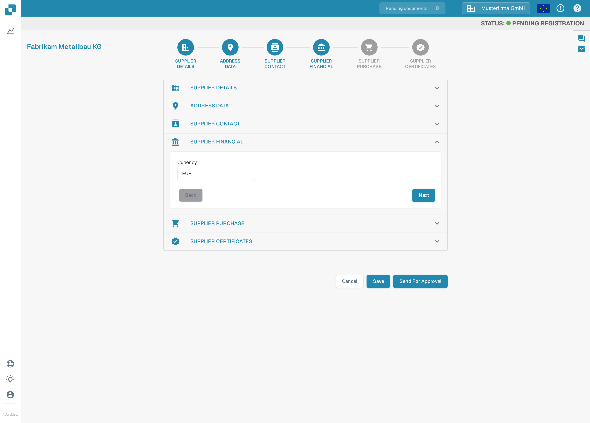
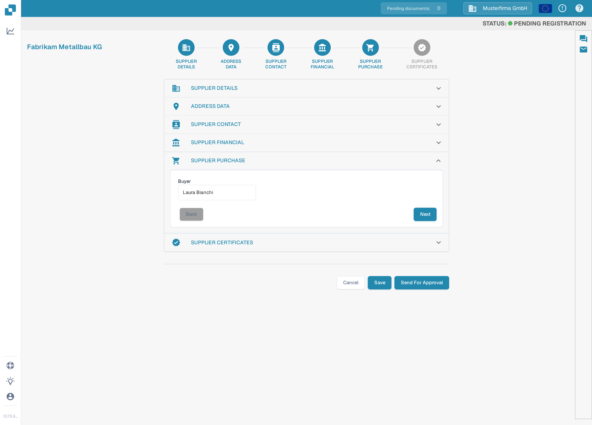
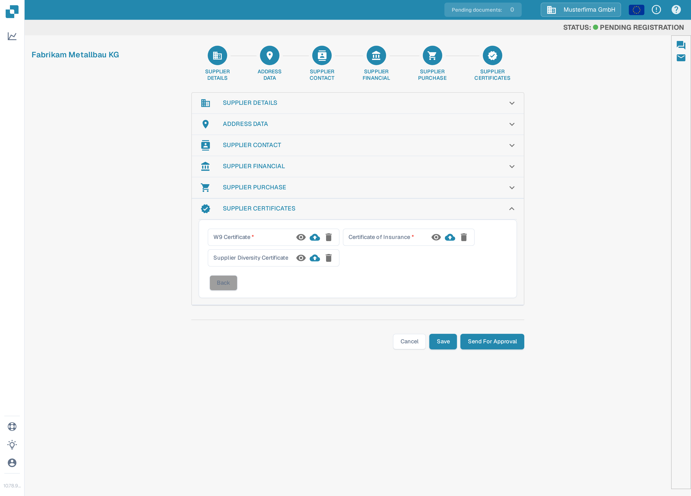
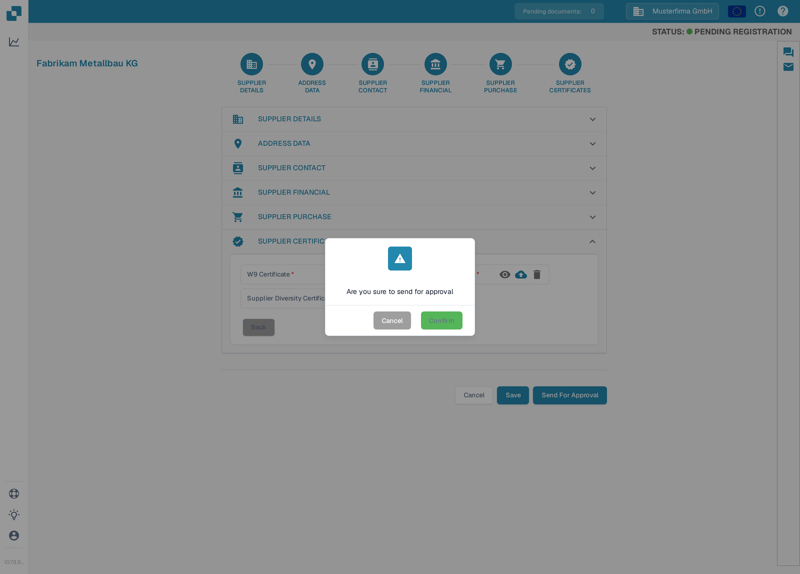

# Supplier Registration

When the [Supplier Portal](supplier-portal.md) is enabled, you can invite your suppliers to register. This page walks through the registration process a supplier completes after receiving an invitation.

1.  You will receive an invitation with a link via E-mail to begin the registration process. Please click on "Go to Registration," submit the required information, and accept the terms and conditions to get started.

    <figure><figcaption>
The invitation E-mail announces the Supplier Portal and contains the <strong>Go to Registration</strong> button that starts the process. You can create and test these invitation E-mails yourself under <a href="../../settings/supplier-setting/editing-email-templates.md">Email Templates</a>.
</figcaption></figure>

    The link opens the public registration form. Enter your first and last name, your E-mail address and a password, confirm the password, and accept the Terms and Conditions. Then click on **Register**.

    <figure><figcaption>
The registration form: enter your name, E-mail address and a password, accept the Terms and Conditions, then click <strong>Register</strong>.
</figcaption></figure>

2.  **Supplier Details**

    Please verify that the Supplier name is correct. This is a critical detail for identity and legal purposes that cannot be changed. Please provide all applicable information including the required fields. When completed, click on "Next" to continue to the Address Data section. To save your progress and continue later, click on "Save."

    <figure><figcaption>
Step 1 of 6, <strong>Supplier Details</strong>: check the supplier name and fill in the required fields (<strong>Supplier Name</strong>, <strong>Tax ID</strong>). The sections are configurable per organisation, so your wizard may show different sections or fields.
</figcaption></figure>

3.  **Address Data**

    Please provide all applicable information including the required fields. When completed, click on "Next" to continue to the Supplier Contact section. To save your progress and continue later, click on "Save."

    <figure><figcaption>
Step 2 of 6, <strong>Address Data</strong>: enter the street, postal code, city and country, then click <strong>Next</strong>.
</figcaption></figure>

4.  **Supplier Contact**

    Please provide all applicable information including the required fields. When completed, click on "Next" to continue to the Supplier Financial section. To save your progress and continue later, click on "Save."

    <figure><figcaption>
Step 3 of 6, <strong>Supplier Contact</strong>: enter the contact person's name and E-mail address, then click <strong>Next</strong>.
</figcaption></figure>

5.  **Supplier Financial**

    Please provide all applicable information. When completed, click on "Next" to continue to the Supplier Purchase section. To save your progress and continue later, click on "Save."

    <figure><figcaption>
Step 4 of 6, <strong>Supplier Financial</strong>: select your currency, then click <strong>Next</strong>.
</figcaption></figure>

6.  **Supplier Purchase**

    Please provide all applicable information. When completed, click on "Next" to continue to the Supplier Certificates section. To save your progress and continue later, click on "Save."

    <figure><figcaption>
Step 5 of 6, <strong>Supplier Purchase</strong>: enter the buyer responsible for your account, then click <strong>Next</strong>.
</figcaption></figure>

7.  **Supplier Certificates**

    Please upload all certificates required (Tax, Insurance, Vendor Diversification). Please save your progress if you need to return to complete the registration process later. When completed, click on "Send for Approval."

    <figure><figcaption>
Step 6 of 6, <strong>Supplier Certificates</strong>: upload the required certificates with the cloud-upload buttons, then click <strong>Send For Approval</strong>.
</figcaption></figure>

8.  Confirm that you want to submit your registration. Your details are then sent to your customer for review, and you will receive an E-mail confirming that you have completed the registration process.

    <figure><figcaption>
Click <strong>Confirm</strong> in the dialog to submit your registration. After the review by your customer you will be notified by E-mail.
</figcaption></figure>
