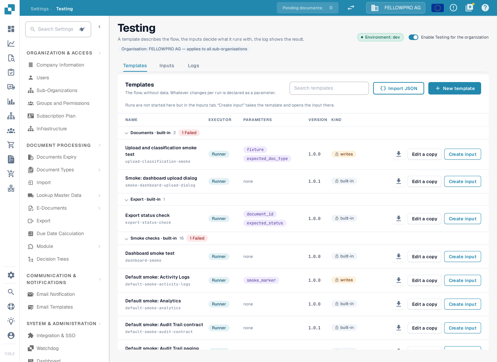
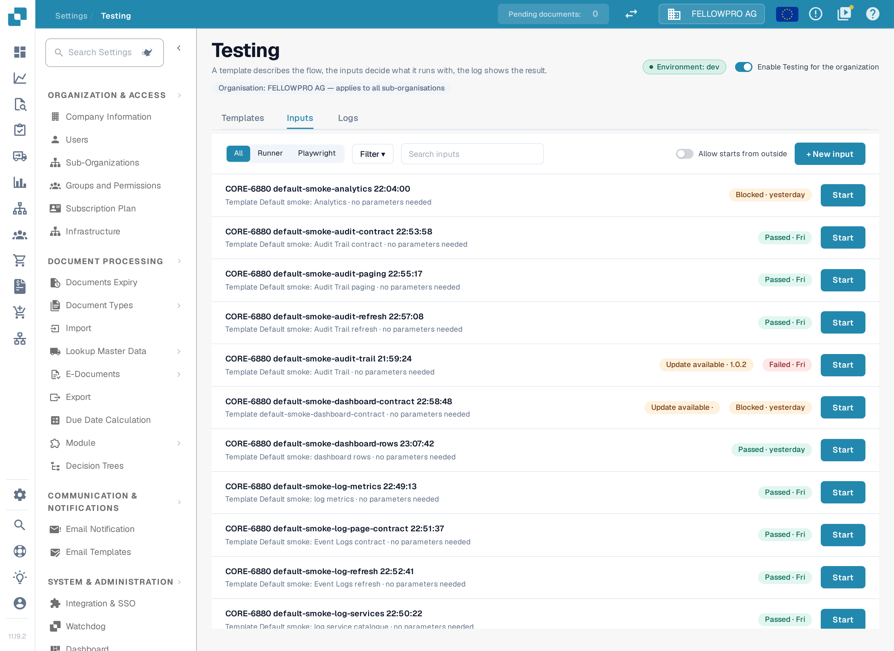
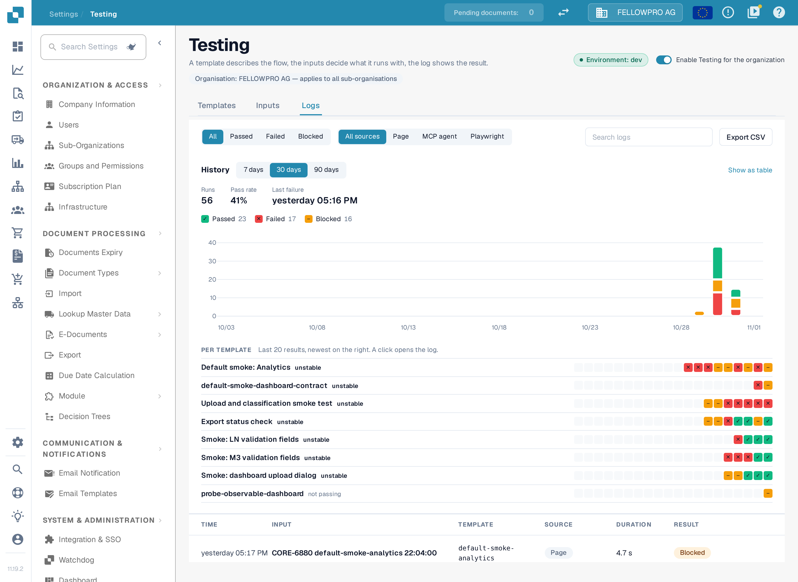
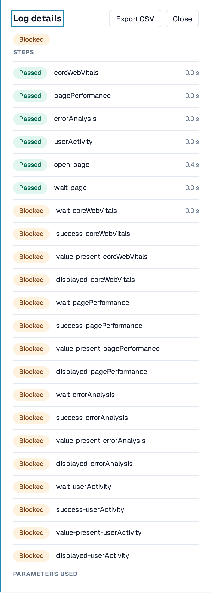

# Live Testing

**Testing** runs browser tests inside your own signed-in DocBits session. A test drives the real screens instead of a mock: it opens the dashboard, uploads a sample invoice, checks that a new document reaches validation, or confirms that an export reports the expected status.

You find the page in **Settings › Testing**. It is meant for administrators who look after the test suites of an organisation.

The page header names the organisation the tests belong to — **Organisation** — and states that it applies to all sub-organisations. The **Environment** badge next to the title names the environment the tests run against, for example **dev**. The switch **Enable Testing for the organization** turns the module on for the organisation.

The page has three tabs: **Templates**, **Inputs** and **Logs**.

A template describes the flow, the inputs decide what it runs with, the log shows the result.

<figure><figcaption>
The Templates tab: the templates DocBits ships with, grouped by category, with the parameters each one expects.
</figcaption></figure>

## Templates

A template contains only the browser steps of a test, never the data it works with. Whatever changes from run to run is declared as a **parameter** and supplied when the test starts. Some shipped templates need no parameters at all; their **Parameters** cell reads **none**.

The list is grouped by category — for example **Documents**, **Export** and **Smoke checks**. A category row can be collapsed and reopened, shows how many templates it holds, and carries a red **Failed** chip when the last run of a template in it did not pass.

Each template row shows:

* **Name** and, in smaller type below it, the template code.
* **Executor**: **Runner** for a test that runs in the DocBits browser, **Playwright** for one driven from outside.
* **Parameters**: the names of the values the test needs, for example `fixture` and `expected_doc_type`, or **none**.
* **Version**, for example `1.0.0`.
* **Kind**: **built-in** for templates DocBits ships with, **writes** for a test that creates or changes data instead of only reading screens. Both chips carry a lock for shipped templates, which cannot be edited in place.

Above the list you can search the templates, import a template as JSON with **Import JSON**, and build one with **New template**.

The row actions are:

* **the download icon**, which saves the template as JSON,
* **Edit a copy**, which opens the template builder with a copy of it,
* **Create input**, which hands the template to the **Inputs** tab so a run can be prepared there.

Runs are never started on this tab.

### Own templates

Templates your organisation creates or imports appear in the same list. Their category row carries no **· built-in** suffix. Unlike the built-in templates they can be changed, and their row actions also offer **Delete**. Deleting a template removes it and all of its versions; saved inputs and past logs stay. DocBits asks for confirmation first, and built-in templates cannot be deleted.

## Inputs

An input keeps the values for one template, so the same test can be started again with the same data.

<figure><figcaption>
Each input names the template it belongs to and shows the result of its last run. <strong>Start</strong> runs it again.
</figcaption></figure>

Each row shows the input's name, the template it belongs to, and the result of its last run with the day, for example **Passed · Fri** or **Blocked · yesterday**. When the template has changed since the input was saved, the row also shows **Update available** with the new version.

Above the list you can:

* filter by executor with **All**, **Runner** and **Playwright**,
* narrow the list further with **Filter**,
* search the inputs,
* switch **Allow starts from outside** on, which lets tests be started through the API, Playwright or automation while this browser tab is open. It is off by default; the registration ends when the tab is reloaded or closed.

**+ New input** opens the input editor: choose the template there and enter the values it declares. Fields a template marks as sensitive are entered as password fields and are not stored with the saved input — they are sent only when a test starts. **Start** on a row runs that input right away.

## Logs

**Logs** records what actually ran, whichever way it was started: from this page, through an automation or from outside.

The filter row above the table offers the **Result** values **All**, **Passed**, **Failed** and **Blocked**, the **Source** values **All sources**, **Page**, **MCP agent** and **Playwright**, a search field and **Export CSV**.

**Export CSV** downloads the logs currently matching the result and source filters as a spreadsheet file. The free-text search is not applied to the export, and the button says so in its tooltip. The same action in a single log downloads only that log.

A result made only of skipped steps is shown as **Blocked**, never as **Passed**: the test could not run, for example because a required screen or value was not there.

<figure><figcaption>
<strong>History</strong> shows how the tests ran over the selected range; below it, <strong>Per template</strong> stacks the last 20 results of every template and the list holds every single run.
</figcaption></figure>

### History

The **History** section summarises the selected range — 7, 30 or 90 days, 30 by default — with the number of **Runs**, the **Pass rate** and the **Last failure**:

* one bar per day stacks **Passed**, **Failed** and **Blocked** results,
* a click on a bar narrows the list below to that day and result, and a chip above the list clears the day again,
* **Show as table** prints the same values as a table.

The chart follows the result and source filters of the tab.

### Per template

**Per template** lists one row per template with its last 20 results, newest on the right. Templates that mix results come first, marked **unstable**; templates that never pass are marked **not passing**, and stable ones **stable**. A click on a cell opens that log.

### Log details

A click on a row of the log list opens **Log details** beside the list (on wide screens) or above it. The panel shows the result of the run, its **Steps** with the time each one took, the error code when there is one, and the **Parameters** used — sensitive values are never shown. **Export CSV** saves this single log, and the panel closes with **Close**.

<figure><figcaption>
Log details of a blocked run: every step with its duration, where it stopped, and the parameters it ran with.
</figcaption></figure>

Use **Previous** and **Next** below the table to page through the logs.

## Leaving the page with unsaved work

If you have unsaved entries open — an input you were editing, or a template in the builder — DocBits asks before the page is left. **Keep editing** stays on the page, **Discard** throws the changes away. A run that is being followed in this tab is never interrupted by navigation.

## Good to know

* A test that is started from this page runs in the tab you are signed in with. If the tab is closed or reloaded, the run and its registration for outside starts end.
* Templates are organisation-wide. Anyone who can open **Settings › Testing** sees the same list.
* A template of kind **writes** changes data. The upload tests, for example, leave one document in the organisation per run.
* Sensitive parameter values are not stored with an input and never appear in a log.

## Related pages

* [Testing](README.md)
* [Dashboard](../../../end-user-and-partner-section/end-user-section/dashboard/README.md)
