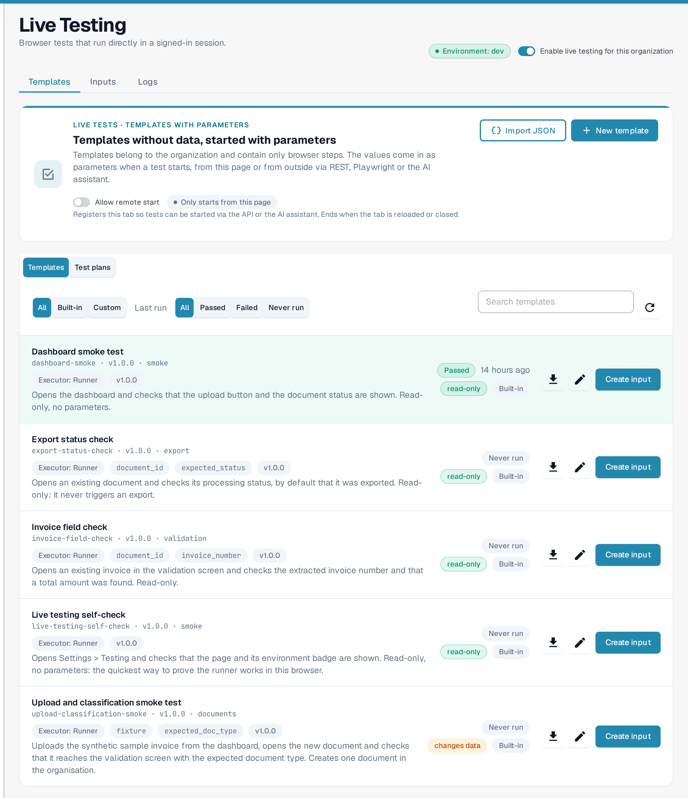
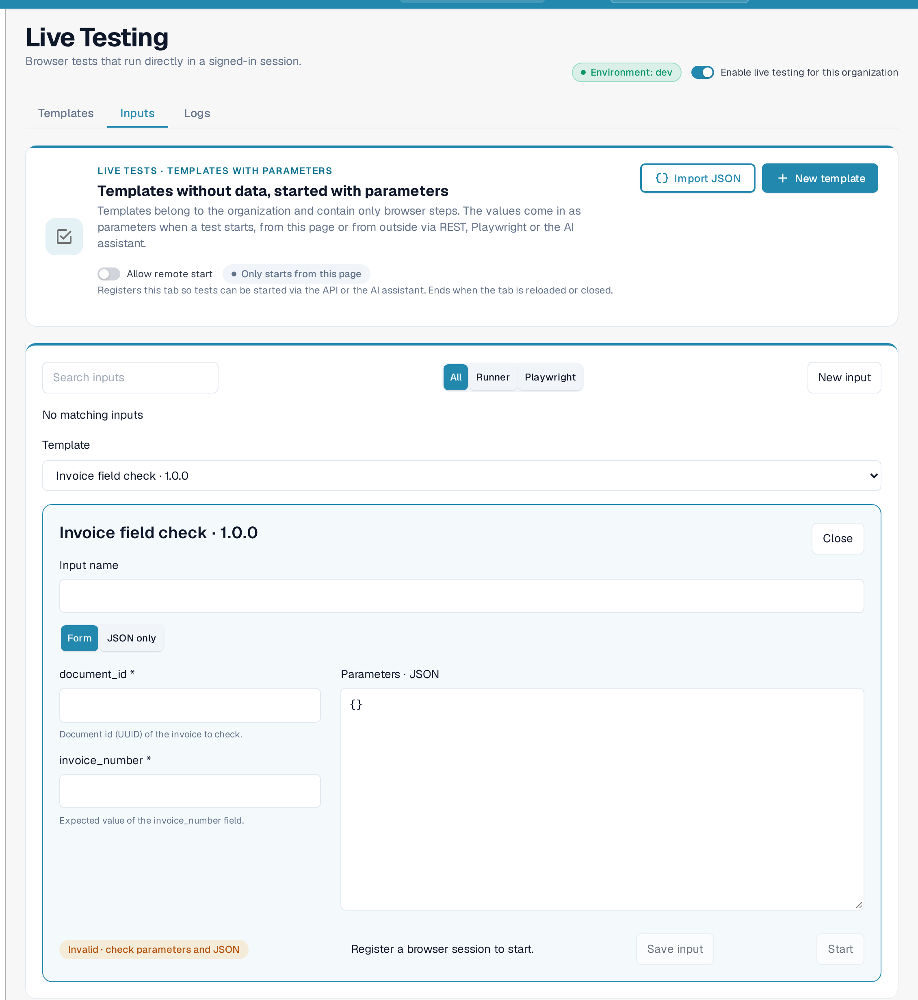

# Live Testing

**Live Testing** runs browser tests inside your own signed-in DocBits session. A test drives the real screens instead of a mock: it opens the dashboard, uploads a sample invoice, checks that a new document reaches validation, or confirms that an export reports the expected status.

You find the page in **Settings › Testing**. It is meant for administrators who look after the test suites of an organisation.

The **Environment** badge next to the title names the environment the tests run against, for example **dev**. The switch **Enable live testing for this organization** turns the tool on for the organisation.

The page has three tabs: **Templates**, **Inputs** and **Logs**.

<figure><figcaption>
The Templates tab: the environment the tests run in, the organisation switch and the templates DocBits ships with.
</figcaption></figure>

## Templates

A template contains only the browser steps of a test, never the data it works with. The values come in as **parameters** when a test starts — from this page, or from outside through REST, Playwright or the AI assistant.

Each template row shows the template name and code, its version, what the test does in one sentence, the result of the last run and whether it is **read-only** or **changes data**:

* **read-only**: the test only looks at screens and values. It never changes a document or a setting.
* **changes data**: the test creates or changes something, for example the upload test creates one document in the organisation.

The **download** action exports a template as JSON, **edit** opens it in the template builder and **Create input** starts a run for that template with the values you enter.

Above the list you can:

* filter by source with **All**, **Built-in** and **Custom**,
* filter by the last result with **All**, **Passed**, **Failed** and **Never run**,
* search the templates,
* refresh the list,
* import a template as JSON with **Import JSON**,
* build a new template with **New template**.

**Built-in** templates come with DocBits and can only be edited by copying them. The switch **Templates / Test plans** above the list changes the view: **Test plans** lists the organisation's test cases with filters for module, priority, automation status and result.

## Start a test

1. On the **Templates** tab, select **Create input** on the template you want, or open the **Inputs** tab and select **New input**.
2. Choose the **Template**, and give the input a **Input name**.
3. Enter the values in the form, or switch to **JSON only** and paste the parameters. Both views stay in step; an invalid combination is marked **Invalid** and names what is missing.
4. Select **Save input** to keep it for later runs, or **Start** to run it right away.

<figure><figcaption>
An input keeps the values for one template. Required parameters are marked with an asterisk, and the JSON view shows the same values.
</figcaption></figure>

Parameters a template marks as sensitive are entered as password fields. They are not stored with the saved input; they are sent only when a test starts.

**A run needs a browser session.** The note next to **Start** says so while none is registered — **Start** stays disabled until the session is registered with **Allow remote start**:

* **Allow remote start** registers this browser tab, so tests can be started from outside: through the API, Playwright or the AI assistant. The registration ends when the tab is reloaded or closed.
* **Only starts from this page** is the default. Tests then have to be started here.

## Logs

**Logs** lists the results of every run with the **Result** filter **All**, **PASS**, **FAIL** and **BLOCKED**, the **Source** filter **All**, **Page**, **MCP agent**, **Playwright** and **Manual**, a search field and **Refresh**. Use **Previous** and **Next** below the table to page through the results.

A blocked test is shown as **BLOCKED**, never as **PASS**: the test could not run, for example because a required screen or value was not there. Sensitive parameter values are never shown in a log.

**Browser run history** below the log lists the runs that were started from this browser tab, with status, template, source, time and duration, filtered by **All**, **Passed**, **Failed** and **Other**.

## Good to know

* A test runs in the browser tab that is signed in. If the tab is closed or reloaded, the run and its session registration end.
* Templates are organisation-wide. Anyone who can open **Settings › Testing** sees the same list.
* The first run of a template that uploads a document leaves one document in the organisation. Use a test document type if that matters for your figures.

## Related pages

* [Testing](README.md)
* [Dashboard](../../../end-user-and-partner-section/end-user-section/dashboard/README.md)
