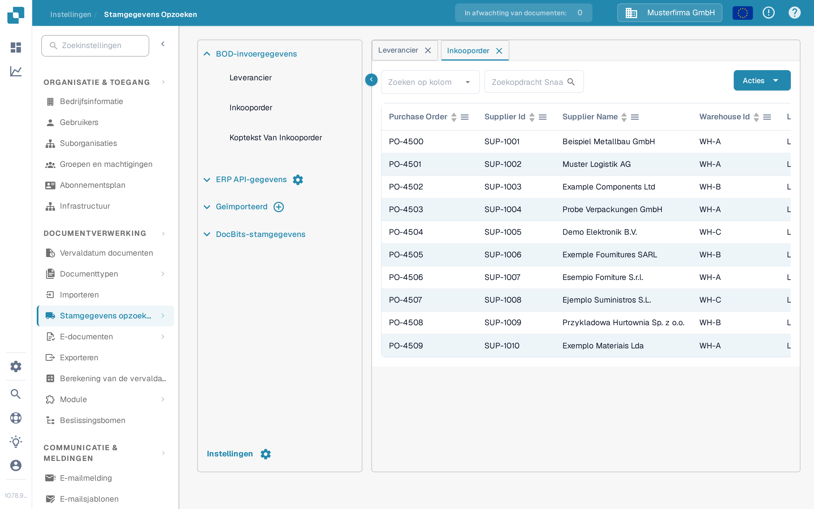

# Inkoopordermatching

Als het gaat om het testen van uw PO Matching-configuratie, moet u een inkooporder aanmaken in LN/M3 om te controleren of INFOR is gesynchroniseerd met DocBits.

## Een inkooporder maken in INFOR

* LN: https://docs.infor.com/ln/10.4/en-us/lnolh/docs/ln\_10.4\_procpoug\_\_en-us.pdf&#x20;
* M3: https://docs.infor.com/m3udi/16.x/en-us/m3beud/default.html?helpcontent=ois610.html&#x20;

Zodra u de inkooporder hebt aangemaakt, gaat u naar **Instellingen → Documentverwerking → [Stamgegevens opzoeken](../../settings/document-processing/master-data-lookup.md)** en zoekt u het inkoopordernummer van de zojuist aangemaakte order: dit moet nu verschijnen in de stamgegevens van inkooporders in DocBits.

<figure><figcaption>
Inkooporders verschijnen in Stamgegevens opzoeken.
</figcaption></figure>

Nadat u uw inkooporder heeft aangemaakt, gaat u naar Instellingen → Stamgegevens opzoeken en zoekt u naar het inkoopordernummer van de PO die u zojuist hebt aangemaakt, zoals het nu zou moeten verschijnen in de stamgegevens van uw inkooporder in DocBits.

Upload nu de factuur waarvan de aantallen en eenheidsprijzen overeenkomen met de inkooporder die u hebt aangemaakt. Valideer het document en selecteer **PO Matching** op het validatiescherm: het [Scherm voor het matchen van inkooporders](../../../end-user-and-partner-section/end-user-section/purchase-order-matching/README.md) legt uit hoe u de inkooporder opzoekt, de regels controleert en deze aan de factuurregels koppelt.

U zou hier uw unieke PO-nummer moeten zien, dit betekent dat DocBits en INFOR correct zijn gesynchroniseerd.

Upload nu uw factuur die overeenkomt met het aantal en de eenheidsprijzen van de inkooporder die u heeft aangemaakt. Valideer het document en selecteer PO Matching op het validatiescherm.

De PO en factuurregelitems moeten automatisch overeenkomen. Selecteer vervolgens eenvoudigweg de exportoptie en controleer of het document zonder fouten wordt geëxporteerd. Als u toch een exportfout tegenkomt, maak dan een ticket aan zodat het DocBits ondersteuningsteam u kan helpen. Als u niet zeker weet hoe u een ticket moet aanmaken in DocBits, raadpleeg dan onze DocBits Overzichtsdocumentatie voor hulp.

\\
