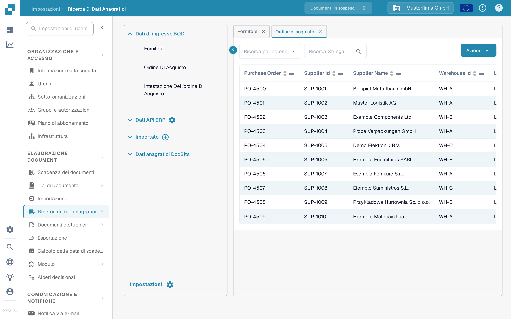

# Abbinamento degli ordini di acquisto

Quando si tratta di testare la configurazione di PO Matching, dovrai creare un ordine d'acquisto in LN/M3 per verificare se INFOR è sincronizzato con DocBits.

## Creazione di un ordine di acquisto in INFOR




* LN: https://docs.infor.com/ln/10.4/en-us/lnolh/docs/ln\_10.4\_procpoug\_\_en-us.pdf&#x20;
* M3: https://docs.infor.com/m3udi/16.x/en-us/m3beud/default.html?helpcontent=ois610.html&#x20;

Una volta creato l'ordine d'acquisto, vai su Impostazioni → Ricerca dati anagrafici e cerca il numero dell'ordine d'acquisto del PO appena creato come dovrebbe ora apparire nei dati anagrafici dell'ordine d'acquisto in DocBits.

<figure><figcaption>
Gli ordini di acquisto compaiono nella Ricerca di dati anagrafici.
</figcaption></figure>

Dovresti vedere il tuo numero univoco PO qui, questo significa che DocBits e INFOR sono correttamente sincronizzati.

Ora carica la fattura che corrisponde alla quantità e ai prezzi unitari dell'ordine di acquisto che hai creato. Convalida il documento e seleziona Abbinamento degli ordini di acquisto nella schermata di convalida.

Le voci PO e le voci della fattura dovrebbero corrispondere automaticamente, quindi seleziona semplicemente l'opzione di esportazione e controlla se il documento viene esportato o meno senza errori. Se riscontri un errore di esportazione, crea un ticket per il team di supporto DocBits per aiutarti. Se non sei sicuro su come creare un ticket in DocBits, consulta la nostra documentazione Panoramica DocBits per assistenza.

\
