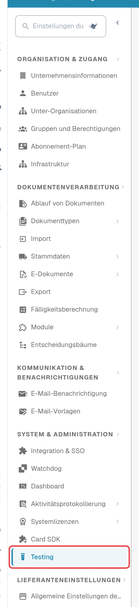
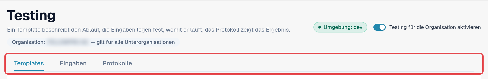
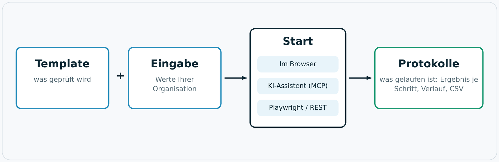

# Testing-Modul

## Wofür das Testing-Modul da ist

Das Testing-Modul prüft, ob DocBits **in Ihrer Organisation** richtig arbeitet: Seiten öffnen sich, Listen zeigen
Daten, ein Dokument hat den erwarteten Status, ein Upload wird wie erwartet klassifiziert. Ein Test klickt sich in
einem Browser-Tab durch die echte Anwendung, genau wie ein Mensch, und hält das Ergebnis jedes Schritts fest.

Nutzen Sie es, wenn Sie

* nach einem Release, einer Konfigurationsänderung oder einem Einstellungsimport bestätigen wollen, dass alles noch läuft;
* dieselbe Abnahmeprüfung in einer Einführung für mehrere Organisationen wiederholen;
* der QA eine Liste von Prüfungen geben wollen, die jeder starten und deren Ergebnis jeder lesen kann;
* Ihre Testautomatisierung oder einen KI-Assistenten dieselben Prüfungen starten und auswerten lassen wollen.

## Wer es nutzen kann

Das Modul steht **Organisations-Admins** zur Verfügung. Es ist in jeder Organisation ausgeschaltet, bis ein
Organisations-Admin es einschaltet.

1. Öffnen Sie **Einstellungen**. Wählen Sie in der Seitenleiste unter **System & Administration** den Eintrag **Testing**.
2. Schalten Sie **Testing für die Organisation aktivieren** ein.

<figure><figcaption>
Seitenleiste der Einstellungen mit hervorgehobenem Eintrag Testing.
</figcaption></figure>

<figure><figcaption>
Kopf der Seite Testing mit Umgebungsanzeige, Schalter und den drei Reitern.
</figcaption></figure>

Unter dem Titel zeigt **Organisation: … — gilt für alle Unterorganisationen**, für welche Organisation diese Seite arbeitet. Was Sie hier einrichten, gilt für diese Organisation und alle ihre Unterorganisationen.

Solange der Schalter aus ist, zeigt die Seite nur *Testing ist ausgeschaltet. Es läuft nichts, bis ein
Organisations-Admin es einschaltet.* Beim Ausschalten enden auch alle Browser-Tabs, die für Starts von außen registriert waren.

Die Anzeige **Umgebung** zeigt, wo Sie sind. In einer Kundenumgebung (Sandbox oder Produktion) ist sie rot, und
DocBits schützt zusätzlich: Tests, die Daten ändern, brauchen eine ausdrückliche Bestätigung, und Export-, Lösch-
oder Freigabeschritte sind gesperrt, solange das Template nicht erklärt, dass es Daten schreibt.

## So funktioniert es: Template, Eingabe, Start, Protokoll

<figure><figcaption>
Schaubild: Template plus Eingabe ergibt einen Test; er wird im Browser, von einem KI-Assistenten oder von außen gestartet; jeder Lauf landet in den Protokollen.
</figcaption></figure>

| Teil | Reiter | Was es ist |
|---|---|---|
| **Template** | **Templates** | Eine wiederverwendbare Testdefinition: *was* geprüft wird, Schritt für Schritt. Es enthält keine Daten Ihrer Organisation. Was sich von Organisation zu Organisation ändert, ist ein **Parameter**. |
| **Eingabe** | **Eingaben** | Die gespeicherten Werte Ihrer Organisation für die Parameter eines Templates, zum Beispiel das zu öffnende Dokument. **Template + Eingabe = ein startbarer Test.** |
| **Start** | **Eingaben** | Das Modul führt den Test aus und steuert ihn. Es gibt drei gleichwertige Wege: im Browser, über einen KI-Assistenten per MCP oder von außen mit Playwright bzw. einem REST-Aufruf. |
| **Protokoll** | **Protokolle** | Was tatsächlich gelaufen ist, egal wie es gestartet wurde: Ergebnis, jeder Schritt, die verwendeten Parameter. Ein Verlaufsdiagramm zeigt die Ergebnisse über die Zeit; Protokolle lassen sich als CSV exportieren. |

DocBits liefert **Standard-Templates** (ihre IDs beginnen mit `default-smoke-`) und einige integrierte Templates mit.
Sie sind für alle Organisationen gleich und lassen sich weder ändern noch löschen. Ein Standard-Template kann in jeder
Organisation laufen; die Eingabe liefert, was für Ihre Organisation spezifisch ist. Eigene Templates können Sie
anlegen und wieder löschen.

## Schnellstart: einen Standardtest ausführen

1. Öffnen Sie **Einstellungen → Testing**, Reiter **Templates**.
2. Suchen Sie in der Gruppe **Smoke-Prüfungen** ein Standard-Template ohne Parameter (Spalte **Parameter** zeigt *keine*).
3. Wählen Sie **Eingabe anlegen**. Der Reiter **Eingaben** öffnet sich mit einer neuen Eingabe für dieses Template.
4. Geben Sie einen **Namen der Eingabe** ein und wählen Sie **Eingabe speichern**.
5. Wählen Sie **Start**. Der Test läuft in diesem Browser-Tab; laden Sie den Tab währenddessen nicht neu und schließen Sie ihn nicht.
6. Öffnen Sie den Reiter **Protokolle**. Die oberste Zeile zeigt das Ergebnis: **Bestanden**, **Fehlgeschlagen** oder **Blockiert**.

<figure><figcaption>
Reiter Templates mit der Gruppe Smoke-Prüfungen.
</figcaption></figure>

Weiterlesen:

* [Templates](templates.md): Standard-Templates, eigene Templates, Import und Löschen
* [Eingaben](inputs.md): Werte Ihrer Organisation speichern
* [Test starten](start-a-test.md): im Browser, über einen KI-Assistenten oder mit Playwright
* [Protokolle und Verlauf](logs.md): Ergebnisse, Diagramm und CSV-Export
* [Fehlerbehebung](troubleshooting.md)
* [Für Entwickler](for-developers.md)
