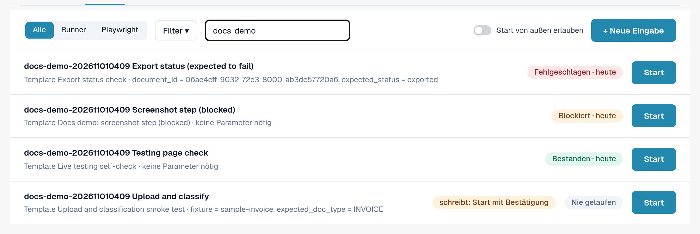
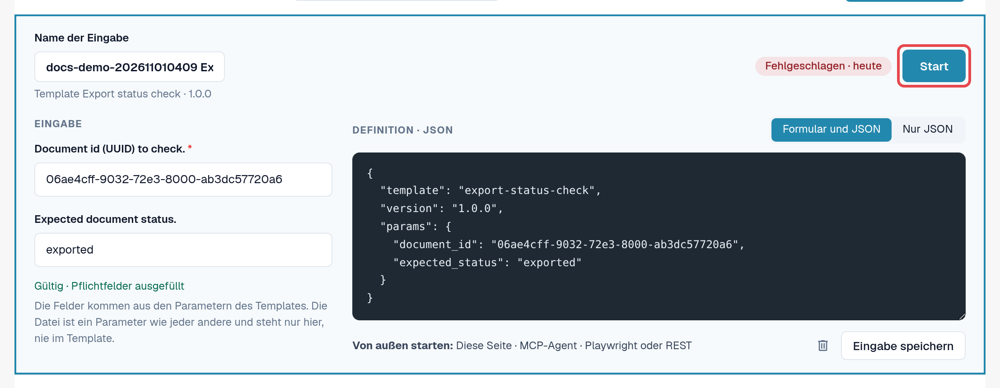
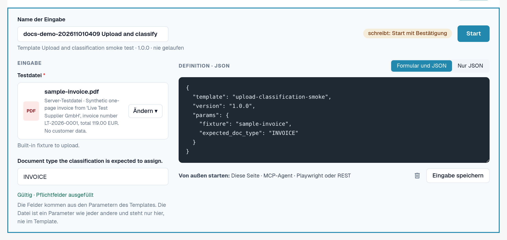

# Eingaben

Eine Eingabe speichert **die Werte Ihrer Organisation** für die Parameter eines Templates, unter einem Namen Ihrer Wahl.
Template plus Eingabe ist ein Test, den Sie immer wieder starten können, von Hand oder automatisch.

Beispiel: Das Standard-Template *Default smoke: validation contract* öffnet ein Dokument und prüft Status und Dokumenttyp.
Es braucht eine Dokument-ID. Ihre Eingabe *Rechnung LT-2026-0001 bereit zur Validierung* speichert die ID eines Dokuments
Ihrer Organisation und den erwarteten Status.

Öffnen Sie **Einstellungen → Testing**, Reiter **Eingaben**.

<figure><figcaption>
Reiter Eingaben mit gespeicherten Eingaben und ihrem letzten Ergebnis.
</figcaption></figure>

Jede Zeile zeigt den Namen der Eingabe, Template und Version, das letzte Ergebnis und **Start**. **Aktualisierung verfügbar**
heißt: Das Template hat eine neuere Version als die, für die diese Eingabe gespeichert wurde. Der Chip
**schreibt: Start mit Bestätigung** markiert Eingaben, deren Template Daten ändert.

## Eingabe anlegen

1. Wählen Sie im Reiter **Templates** beim Template **Eingabe anlegen**. (Oder wählen Sie im Reiter **Eingaben**
   **+ Neue Eingabe** und dann das Template.)
2. Geben Sie den **Namen der Eingabe** ein, zum Beispiel Zweck und Organisation.
3. Füllen Sie die Parameter aus. Pflichtfelder tragen ein Sternchen. Sie können zwischen **Formular und JSON** und
   **Nur JSON** wechseln; beides bleibt im Gleichschritt.
4. Prüfen Sie die Zeile unter dem Formular: *Gültig · Pflichtfelder ausgefüllt* heißt, die Eingabe kann starten.
5. Wählen Sie **Eingabe speichern**.

<figure><figcaption>
Eingabe-Editor mit Name, Parametern und Gültigkeitszeile.
</figcaption></figure>

### Dateien als Parameter

Manche Templates laden ein Dokument hoch. Ihr Dateiparameter bietet **Dateien der Organisation** (PDF, PNG oder JPEG bis
10 MB, die Ihre Organisation für Tests hochgeladen hat) und **Testdateien des Servers** (synthetische Testdateien von DocBits).
Die Datei wird in der Organisation gespeichert, nie im Template.

<figure><figcaption>
Dateiparameter mit Dateien der Organisation und Testdateien des Servers.
</figcaption></figure>

### Werte, die nie gespeichert werden

Als vertraulich markierte Parameter (zum Beispiel ein Passwort für ein Fremdsystem) werden nie gespeichert. Die Eingabe
merkt sich nur, dass der Wert gebraucht wird; Sie geben ihn bei jedem Start ein (*Wird nur beim Start gesendet, nie
gespeichert.*). Protokolle zeigen solche Werte nur als *beim Start angegeben*.

## Eingabe ändern oder löschen

Öffnen Sie die Eingabe aus der Liste, ändern Sie sie und wählen Sie **Eingabe speichern**. Zum Löschen wählen Sie im
Editor das Papierkorb-Symbol und bestätigen. Das Löschen einer Eingabe löscht ihre Protokolle nicht.


Führt Ihre Organisation **Testfälle**, listet der Link **Testfälle** im Filtermenü des Reiters Eingaben deren Fälle und
zeigt, welche ein Template haben. Ein Fall ohne Template kann von einer berechtigten Person manuell bestätigt werden.

