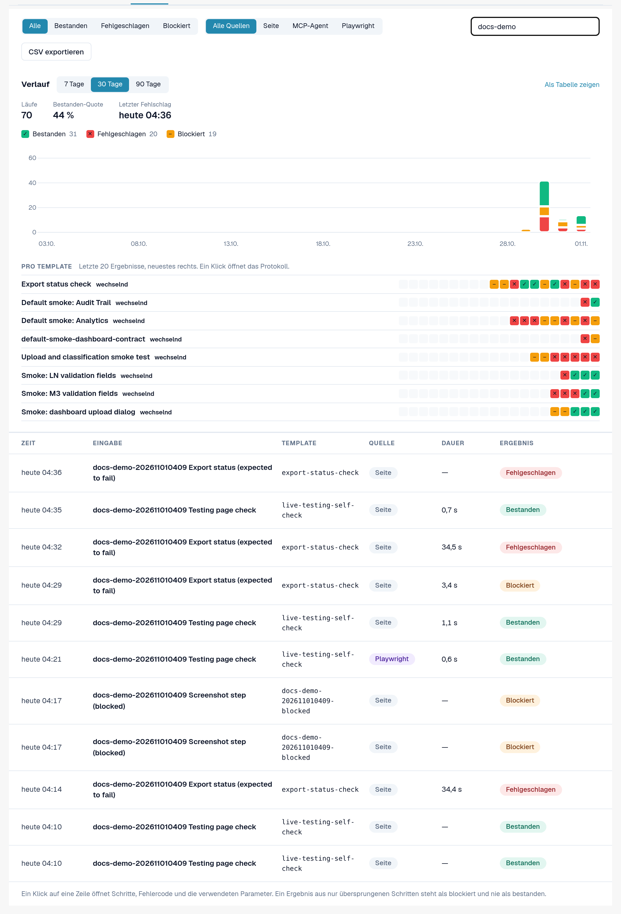
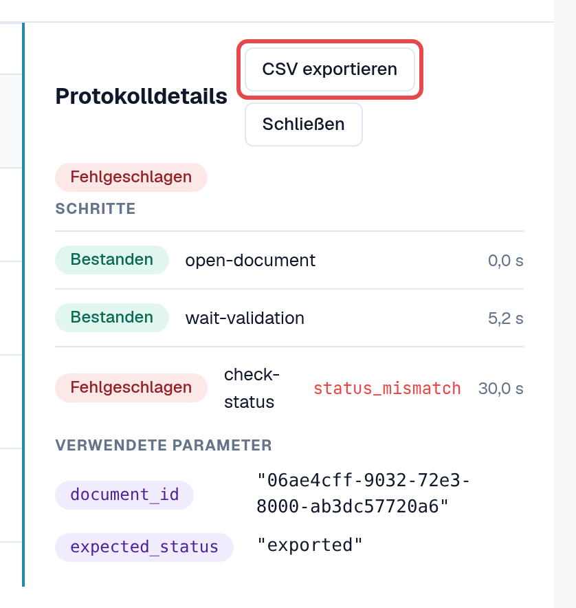
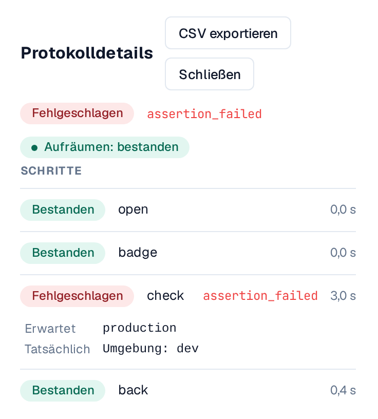
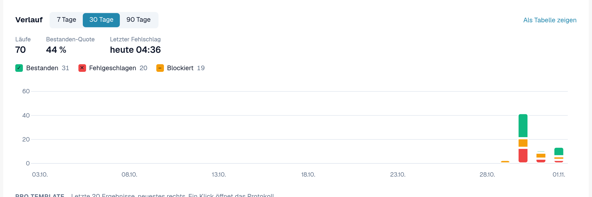
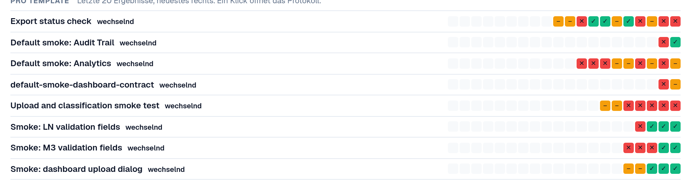
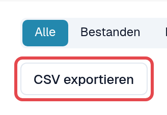

# Protokolle und Verlauf

Jeder Lauf, egal wie er gestartet wurde, landet im Reiter **Protokolle**: Ergebnis, Schritte, Fehlercode eines
fehlgeschlagenen Schritts und die verwendeten Parameter. Protokolle speichern keine Seiteninhalte und keine Screenshots.

Öffnen Sie **Einstellungen → Testing**, Reiter **Protokolle**.

<figure><figcaption>
Reiter Protokolle mit gemischten Ergebnissen und Quellen.
</figcaption></figure>

## Die Liste lesen

| Spalte | Bedeutung |
|---|---|
| **Zeit** | Wann der Lauf begann. |
| **Eingabe** | Die gestartete Eingabe (oder der Testplanfall). |
| **Template** | Die ID des Templates. |
| **Quelle** | **Seite** (im Browser gestartet), **MCP-Agent**, **Playwright**, **Manuell** (von Hand bestätigter Fall). |
| **Dauer** | Wie lange der Lauf dauerte. |
| **Ergebnis** | **Bestanden**: Alle Schritte bestanden. **Fehlgeschlagen**: Ein Schritt schlug fehl. **Blockiert**: Der Lauf ließ sich nicht bewerten, etwa weil Schritte übersprungen wurden; ein Lauf nur aus übersprungenen Schritten gilt nie als bestanden. |

Filtern Sie mit **Alle / Bestanden / Fehlgeschlagen / Blockiert**, mit **Alle Quellen / Seite / MCP-Agent / Playwright**
oder mit **Protokolle suchen**.

## Ein Protokoll öffnen

Wählen Sie eine Zeile. **Protokolldetails** zeigt jeden Schritt mit Ergebnis, den Fehlercode eines fehlgeschlagenen
Schritts und die **Verwendeten Parameter** (vertrauliche Werte nur als *beim Start angegeben*). **Fall öffnen** springt zum
Testplanfall, falls es einen gibt.

<figure><figcaption>
Protokolldetails eines fehlgeschlagenen Laufs.
</figcaption></figure>

### Erwarteter und tatsächlicher Wert

Unter einer fehlgeschlagenen Prüfung zeigen die **Protokolldetails**, was die Prüfung erwartet hat und was sie gefunden hat:

* **Erwartet**: der Wert, den das Template verlangt.
* **Tatsächlich**: der Wert, der auf der Seite stand.

Beides erscheint nur auf **Entwicklungs- und Testumgebungen**, ist auf 120 Zeichen gekürzt und entfällt, wenn der Schritt einen
vertraulichen Wert verwendet. Auf einer Kundenumgebung (Sandbox, Produktion) behält das Protokoll nur den Fehlercode.

### Aufräumen

Hat das Template [Aufräumschritte](steps-and-blocks.md), zeigt der Chip neben dem Ergebnis, wie sie endeten:
**Aufräumen: bestanden**, **Aufräumen: fehlgeschlagen** oder **Aufräumen: übersprungen** (zum Beispiel weil der Lauf gestoppt wurde).
Aufräumschritte laufen auch nach einer fehlgeschlagenen Prüfung. Ein fehlgeschlagenes Aufräumen ändert das Ergebnis des Laufs nicht, aber
Testdaten, etwa ein hochgeladenes Dokument, können zurückbleiben. Öffnen Sie das Protokoll, um zu sehen, welcher Aufräumschritt fehlschlug.

<figure><figcaption>
Protokolldetails: die fehlgeschlagene Prüfung mit Erwartet und Tatsächlich und der Chip Aufräumen: bestanden.
</figcaption></figure>

## Verlauf

Über der Liste zeigt **Verlauf**, wie die Tests über die Zeit gelaufen sind. Wechseln Sie zwischen **Als Diagramm zeigen**
und **Als Tabelle zeigen**.

* **Ergebnisse pro Tag**: wie viele Läufe an jedem Tag bestanden, fehlgeschlagen oder blockiert waren, in Ihrer Zeitzone.
  Wählen Sie den **Zeitraum** (7 bis 90 Tage, Standard 30). Ein Klick auf einen Tag filtert die Liste darauf;
  **Wieder alle Tage zeigen** hebt den Filter auf.
* **Bestanden-Quote** und **Letzter Fehlschlag** fassen den Zeitraum zusammen. Noch laufende Tests zählen als *noch ohne Ergebnis*.
* **Pro Template**: die letzten 20 Ergebnisse je Template, das neueste rechts, mit Kennzeichnung **stabil** (nur bestanden),
  **wechselnd** (gemischte Ergebnisse) oder **nicht bestanden** (nur fehlgeschlagen oder blockiert). Ein Klick auf ein Ergebnis
  öffnet sein Protokoll. Wechselnde Templates stehen oben.

<figure><figcaption>
Verlauf: Ergebnisse pro Tag.
</figcaption></figure>

<figure><figcaption>
Pro Template: letzte 20 Ergebnisse und Stabilität.
</figcaption></figure>

## Als CSV exportieren

Wählen Sie **CSV exportieren** in der Werkzeugleiste, um die Protokolle mit dem gewählten Ergebnis und der gewählten Quelle
herunterzuladen (höchstens 5.000; die Suche wird nicht angewendet). In den **Protokolldetails** lädt **CSV exportieren** ein
einzelnes Protokoll mit allen Schritten herunter.

Die Datei öffnet sich direkt in Excel (UTF-8). Zeiten stehen in UTC. Sie enthält dieselben Angaben wie die Seite: keine
vertraulichen Werte, keine Seiteninhalte.

<figure><figcaption>
CSV exportieren in der Werkzeugleiste der Protokolle.
</figcaption></figure>
