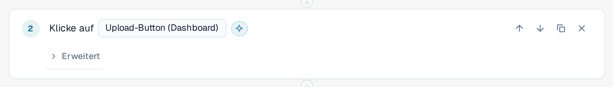
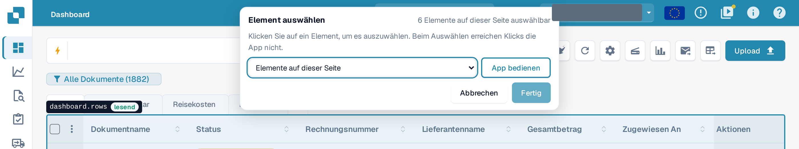
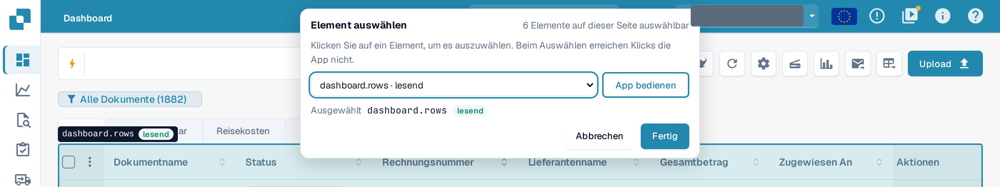
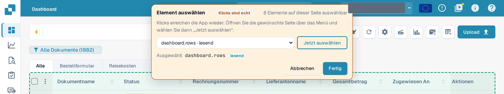

# Element in der App auswählen

Jeder Schritt muss wissen, **auf welches Element** der Seite er wirkt: eine Schaltfläche, ein Feld, eine Tabelle. Statt es in einer langen
Liste zu suchen, zeigen Sie in der echten Anwendung darauf.

## Ein Element auswählen

1. Wählen Sie im Template-Editor die Fadenkreuz-Schaltfläche **In der App auswählen** neben dem Element eines Schritts.

<figure><figcaption>
Die Schaltfläche In der App auswählen neben dem Element eines Klicken-Schritts
</figcaption></figure>

2. DocBits öffnet die Seite, auf der der Test bei diesem Schritt steht: die Seite des nächsten früheren Schritts **Seite öffnen**.
   Verwendet dieser Schritt einen Eingabewert, fragt DocBits, welche Seite geöffnet werden soll. Ihr Entwurf bleibt erhalten, ungespeichert, und die
   Anwendung bleibt in diesem Browser-Tab.
3. Oben erscheint eine Leiste **Element auswählen**. Sie nennt, wie viele Elemente auf dieser Seite auswählbar sind. Bewegen Sie die Maus
   über die Seite: DocBits umrandet das Element unter dem Zeiger und nennt es zusammen mit seiner Klasse: **lesend** (liest nur), ändert Daten,
   nicht umkehrbar oder unbekannt.

<figure><figcaption>
Zeiger über der Dokumentliste: Die Umrandung nennt das Element dashboard.rows und seine Klasse lesend
</figcaption></figure>

4. Klicken Sie das Element an. Die Leiste zeigt es unter **Ausgewählt**. Sie können ein Element auch aus der Liste
   **Elemente auf dieser Seite** in der Leiste wählen; das geht mit der Tastatur und mit einem Screenreader.

<figure><figcaption>
Die Leiste nach einem Klick: dashboard.rows ist ausgewählt, Fertig ist aktiv
</figcaption></figure>

5. Wählen Sie **Fertig**. Der Editor öffnet sich wieder mit Ihrem Entwurf und dem Element im Schritt. Mit **Abbrechen** kehren Sie ohne
   Änderung zurück. In beiden Fällen bleibt der Entwurf ungespeichert: Wählen Sie im Editor **Speichern**, wenn Sie zufrieden sind.

Während Sie auswählen, **sieht die Anwendung Ihre Klicks nicht.** Wer eine Schaltfläche **Löschen** anklickt, löscht nichts. Verlassen Sie die
Auswahl mit **Fertig** oder **Abbrechen**; keine Taste (auch nicht Esc) schließt sie. Die Schaltfläche ist ausgeschaltet, solange ein Test in
diesem Tab läuft.

## Eine Tabelle, eine Spalte oder eine Zeilenaktion auswählen

Schritte der Gruppe **Tabelle** (**Tabellenzeile prüfen**, **Tabellenzeile anklicken**, **Wert merken** aus einer Tabellenzelle) akzeptieren
nur Tabellen. Klicken Sie eine Zelle der Tabelle an: DocBits übernimmt die Tabelle und schlägt die Spalte dieser Zelle und die übrigen Spalten
der Zeile für die Spaltenfelder des Schritts vor. Klicken Sie bei **Tabellenzeile anklicken** die Schaltfläche in der Zeile an, um diese
Zeilenaktion zu übernehmen. **Anzahl prüfen** akzeptiert jedes Element, auch eine Tabelle.

## Beim Auswählen die App bedienen

Das gesuchte Element kann auf einer anderen Seite liegen. Wählen Sie **App bedienen**. Die Leiste wird orange und zeigt **Klicks sind echt**:
Ab jetzt erreichen Ihre Klicks die Anwendung wieder, und Sie können die andere Seite über das normale Menü öffnen. Die Leiste bleibt, und ihre
Liste folgt der Seite. Wählen Sie **Jetzt auswählen**, um wieder auszuwählen.

<figure><figcaption>
Modus App bedienen: Klicks sind echt, Jetzt auswählen kehrt zum Auswählen zurück
</figcaption></figure>


Im Modus **App bedienen** ist ein Klick ein echter Klick: Er kann Daten Ihrer Organisation speichern, löschen oder senden.
Wechseln Sie mit **Jetzt auswählen** zurück, bevor Sie etwas anklicken, das Sie nicht auslösen möchten.

