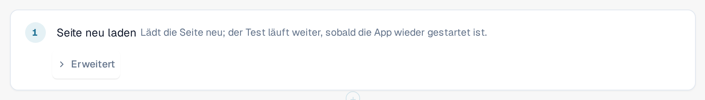

# Neu laden und fortsetzen

Manches lässt sich erst prüfen, nachdem die Seite neu geladen wurde, zum Beispiel dass eine Einstellung nach dem Neuladen noch da ist.
Der Schritt **Seite neu laden** lädt die Browser-Seite mitten im Test neu, und der Test läuft danach weiter.

## Einen Neuladen-Schritt hinzufügen

1. Wählen Sie im Template-Editor **+ Schritt hinzufügen**, dann die Gruppe **Seite** und **Seite neu laden**.
2. Setzen Sie den Schritt dorthin, wo neu geladen werden soll. Schritte danach laufen in der neu geladenen Seite.

<figure><figcaption>
Der Schritt Seite neu laden im Template-Editor
</figcaption></figure>

## Was während eines Laufs passiert

1. Der Tab sichert den Fortschritt des Tests und lädt die Seite neu.
2. Während die Anwendung neu startet, sagt ein Hinweis oben **Seite neu geladen, der Test läuft weiter**, gefolgt vom Namen des Tests.
   Schließen Sie den Tab nicht.
3. Die neu geladene Seite übernimmt den Lauf wieder und macht mit dem nächsten Schritt weiter. Die Schritte vor dem Neuladen behalten
   ihre Ergebnisse, der Schritt **Seite neu laden** wird als bestanden gezeigt, und die Uhr des Tests läuft während des Neuladens weiter.

<figure><figcaption>
Hinweis nach dem Neuladen: Seite neu geladen, der Test läuft weiter
</figcaption></figure>

Gemerkte Werte bleiben über das Neuladen erhalten, außer Werte, die Sie als geheim markiert haben (siehe
[Schritte und fertige Bausteine](steps-and-blocks.md)). Achten Sie darauf, dass kein Schritt nach dem Neuladen einen geheimen Wert braucht.

## Gut zu wissen

* Nur dieser Schritt lädt die Seite neu, ohne den Test zu beenden. Wenn Sie den Tab selbst neu laden oder schließen, endet der Lauf
  als **Abgebrochen**.
* Die Seite muss innerhalb von etwa zwei Minuten zurückkommen. Sonst endet der Lauf als **Abgebrochen** oder **Nicht zustellbar**.
* Ein Test kann bis zu fünf Neuladen-Schritte enthalten.
* Der Test läuft im selben Browser-Tab und mit demselben Benutzer weiter. Erlaubt der Browser dem Tab nicht, den Fortschritt zu sichern
  (zum Beispiel weil der Speicher blockiert ist), schlägt der Neuladen-Schritt fehl, bevor die Seite neu geladen wird.
* Der Test braucht Template-Schema 1.3; der Editor setzt es, wenn Sie den Schritt hinzufügen.
