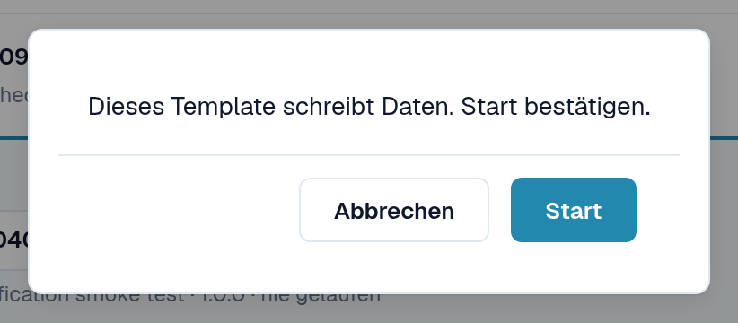
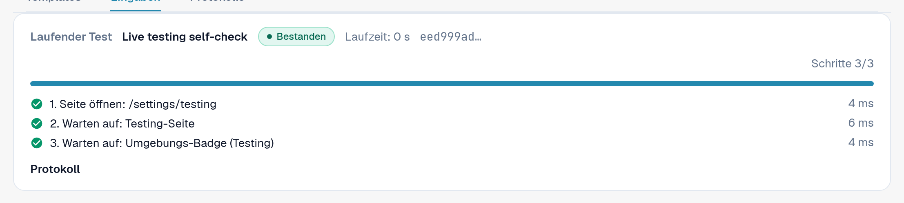
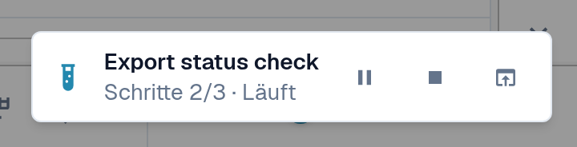
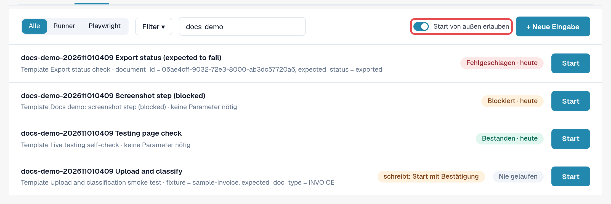
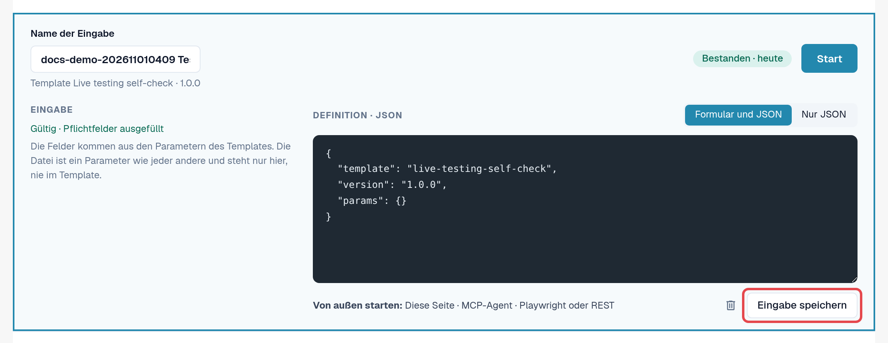

# Test starten

Ein Test ist ein Template plus eine Eingabe. Das Testing-Modul führt ihn aus und steuert ihn; Sie wählen, wie er startet.
Die drei Wege sind gleichwertig, und jeder Lauf landet in den [Protokollen](logs.md).

| Weg | Wann | In den Protokollen als |
|---|---|---|
| **Im Browser** | Sie wollen eine Prüfung jetzt ausführen und zusehen. | **Seite** |
| **KI-Assistent (MCP)** | Sie arbeiten mit einem an DocBits angebundenen KI-Assistenten, der Prüfungen starten und auswerten soll. | **MCP-Agent** |
| **Von außen (Playwright oder REST)** | Ihre Testautomatisierung oder CI-Pipeline startet Prüfungen, etwa nach einem Deployment. | **Playwright** |

In jedem Fall wird in einem **DocBits-Browser-Tab eines Organisations-Admins** geklickt, mit dessen Rechten. Der Tab muss
offen bleiben; Neuladen oder Schließen beendet den Lauf. Einzige Ausnahme ist ein Schritt **Seite neu laden** des Tests selbst
(siehe [Neu laden und fortsetzen](reload-and-resume.md)).

## Im Browser starten

1. Öffnen Sie **Einstellungen → Testing**, Reiter **Eingaben**.
2. Wählen Sie **Start** bei der Eingabe (oder öffnen Sie die Eingabe und wählen Sie **Start**).
3. Ändert das Template Daten, fragt DocBits: *Dieses Template schreibt Daten. Start bestätigen.* Wählen Sie **Start**, um fortzufahren.
4. Der Test läuft in diesem Tab. Auf der Seite Testing zeigt der Bereich **Laufender Test** Status, **Aktuelle Aktion**,
   Fortschritt sowie **Pausieren**, **Fortsetzen** und **Stoppen**. Öffnet der Test eine andere Seite, zeigt dort eine kleine
   Anzeige unten rechts den Fortschritt. Ist der Test fertig, zeigt die Anzeige das Ergebnis mit **Protokoll öffnen**
   und **Ausblenden**.
5. Ist der Test fertig, lesen Sie das Ergebnis im Reiter **Protokolle**.

<figure><figcaption>
Rückfrage vor einem Test, der Daten schreibt.
</figcaption></figure>

<figure><figcaption>
Bereich Laufender Test nach einem bestandenen Lauf.
</figcaption></figure>

<figure><figcaption>
Laufanzeige unten rechts auf einer anderen Seite.
</figcaption></figure>


**Uploads während eines Tests:** Hat Ihre Organisation Unterorganisationen und zeigt das Dashboard alle an, fragt der Upload-Dialog
normalerweise, zu welcher Unterorganisation das Dokument gehört. Während ein Test läuft, geht der Upload ohne Rückfrage an die **erste
Unterorganisation, die der Dialog anbietet**. Um in eine bestimmte Unterorganisation hochzuladen, starten Sie den Test aus der Ansicht
dieser Unterorganisation.


## Start von außen erlauben

Ein KI-Assistent oder ein Playwright-Skript kann nicht selbst klicken; es bittet DocBits, einen Test **in einem von Ihnen
registrierten Browser-Tab** auszuführen:

1. Öffnen Sie **Einstellungen → Testing**, Reiter **Eingaben**, in dem Browser-Tab, der die Tests ausführen soll.
2. Schalten Sie **Start von außen erlauben** ein. Der Tab nimmt jetzt Starts an und zeigt seine Sitzungs-ID.
3. Lassen Sie den Tab offen. Die Registrierung endet, wenn der Tab neu geladen oder geschlossen wird.

<figure><figcaption>
Start von außen erlauben eingeschaltet, mit Sitzungs-ID.
</figcaption></figure>

Der Eingabe-Editor erinnert unter **Von außen starten:** an die drei Wege **Diese Seite**, **MCP-Agent** und **Playwright oder REST**.

<figure><figcaption>
Zeile Von außen starten im Eingabe-Editor.
</figcaption></figure>

## Über einen KI-Assistenten starten (MCP)

Wenn Ihr KI-Assistent mit DocBits verbunden ist (siehe die Seite *DocBits MCP* in diesem Handbuch; deutschen Link beim
PR aus der Live-Navigation übernehmen):

1. Erlauben Sie in einem Browser-Tab den Start von außen (siehe oben).
2. Bitten Sie den Assistenten zum Beispiel: *„Zeig mir meine DocBits-Testeingaben und starte ‚Rechnung LT-2026-0001 bereit zur
   Validierung' in meinem registrierten Browser-Tab. Sag mir danach das Ergebnis."*
3. Sind mehrere Tabs registriert, fragt der Assistent, welcher genutzt werden soll; vor einem Test, der Daten ändert, fragt er
   Sie um Erlaubnis. Danach liest er das Protokoll und meldet das Ergebnis.

## Mit Playwright oder einem anderen Werkzeug starten (REST)

Ihre Testautomatisierung startet eine Eingabe mit einem API-Aufruf und liest danach ihr Protokoll. Sie braucht:

* ein Token eines Organisations-Admins der Organisation;
* die ID der Eingabe;
* die Sitzungs-ID eines Browser-Tabs mit eingeschaltetem **Start von außen erlauben**.

Aufruf und Beispiel stehen auf der Seite [Für Entwickler](for-developers.md).

## Kundenumgebungen

In Sandbox und Produktion ist die Anzeige **Umgebung** rot. Tests, die Daten ändern, brauchen bei jedem Start eine
ausdrückliche Bestätigung, und Export-, Lösch- oder Freigabeschritte sind gesperrt, solange das Template nicht erklärt, dass
es Daten schreibt. Führen Sie schreibende Tests möglichst in einer Testumgebung aus.
