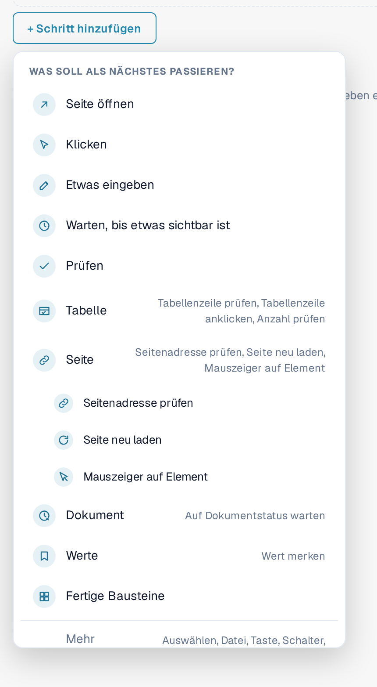
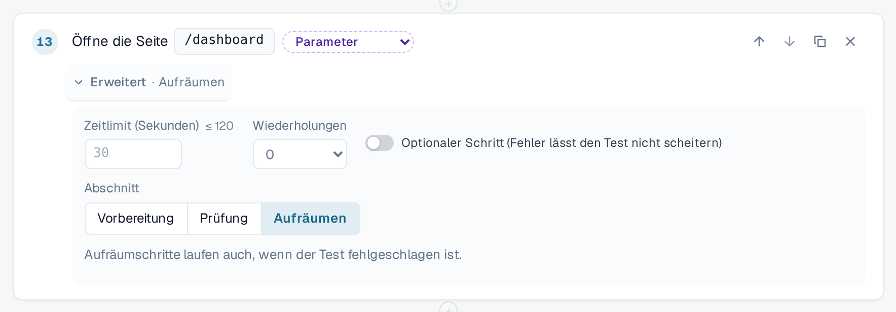
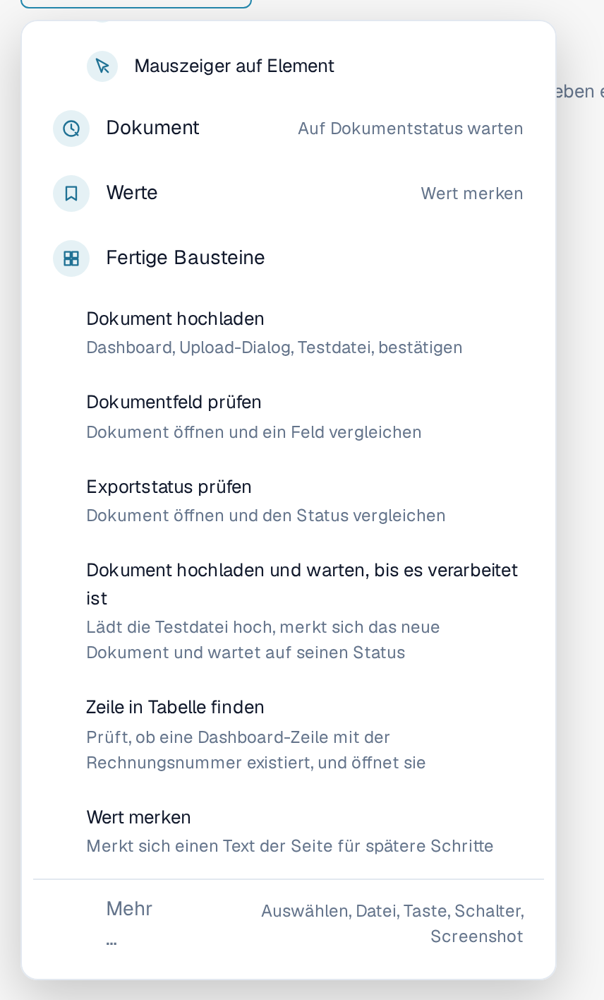
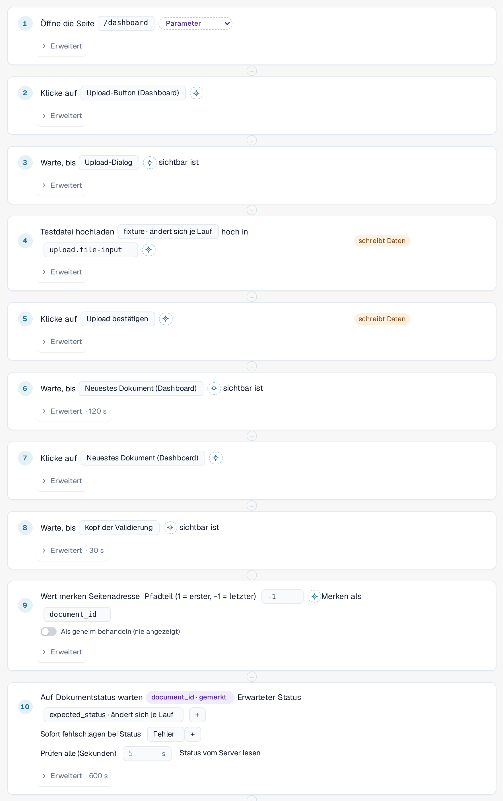
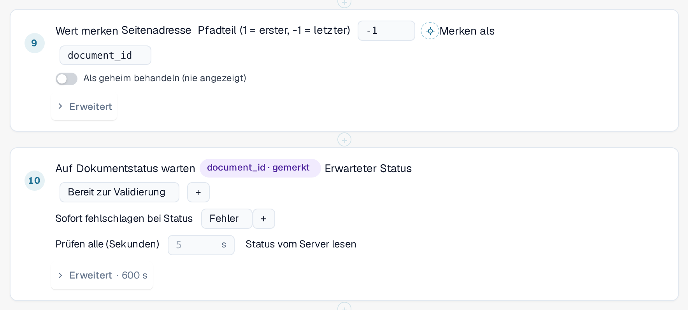
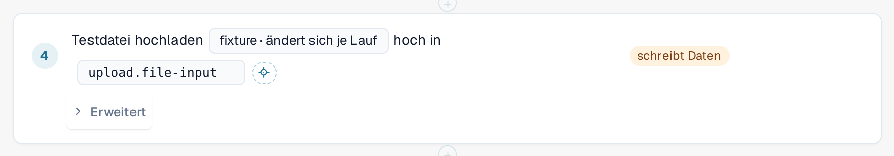

# Schritte und fertige Bausteine

Diese Seite erklärt, wie Sie im Editor ein Template aufbauen ([Templates](templates.md)): die Schrittgruppen, die
**Erweitert**-Einstellungen eines Schritts, die fertigen Bausteine und wie ein Test Werte von einem Schritt an den nächsten weitergibt.

## Schritt hinzufügen

Wählen Sie im Template-Editor **+ Schritt hinzufügen**. Das Menü **Was soll als Nächstes passieren?** listet die Schritte auf.
Die fünf Grundschritte sind **Seite öffnen**, **Klicken**, **Etwas eingeben**, **Warten, bis etwas sichtbar ist** und **Prüfen**.
Vier **Gruppen** enthalten die spezielleren Schritte. Wählen Sie eine Gruppe, um ihre Schritte zu sehen:

| Gruppe | Schritte |
|---|---|
| **Tabelle** | **Tabellenzeile prüfen**, **Tabellenzeile anklicken**, **Anzahl prüfen**. Für Listen wie die Dokumentliste im Dashboard. |
| **Seite** | **Seitenadresse prüfen**, **Seite neu laden** (siehe [Neu laden und fortsetzen](reload-and-resume.md)), **Mauszeiger auf Element**. |
| **Dokument** | **Auf Dokumentstatus warten**: wartet, bis ein Dokument einen Status erreicht, zum Beispiel *Bereit zur Validierung*. |
| **Werte** | **Wert merken**: behält einen Text der Seite für spätere Schritte. |

**Fertige Bausteine** fügen mehrere Schritte auf einmal hinzu (siehe unten). **Mehr …** bietet weitere Schritte: eine Option
auswählen, eine Datei hochladen, eine Taste drücken, einen Schalter umlegen und einen Screenshot aufnehmen
(Screenshot-Schritte überspringt der Runner im Browser).

<figure><figcaption>
Menü Schritt hinzufügen mit den Gruppen Tabelle, Seite, Dokument und Werte; die Gruppe Seite ist geöffnet
</figcaption></figure>

Um einen Schritt auf ein Element der Seite zu richten, wählen Sie es in der Liste oder nutzen Sie **In der App auswählen**
([Element in der App auswählen](pick-in-app.md)).

## Erweiterte Einstellungen eines Schritts

Jeder Schritt hat eine Zeile **Erweitert**. Wählen Sie sie, um die Einstellungen dieses Schritts zu öffnen. Die eingeklappte Zeile
zeigt, was Sie geändert haben, zum Beispiel *Erweitert · 120 s* oder *Erweitert · Aufräumen*.

| Einstellung | Bedeutung |
|---|---|
| **Zeitlimit (Sekunden)** | Wie lange der Schritt dauern darf, höchstens 120 Sekunden. Lassen Sie das Feld leer, gilt der Standard von 30 Sekunden. Schritte, die auf ein Dokument warten, haben ein eigenes, längeres Limit. |
| **Wiederholungen** | Wie oft DocBits den Schritt wiederholt, wenn er fehlschlägt (0 bis 3). |
| **Optionaler Schritt (Fehler lässt den Test nicht scheitern)** | Schlägt der Schritt fehl, zeigt das Protokoll ihn als übersprungen mit seinem Fehler, und der Test läuft weiter. |
| **Abschnitt** | **Vorbereitung**, **Prüfung** oder **Aufräumen**. Standard ist **Prüfung**. |

**Vorbereitung**-Schritte richten den Test ein. **Prüfung**-Schritte sind der Test selbst. **Aufräumen**-Schritte entfernen, was der Test
hinterlassen hat, zum Beispiel ein hochgeladenes Dokument. **Aufräumschritte laufen auch, wenn der Test fehlgeschlagen ist** oder die
Zeit überschritten hat, und ein fehlgeschlagener Aufräumschritt ändert das Ergebnis des Tests nie. Sie müssen die letzten Schritte des
Templates sein; der Editor meldet einen Fehler, wenn nach einem Aufräumschritt ein normaler Schritt folgt. Sie laufen nicht, wenn Sie den
Test stoppen oder den Tab schließen. Ein Template mit Aufräumschritten wird als Schema 1.3 gespeichert (siehe [Für Entwickler](for-developers.md)).

<figure><figcaption>
Erweiterte Einstellungen eines Schritts: Zeitlimit, Wiederholungen, optionaler Schritt und Abschnitt, mit ausgewähltem Aufräumen
</figcaption></figure>

## Fertige Bausteine

Wählen Sie **+ Schritt hinzufügen** und dann **Fertige Bausteine**. Ein Baustein fügt die Schritte einer häufigen Abfolge zusammen mit den
Parametern hinzu, die er braucht. Alle Schritte lassen sich danach ändern.

| Baustein | Was er hinzufügt |
|---|---|
| **Dokument hochladen** | Öffnet das Dashboard, öffnet den Upload-Dialog, wählt die Testdatei und bestätigt. |
| **Dokumentfeld prüfen** | Öffnet ein Dokument und vergleicht ein Feld mit einem erwarteten Wert. |
| **Exportstatus prüfen** | Öffnet ein Dokument und vergleicht seinen Status. |
| **Dokument hochladen und warten, bis es verarbeitet ist** | Lädt die Testdatei hoch, merkt sich das neue Dokument und wartet auf seinen Status. |
| **Zeile in Tabelle finden** | Prüft, ob in der Dashboard-Liste eine Zeile mit einer bestimmten Rechnungsnummer existiert, und öffnet sie. |
| **Wert merken** | Merkt sich einen Text der Seite für spätere Schritte. |

<figure><figcaption>
Fertige Bausteine im Menü Schritt hinzufügen
</figcaption></figure>

### Dokument hochladen und warten, bis es verarbeitet ist

Nutzen Sie diesen Baustein, wenn ein späterer Schritt das Dokument braucht, das der Test eben hochgeladen hat. Der Baustein erkennt das neue
Dokument selbst und nicht an der obersten Zeile der Liste; ein älteres Dokument wird also nie versehentlich gewählt. Dann liest er die
Dokument-ID aus der Seitenadresse und wartet, bis das Dokument den erwarteten Status erreicht (Standard *Bereit zur Validierung*, bis zu
10 Minuten; er bricht sofort ab, wenn das Dokument den Status *Fehler* erhält). Er fügt die Eingabewerte **fixture** (die Testdatei) und
**expected_status** hinzu und erhöht die Zeit des gesamten Tests auf mindestens 15 Minuten.

<figure><figcaption>
Schritte des Bausteins Dokument hochladen und warten, bis es verarbeitet ist
</figcaption></figure>


**Wohin Uploads gehen:** Hat Ihre Organisation Unterorganisationen und zeigt das Dashboard alle an, fragt der Upload-Dialog
normalerweise, zu welcher Unterorganisation das Dokument gehört. Ein Test kann diese Frage nicht beantworten. Solange ein Test im Tab
läuft, geht der Upload ohne Rückfrage an die **erste Unterorganisation, die der Dialog anbietet**. Außerhalb eines Tests ändert sich
nichts. Um in eine bestimmte Unterorganisation hochzuladen, starten Sie den Test aus der Ansicht dieser Unterorganisation.


### Zeile in Tabelle finden

Der Baustein prüft, ob die Dashboard-Liste eine Zeile mit der angegebenen Rechnungsnummer (Eingabewert **row_value**) hat, und öffnet sie.
Um nach einer anderen Spalte zu suchen, ändern Sie Spalte und Wert im Schritt. Beide Schritte gehören zur Gruppe **Tabelle**;
**Anzahl prüfen** zählt Zeilen oder beliebige andere Elemente.

## Einen Wert merken und später verwenden

Ein Test braucht oft einen Wert, den es nur während des Laufs gibt, zum Beispiel die ID eines Dokuments, das er gerade hochgeladen hat.

1. Fügen Sie **Wert merken** hinzu (Gruppe **Werte**). Wählen Sie, woher der Wert kommt: ein Text der Seite, die Seitenadresse (ein Teil des
   Pfads oder ein Abfrageparameter) oder eine Zelle einer Tabellenzeile. Geben Sie unter **Merken als** einen Namen ein, zum Beispiel
   `document_id`. Schalten Sie **Als geheim behandeln (nie angezeigt)** ein, wenn der Wert nirgends erscheinen darf.
2. Wählen Sie in einem späteren Schritt den gemerkten Wert, statt einen einzutippen. Der Schritt zeigt dann einen Chip wie
   *document_id · gemerkt*. Im Template-JSON steht er als `{{vars.document_id}}`.

Zwei Arten von Werten lassen sich in einem Schritt nutzen:

| Art | Schreibweise | Woher | Beispiel |
|---|---|---|---|
| **Eingabe** | `{{params.name}}` | Aus der gespeicherten [Eingabe](inputs.md): Sie ist bei jedem Lauf dieser Eingabe gleich. Anlegen mit dem Parameter-Knopf neben einem Wert. | *fixture · ändert sich je Lauf* |
| **Gemerkter Wert** | `{{vars.name}}` | Aus einem früheren Schritt **Wert merken** desselben Laufs. | *document_id · gemerkt* |

<figure><figcaption>
Wert merken speichert die Dokument-ID; der nächste Schritt wartet auf dieses Dokument
</figcaption></figure>

<figure><figcaption>
Ein Schritt, der den Eingabewert fixture verwendet
</figcaption></figure>

Ein gemerkter Wert existiert nur für den aktuellen Lauf und wird nie im Template oder im Protokoll gespeichert. Gemerkte Werte bleiben
über ein [Neuladen der Seite](reload-and-resume.md) im Test erhalten, außer sie sind als geheim markiert.
