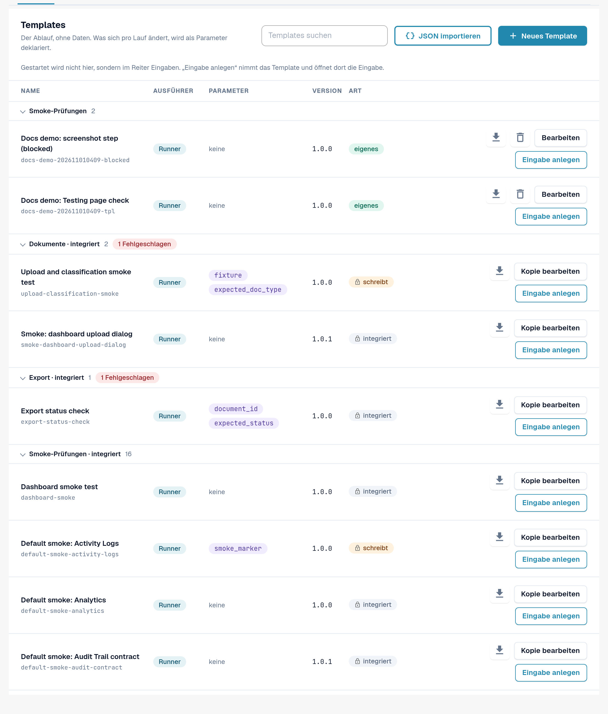
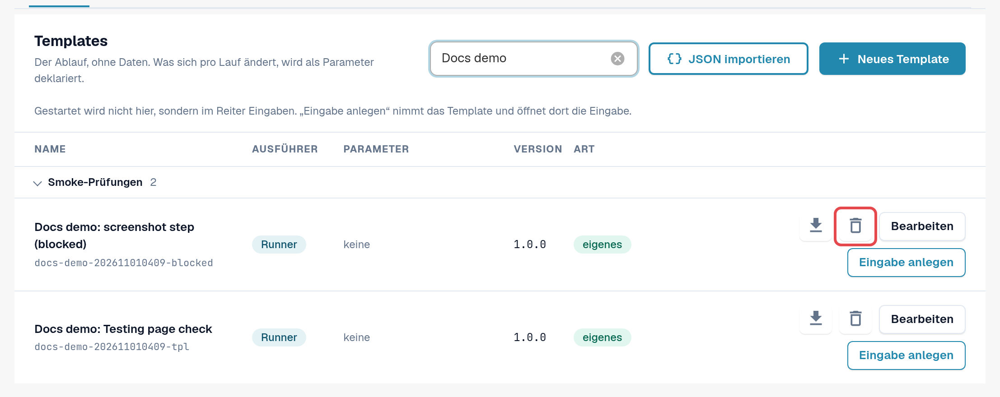
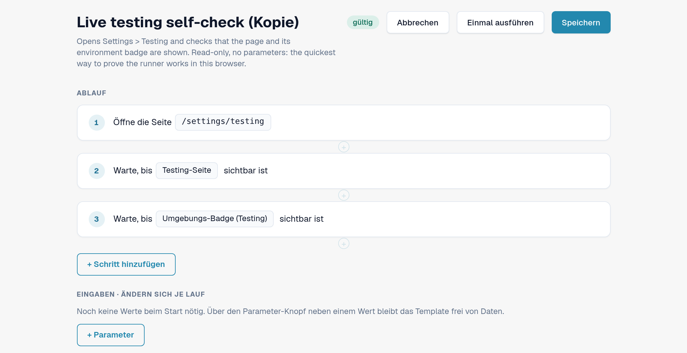
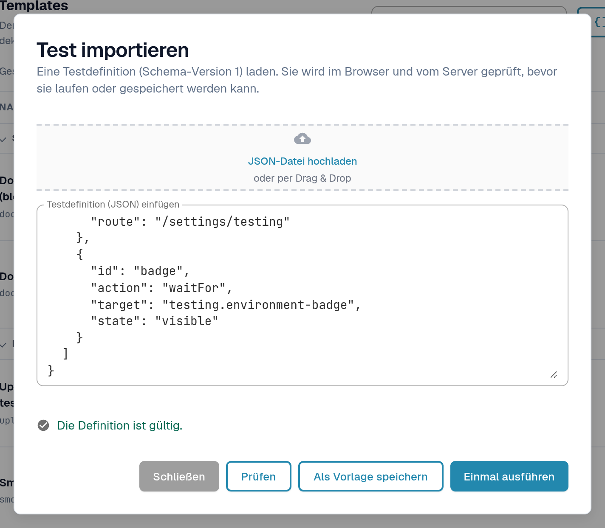
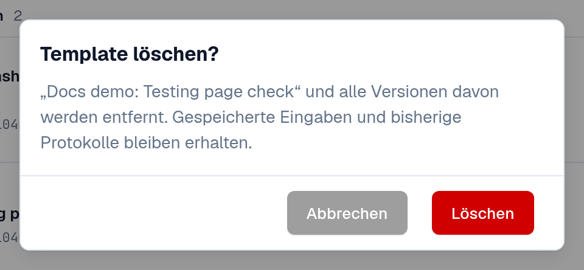

# Templates

Ein Template beschreibt, **was** geprüft wird: welche Seite sich öffnet, was angeklickt oder ausgefüllt wird und was am
Ende sichtbar oder wahr sein muss. Es enthält keine Daten Ihrer Organisation. Werte, die je Organisation oder je Lauf
anders sind, etwa eine Dokument-ID, sind **Parameter**; sie kommen aus einer [Eingabe](inputs.md).

Öffnen Sie **Einstellungen → Testing**, Reiter **Templates**.

<figure><figcaption>
Reiter Templates: Gruppen, Spalten und Aktionen.
</figcaption></figure>

## Die Liste lesen

Templates sind nach Kategorien gruppiert (zum Beispiel **Smoke-Prüfungen**, **Validierung**, **Dokumente**, **Export**).
Ein Klick auf den Gruppennamen klappt die Gruppe ein; ein roter Chip zählt Templates, deren letzter Lauf fehlgeschlagen
ist. **Templates suchen** filtert nach Namen.

| Spalte | Bedeutung |
|---|---|
| **Name** | Name des Templates, darunter seine ID. |
| **Ausführer** | **Runner**: läuft von dieser Seite aus in Ihrem Browser-Tab. **Playwright**: eine Prüfung Ihrer Testautomatisierung; sie lässt sich hier dokumentieren, aber nicht starten. |
| **Parameter** | Die Werte, die eine Eingabe liefern muss. *keine* heißt: Das Template läuft, wie es ist. |
| **Version** | Gespeicherte Versionen ändern sich nie. Eine Änderung wird als neue Version gespeichert. |
| **Art** | **integriert** (Schloss): Teil des Standardsatzes, für alle Organisationen gleich, nur lesbar. **eigenes**: Template Ihrer Organisation. **schreibt**: Das Template ändert Daten (lädt z. B. ein Dokument hoch) und braucht vor dem Start eine Bestätigung. |

Aktionen in der Zeile:

| Aktion | Wirkung |
|---|---|
| Download-Symbol (**Als JSON exportieren**) | Lädt die Templatedefinition als JSON-Datei herunter, etwa zum Aufbewahren oder zum Import in eine andere Organisation. |
| **Kopie bearbeiten** (integriert) / **Bearbeiten** (eigenes) | Öffnet den Template-Editor mit einer Kopie, die Sie ändern und als eigenes Template speichern. |
| **Eingabe anlegen** | Öffnet den Reiter [Eingaben](inputs.md) mit einer neuen Eingabe für dieses Template. Gestartet wird dort, nicht hier. |
| Papierkorb-Symbol (**Template löschen**) | Nur bei eigenen Templates, siehe *Eigenes Template löschen* weiter unten. |

<figure><figcaption>
Eine Standardzeile und eine eigene Zeile mit ihren Aktionen.
</figcaption></figure>

## Eigenes Template anlegen

Ein eigenes Template brauchen Sie, wenn kein Standard prüft, was Sie brauchen, oder wenn Sie eine geänderte Kopie eines Standards möchten.

**Von einem Standard aus:** in seiner Zeile **Kopie bearbeiten** wählen. **Leer beginnen:** **Neues Template** wählen.

Im Template-Editor:

1. Geben Sie den **Namen des Templates** ein und optional, wofür es da ist.
2. Wählen Sie **+ Schritt hinzufügen** und einen Baustein, zum Beispiel **Seite öffnen**, **Klicken**, **Ausfüllen**,
   **Auswählen**, **Warten auf**, **Text prüfen**, **Feld prüfen** oder **Status prüfen**. **Fertige Bausteine** fügen einen
   üblichen Ablauf auf einmal ein, etwa **Dokument hochladen** oder **Dokument hochladen und warten, bis es verarbeitet ist**. Die Schrittgruppen, die
   **Erweitert**-Einstellungen und die Aufräumschritte beschreibt [Schritte und fertige Bausteine](steps-and-blocks.md).
3. Machen Sie jeden Wert, der je Organisation oder Lauf anders ist, über die Parameter-Schaltfläche neben dem Wert zum
   Parameter. Er erscheint unter **Eingaben · ändern sich je Lauf**, mit Typ (**Text**, **Zahl**, **Ja/Nein**,
   **Server-Testdatei**), **Standardwert** und **Pflicht**, wenn er ausgefüllt werden muss.
4. Wählen Sie **Speichern**. Um den Entwurf einmal ohne Speichern zu testen, wählen Sie **Einmal ausführen**.

Um das Element eines Schritts durch Zeigen in der Anwendung zu wählen, nutzen Sie **In der App auswählen**
([Element in der App auswählen](pick-in-app.md)).

Schritte, die Daten ändern (etwa ein Dokument hochladen), sind mit **schreibt Daten** markiert. Ein Template mit solchen
Schritten fragt bei jedem Start nach einer Bestätigung.

<figure><figcaption>
Template-Editor mit zwei Schritten und einem Parameter.
</figcaption></figure>

Hat inzwischen jemand dieselbe Version dieses Templates gespeichert (zum Beispiel in einem anderen Tab), behält DocBits
Ihren Entwurf und bietet **Als nächste freie Version speichern** oder **Neueste Version laden** an.

## Template aus JSON importieren

1. Wählen Sie **JSON importieren**.
2. Wählen Sie **JSON-Datei hochladen** oder fügen Sie die Definition in **Testdefinition (JSON) einfügen** ein.
3. Wählen Sie **Prüfen**. DocBits prüft die Definition im Browser und auf dem Server und listet Probleme auf.
4. Wählen Sie **Als Vorlage speichern**, um sie zu Ihren Templates hinzuzufügen, oder **Einmal ausführen**, um sie ohne Speichern zu testen.

<figure><figcaption>
Dialog Test importieren mit geprüfter Definition.
</figcaption></figure>

Das Format beschreibt die Seite [Für Entwickler](for-developers.md).

## Eigenes Template löschen

1. Wählen Sie in der Zeile Ihres eigenen Templates das Papierkorb-Symbol (**Template löschen**).
2. Lesen Sie die Rückfrage **Template löschen?** und wählen Sie **Löschen**.

Das Template und **alle seine Versionen** werden entfernt. Gespeicherte Eingaben und bisherige Protokolle bleiben
erhalten, der Verlauf bleibt also lesbar. Eingaben, die auf das Template zeigten, bleiben in der Liste; bearbeiten oder
löschen Sie sie. Ein Template mit derselben ID können Sie später wieder speichern. Integrierte und Standard-Templates
lassen sich nicht löschen.

<figure><figcaption>
Rückfrage Template löschen.
</figcaption></figure>
