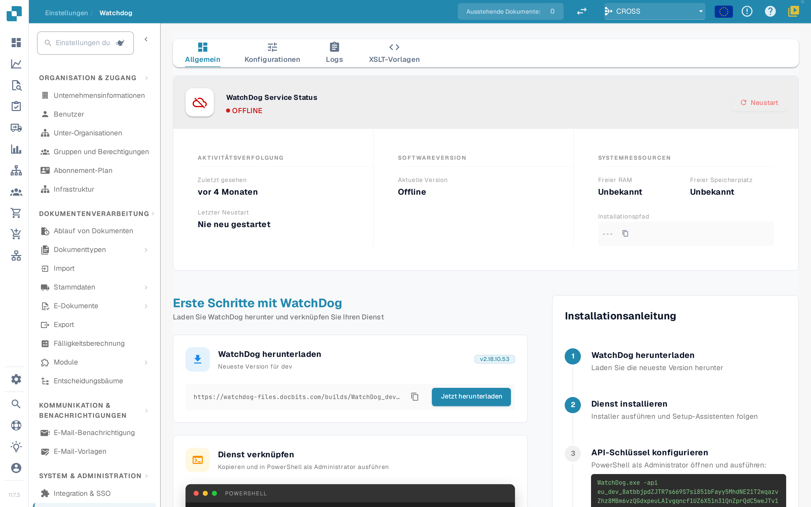
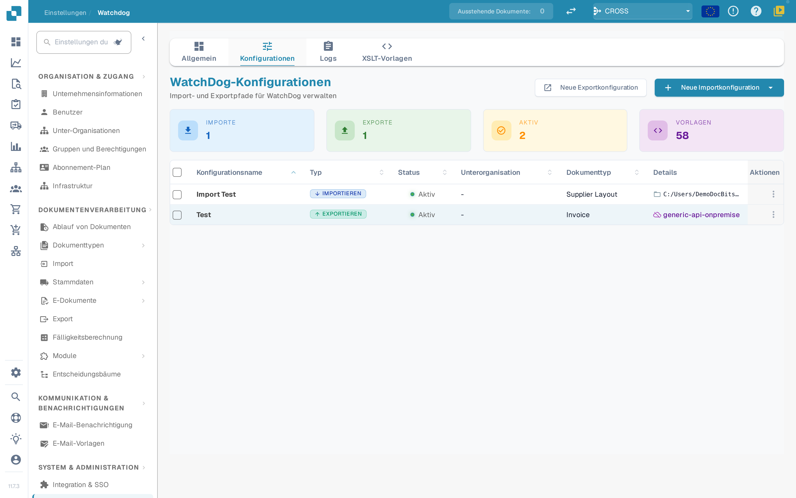
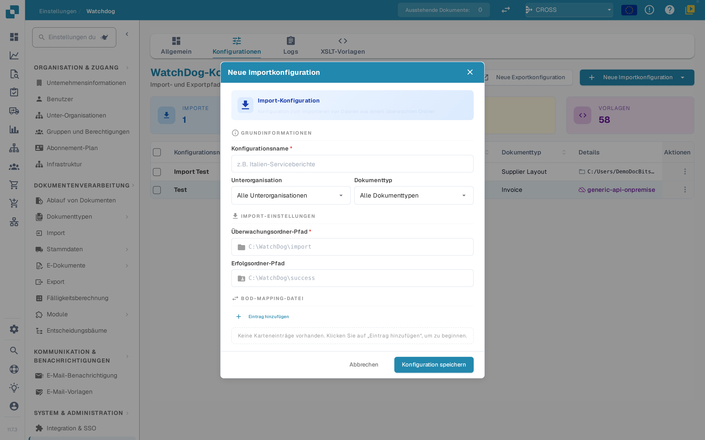
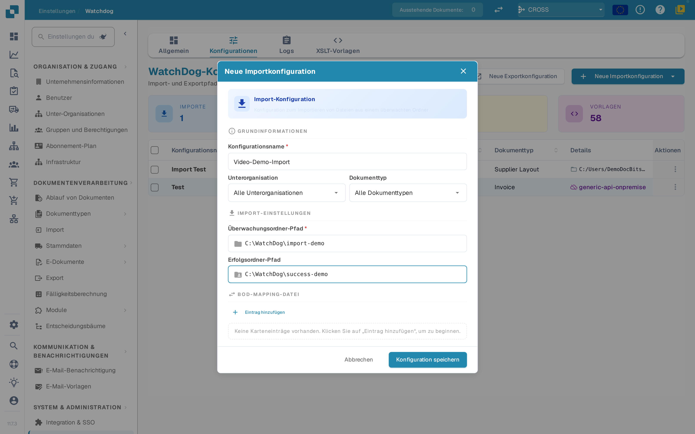
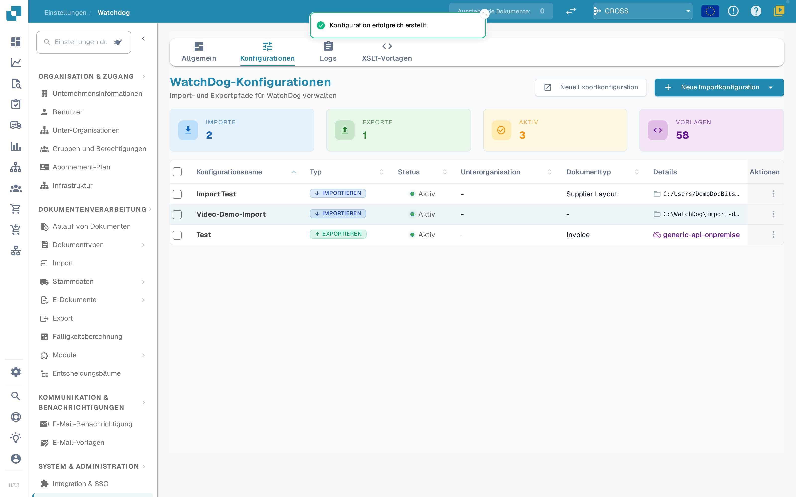
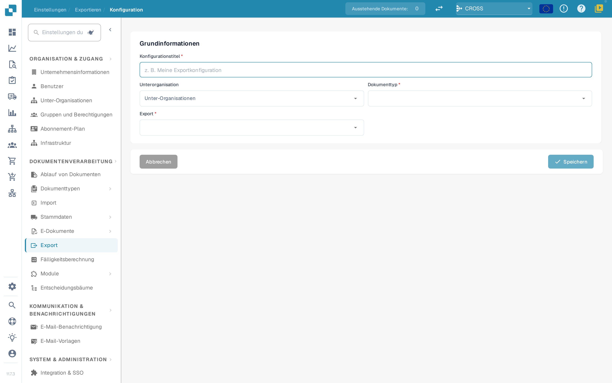
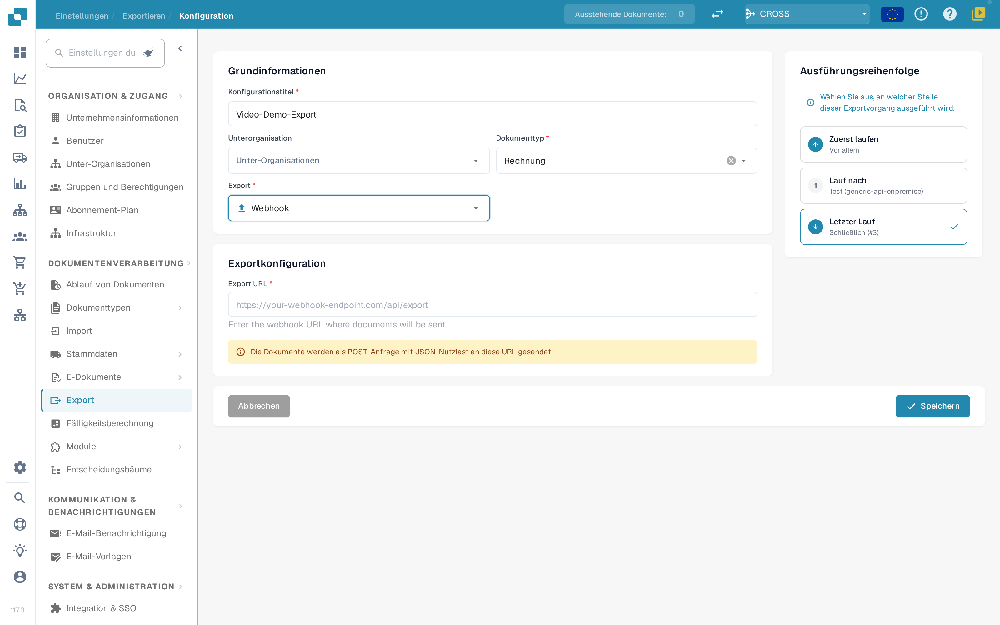
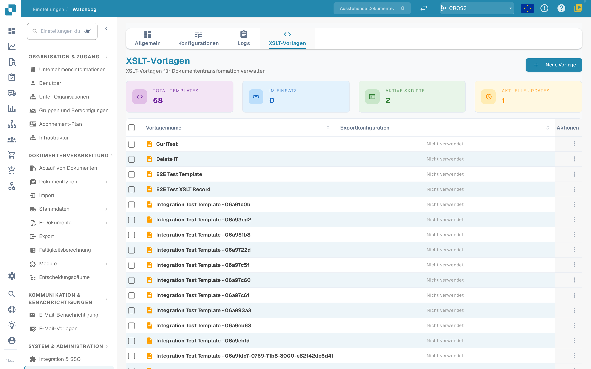
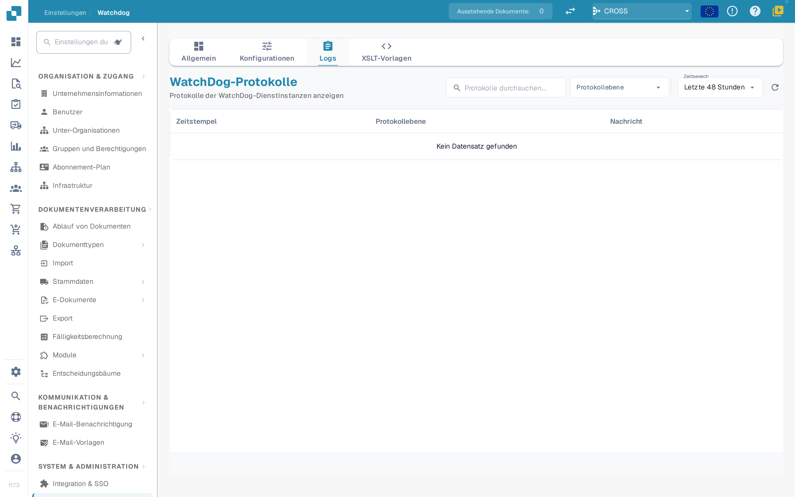

# WatchDog

<figure><figcaption></figcaption></figure>

<figure><figcaption></figcaption></figure>

**WatchDog** ist ein Windows-basierter On-Premise-Dienst, der lokale Ordner auf eingehende Dokumente überwacht, sie zur Verarbeitung in die DocBits Cloud hochlädt und fertig verarbeitete Dokumente in lokale Ordner oder ERP-Systeme zurückexportiert.

## Video-Anleitung



*1:44 Min. · Produktoberfläche auf Deutsch · Stimme und Einstiegsszene KI-generiert*

[Untertitel (VTT)](https://docbits-videos.fra1.cdn.digitaloceanspaces.com/product-tours/watchdog/2026-10-28/v1/de.vtt) · [Video herunterladen](https://docbits-videos.fra1.cdn.digitaloceanspaces.com/product-tours/watchdog/2026-10-28/v1/de.mp4)

## Hauptmerkmale

* **Automatische Ordnerüberwachung** — überwacht lokale Pfade und UNC-Netzwerkpfade auf neue PDFs
* **Unterstützung mehrerer Konfigurationen** — mehrere Import-/Export-Konfigurationen pro Instanz
* **6 Exportmethoden** — Local Folder, Infor IDM, Infor BOD, ION API, GLS840MI, REST API
* **Auto-Update** — automatische Versionsupdates mit Rollback bei Fehlern
* **Fernverwaltung** — Neustart, Update und Konfiguration über die DocBits-Oberfläche

## Schnellstart

<figure><figcaption></figcaption></figure>

### 1. WatchDog herunterladen

Laden Sie `WatchDog.exe` in der DocBits-Anwendung unter **Settings → Document Processing → WatchDog → General Tab** herunter.

### 2. Über den API-Schlüssel konfigurieren

Öffnen Sie die **Eingabeaufforderung als Administrator** und führen Sie Folgendes aus:

```powershell
WatchDog.exe -api YOUR_API_KEY
```

> **Hinweis:** Der API-Schlüssel steht in Ihren DocBits-Einstellungen auf der Registerkarte „General“ von WatchDog zur Verfügung. Er verbindet WatchDog mit Ihrer DocBits-Organisation.

### 3. Als Windows-Dienst installieren

```powershell
WatchDog.exe install
WatchDog.exe start
```

### 4. Konfigurationen in DocBits erstellen

Alle Import- und Export-Konfigurationen werden direkt in der **DocBits-Anwendung** erstellt:

**Settings → Document Processing → WatchDog → Configurations Tab**

* **Import Configurations** — definieren Überwachungsordner und Dokumenttypen
* **Export Configurations** — definieren Exportziele, XSLT-Vorlagen und Exportmethoden

> **Wichtig:** Export-Konfigurationen erfordern einen **Dokumenttyp** (`doc_type`). Konfigurationen ohne Dokumenttyp werden abgelehnt.

### 5. Autostart (optional)

So starten Sie WatchDog beim Systemstart automatisch:

1. Öffnen Sie die **Dienste** (`Win + R` → `services.msc`)
2. Suchen Sie **WatchDog** in der Liste
3. Setzen Sie den **Starttyp** auf **Automatisch (Verzögerter Start)**

## Befehlsreferenz

| Befehl | Beschreibung |
| :--- | :--- |
| `WatchDog.exe -api KEY` | API-Schlüssel konfigurieren und mit DocBits verbinden |
| `WatchDog.exe install` | Als Windows-Dienst installieren |
| `WatchDog.exe start` | Dienst starten |
| `WatchDog.exe stop` | Dienst beenden |
| `WatchDog.exe debug` | Zur Fehlersuche im Konsolenmodus ausführen |
| `WatchDog.exe --version` | Aktuelle Version anzeigen |
| `WatchDog.exe --list-folders` | Konfigurierte Überwachungsordner auflisten |
| `WatchDog.exe remove` | Dienst deinstallieren |

## Weitere Ressourcen

* [WatchDog-Installation](watchdog-installation.md)
* [WatchDog-Konfiguration](watchdog-v2-configuration.md)
* [WatchDog Admin-FAQ](watchdog-admin-faq.md)

## Bildschirmfotos

<figure><figcaption><p>Status und erste Schritte</p></figcaption></figure>

<figure><figcaption><p>Übersicht der Konfigurationen</p></figcaption></figure>

<figure><figcaption><p>Neue Importkonfiguration</p></figcaption></figure>

<figure><figcaption><p>Importkonfiguration ausgefüllt</p></figcaption></figure>

<figure><figcaption><p>Importkonfiguration gespeichert</p></figcaption></figure>

<figure><figcaption><p>Neue Exportkonfiguration</p></figcaption></figure>

<figure><figcaption><p>Exportkonfiguration mit Webhook als Ziel</p></figcaption></figure>

<figure><figcaption><p>XSLT-Vorlagen</p></figcaption></figure>

<figure><figcaption><p>XSLT-Vorlagen verwalten</p></figcaption></figure>

<figure><figcaption><p>WatchDog-Protokolle</p></figcaption></figure>
