# WatchDog

WatchDog est un service Windows qui surveille des dossiers, transmet les documents à DocBits et prend en charge les destinations d’exportation configurées. Les connexions, autorisations et méthodes doivent correspondre à votre environnement.

<figure>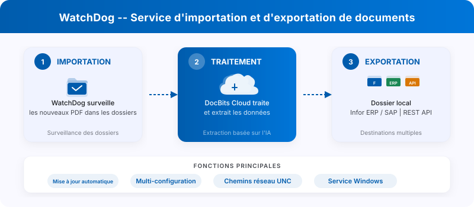<figcaption><p>WatchDog : surveillance des dossiers, traitement dans DocBits et destinations d’export.</p></figcaption></figure>

## Vidéo pas à pas



*1:51 min · Interface du produit en français · Voix et scène d'introduction générées par IA*

[Sous-titres (VTT)](https://docbits-videos.fra1.cdn.digitaloceanspaces.com/product-tours/watchdog/2026-10-28/v1/fr.vtt) · [Télécharger la vidéo](https://docbits-videos.fra1.cdn.digitaloceanspaces.com/product-tours/watchdog/2026-10-28/v1/fr.mp4)

## Démarrage rapide

### 1. Télécharger et préparer

Ouvrez **Paramètres → WatchDog → Général**. Utilisez le téléchargement et les instructions adaptés à votre environnement. Une version Dev illustrée n’est pas une recommandation de déploiement pour tous les environnements.

<figure><figcaption><p>Vue Général avec les quatre onglets actuels et l’état Hors ligne de l’environnement de test. La clé API, les commandes sensibles et le chemin d’installation sont masqués. Cette image ne prouve pas une installation ou une connexion réussie.</p></figcaption></figure>

### 2. Configurer la clé API

Dans un terminal administrateur, utilisez la clé autorisée de votre organisation et de votre environnement. Remplacez le marqueur d’exemple ; ne publiez pas une commande contenant une véritable clé.

```powershell
WatchDog.exe -api YOUR_API_KEY
```

### 3. Installer et démarrer le service Windows

```powershell
WatchDog.exe install
WatchDog.exe start
```

### 4. Créer les configurations

Dans **Configurations**, préparez les importations et les exportations. Les importations définissent les dossiers et le périmètre des documents ; les exportations définissent leur méthode et leur destination. Le type de document (`doc_type`) est obligatoire pour une configuration d’exportation.

La vue actuelle comprend **Général**, **Configurations**, **Journaux** et **Modèles XSLT**. Le statut du service figure dans Général ; les exportations ne constituent pas un onglet supplémentaire.

### 5. Définir le démarrage automatique

Si votre installation doit démarrer avec Windows, ouvrez `services.msc`, sélectionnez le service WatchDog et configurez le type de démarrage adapté. Vérifiez ensuite l’état, la communication récente et les journaux. La capture Hors ligne ne prouve pas une installation réussie.

## Référence des commandes

| Commande | Description |
| :--- | :--- |
| `WatchDog.exe -api KEY` | Configure la clé d'API et se connecte à DocBits |
| `WatchDog.exe install` | Installe en tant que service Windows |
| `WatchDog.exe start` | Démarre le service |
| `WatchDog.exe stop` | Arrête le service |
| `WatchDog.exe debug` | Exécute en mode console pour le dépannage |
| `WatchDog.exe --version` | Affiche la version actuelle |
| `WatchDog.exe --list-folders` | Liste les dossiers surveillés configurés |
| `WatchDog.exe remove` | Désinstalle le service |


## Ressources complémentaires

* [Installation de WatchDog](watchdog-installation.md)
* [Configuration de WatchDog](watchdog-v2-configuration.md)
* [FAQ administrateur et dépannage](watchdog-admin-faq.md)

## Captures d'écran

<figure>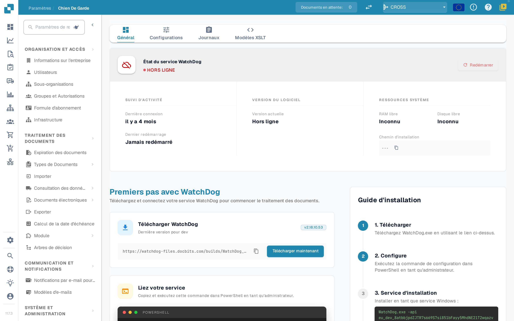<figcaption><p>État et premiers pas</p></figcaption></figure>

<figure>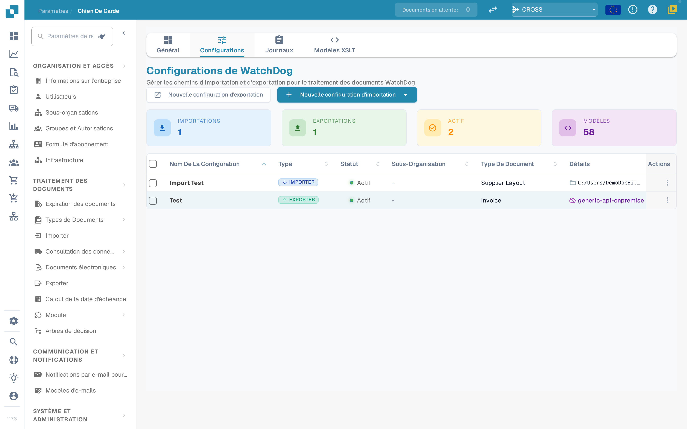<figcaption><p>Vue d'ensemble des configurations</p></figcaption></figure>

<figure>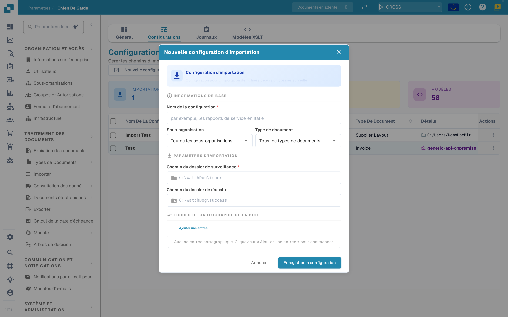<figcaption><p>Nouvelle configuration d'import</p></figcaption></figure>

<figure>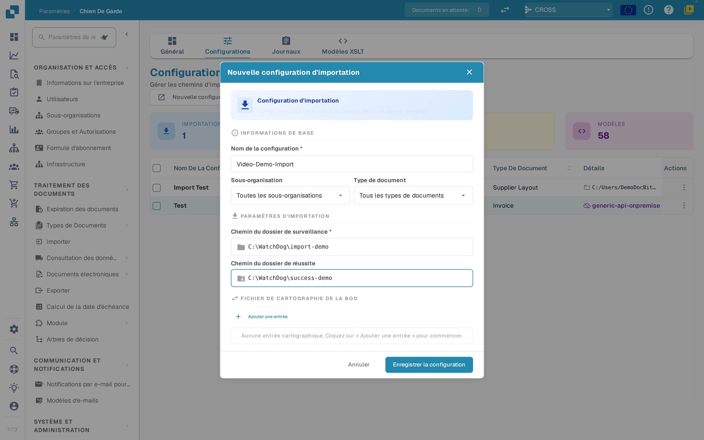<figcaption><p>Configuration d'import renseignée</p></figcaption></figure>

<figure>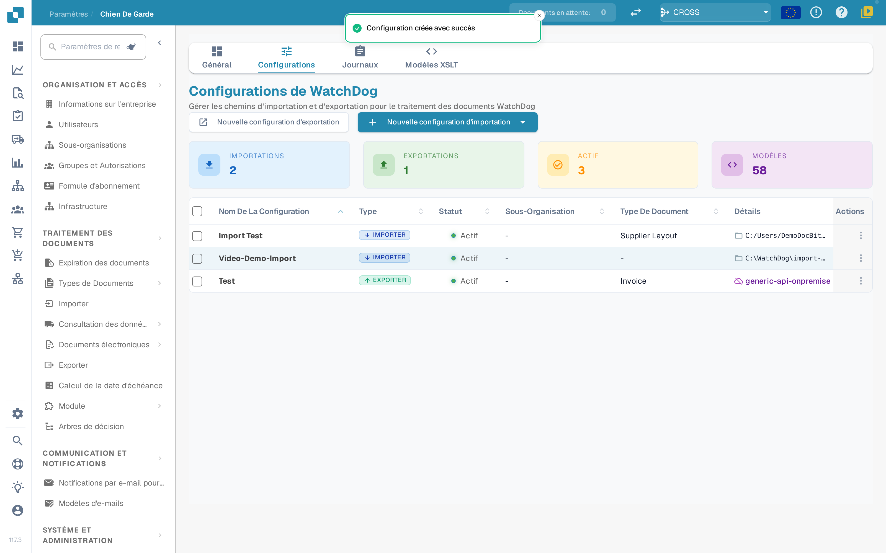<figcaption><p>Configuration d'import enregistrée</p></figcaption></figure>

<figure>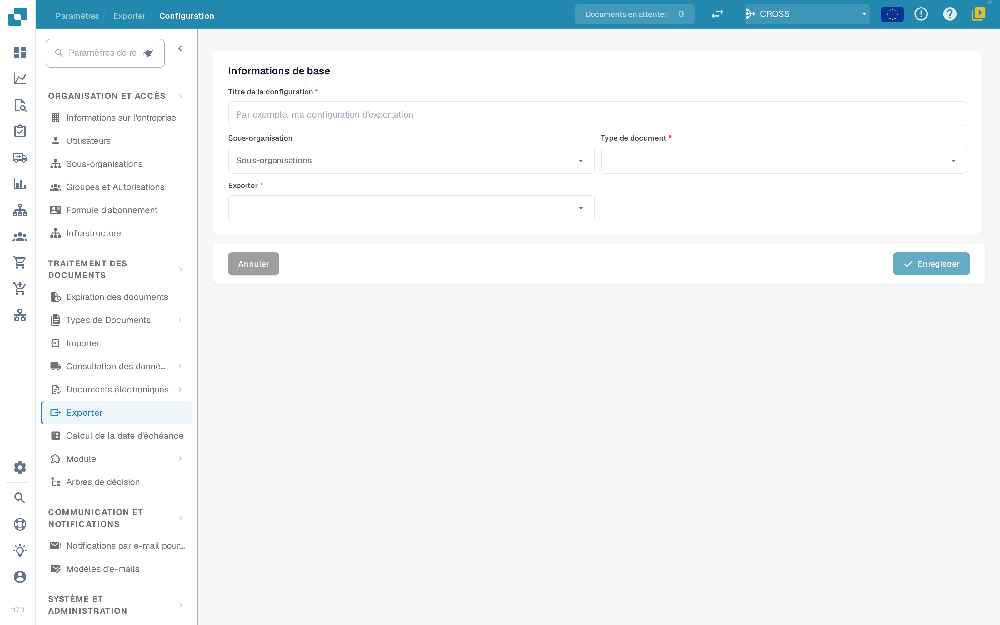<figcaption><p>Nouvelle configuration d'export</p></figcaption></figure>

<figure>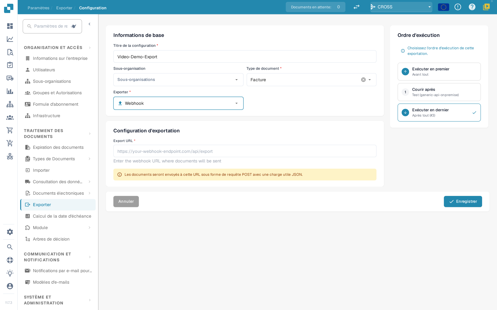<figcaption><p>Configuration d'export avec un webhook comme cible</p></figcaption></figure>

<figure>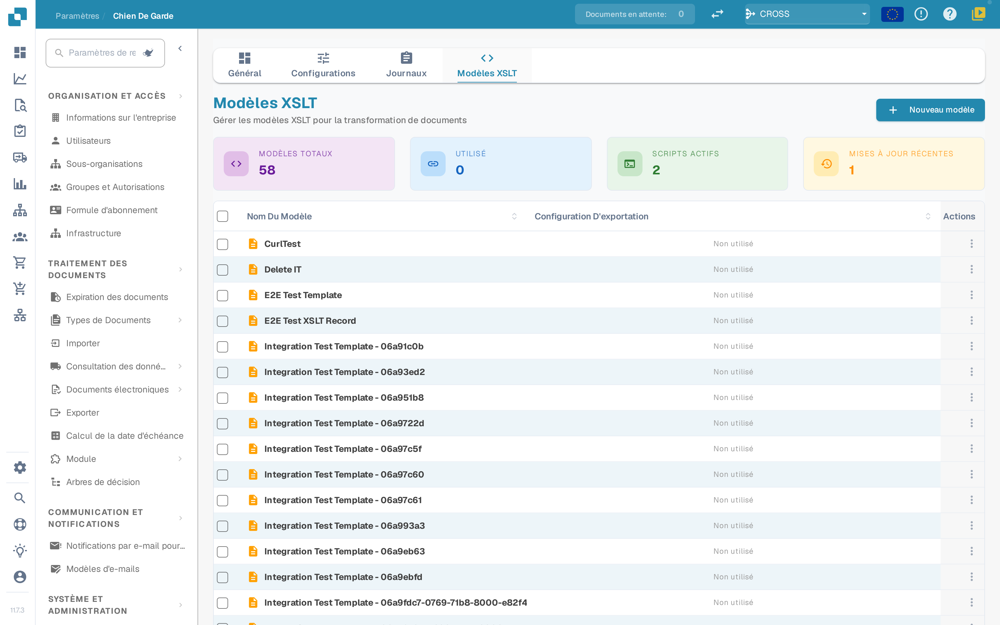<figcaption><p>Modèles XSLT</p></figcaption></figure>

<figure>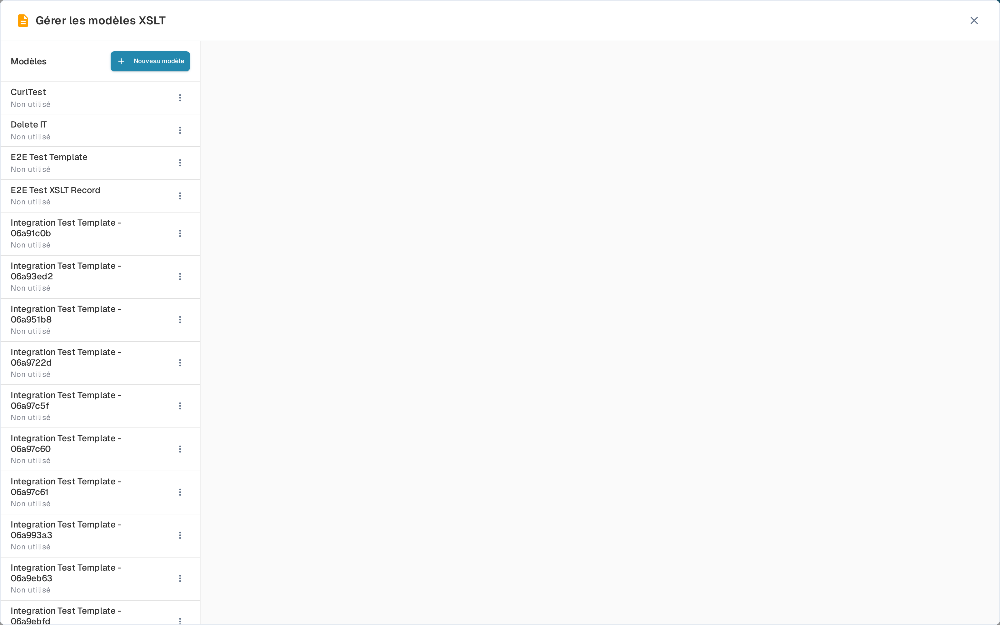<figcaption><p>Gérer les modèles XSLT</p></figcaption></figure>

<figure>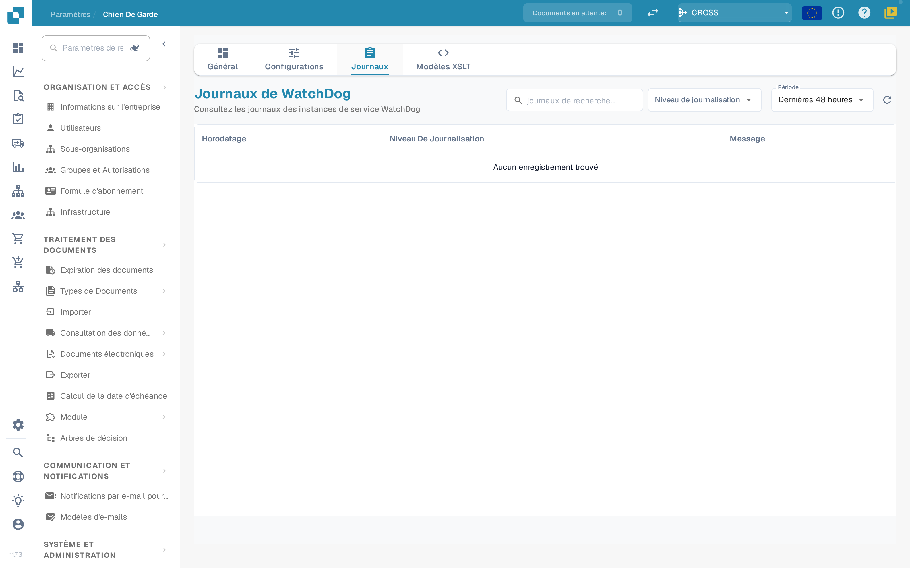<figcaption><p>Journaux de WatchDog</p></figcaption></figure>
