# WatchDog

<figure>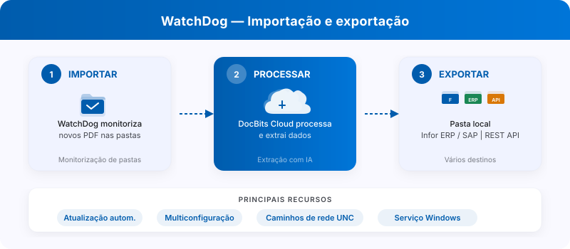<figcaption><p>WatchDog: monitorização de pastas, processamento no DocBits e destinos de exportação.</p></figcaption></figure>

<figure>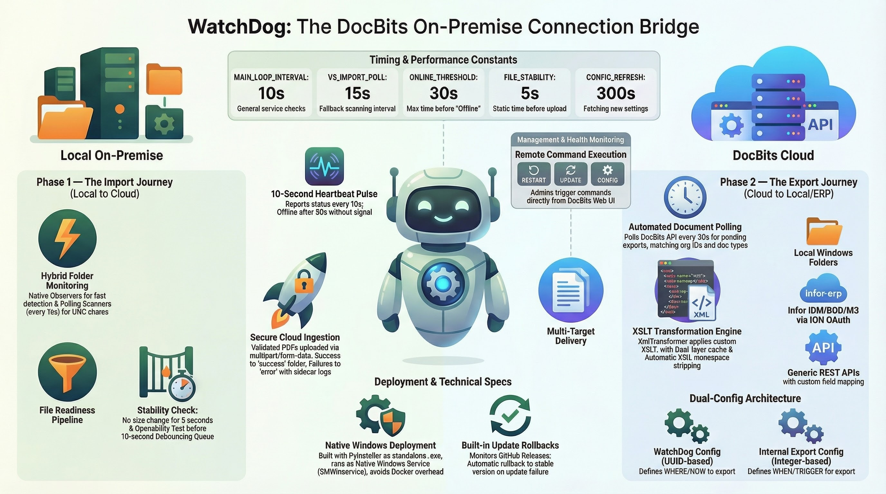<figcaption></figcaption></figure>

O **WatchDog** é um serviço on-premise baseado em Windows que monitora pastas locais em busca de documentos recebidos, envia-os para a DocBits Cloud para processamento e exporta os documentos finalizados de volta para pastas locais ou sistemas ERP.

## Vídeo passo a passo



*1:38 min · Interface do produto em português · Voz e cena de abertura geradas por IA*

[Legendas (VTT)](https://docbits-videos.fra1.cdn.digitaloceanspaces.com/product-tours/watchdog/2026-10-28/v1/pt.vtt) · [Transferir o vídeo](https://docbits-videos.fra1.cdn.digitaloceanspaces.com/product-tours/watchdog/2026-10-28/v1/pt.mp4)

## Principais Recursos

* **Monitoramento automático de pastas** — observa caminhos locais e caminhos de rede UNC em busca de novos PDFs
* **Suporte a várias configurações** — várias configurações de importação/exportação por instância
* **6 métodos de exportação** — Local Folder, Infor IDM, Infor BOD, ION API, GLS840MI, REST API
* **Auto-Update** — atualizações automáticas de versão com rollback em caso de falha
* **Gerenciamento remoto** — reinicie, atualize e configure pela interface do DocBits

## Início Rápido

<figure><figcaption></figcaption></figure>

### 1. Baixe o WatchDog

Baixe o `WatchDog.exe` em **Settings → Document Processing → WatchDog → General Tab** no aplicativo DocBits.

### 2. Configure com a API Key

Abra o **Prompt de Comando como Administrador** e execute:

```powershell
WatchDog.exe -api YOUR_API_KEY
```

> **Nota:** A API Key está disponível nas configurações do DocBits, na aba General do WatchDog. Ela conecta o WatchDog à sua organização no DocBits.

### 3. Instale como Serviço do Windows

```powershell
WatchDog.exe install
WatchDog.exe start
```

### 4. Crie as Configurações no DocBits

Todas as configurações de importação e exportação são criadas diretamente no **aplicativo DocBits**:

**Settings → Document Processing → WatchDog → Configurations Tab**

* **Import Configurations** — definem as pastas monitoradas e os tipos de documento
* **Export Configurations** — definem os destinos de exportação, os modelos XSLT e os métodos de exportação

> **Importante:** As configurações de exportação exigem um **tipo de documento** (`doc_type`). Configurações sem tipo de documento serão rejeitadas.

### 5. Início Automático (Opcional)

Para iniciar o WatchDog automaticamente na inicialização:

1. Abra **Serviços** (`Win + R` → `services.msc`)
2. Encontre **WatchDog** na lista
3. Defina **Tipo de Inicialização** como **Automático (Início Atrasado)**

## Referência de Comandos

| Comando | Descrição |
| :--- | :--- |
| `WatchDog.exe -api KEY` | Configura a API Key e conecta ao DocBits |
| `WatchDog.exe install` | Instala como Serviço do Windows |
| `WatchDog.exe start` | Inicia o serviço |
| `WatchDog.exe stop` | Para o serviço |
| `WatchDog.exe debug` | Executa em modo console para solução de problemas |
| `WatchDog.exe --version` | Mostra a versão atual |
| `WatchDog.exe --list-folders` | Lista as pastas monitoradas configuradas |
| `WatchDog.exe remove` | Desinstala o serviço |

## Mais Recursos

* [Instalação do WatchDog](watchdog-installation.md)
* [Configuração do WatchDog](watchdog-v2-configuration.md)
* [FAQ do Administrador do WatchDog](watchdog-admin-faq.md)

## Capturas de ecrã

<figure>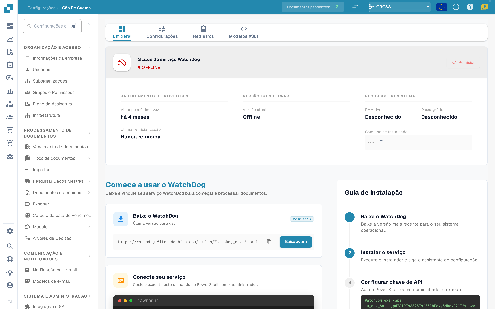<figcaption><p>Estado e primeiros passos</p></figcaption></figure>

<figure>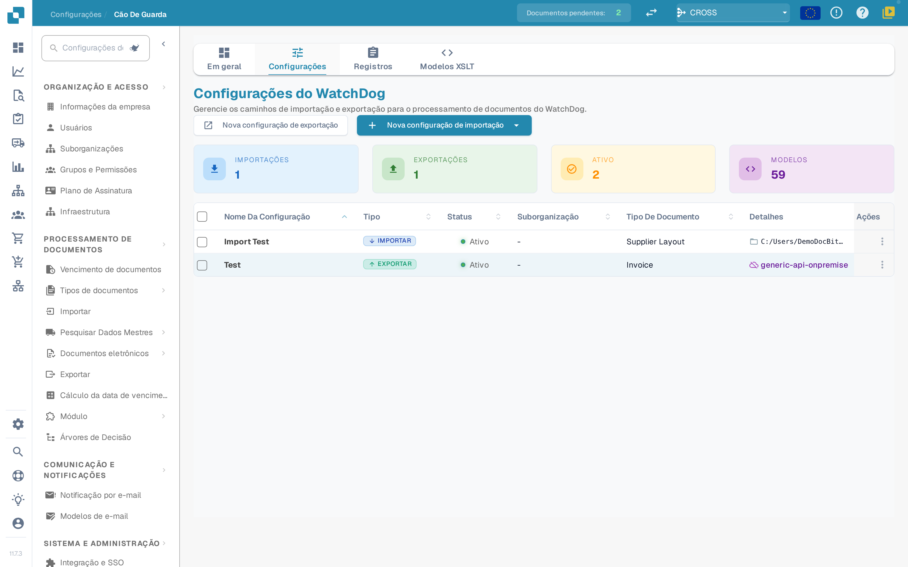<figcaption><p>Vista geral das configurações</p></figcaption></figure>

<figure>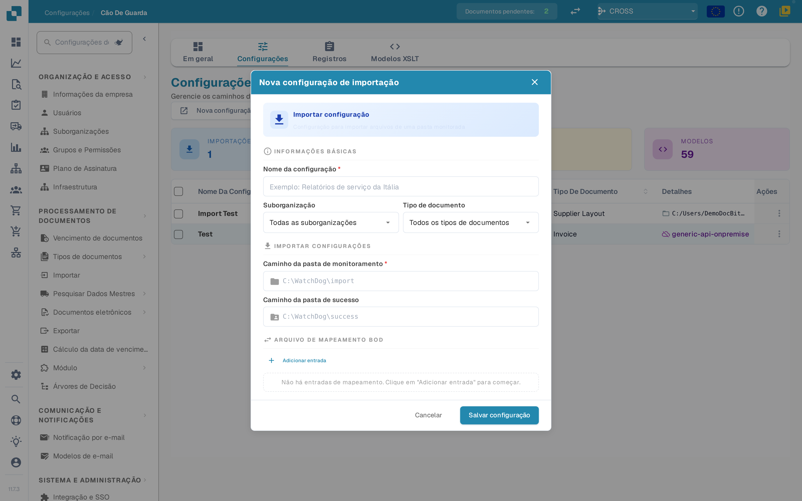<figcaption><p>Nova configuração de importação</p></figcaption></figure>

<figure>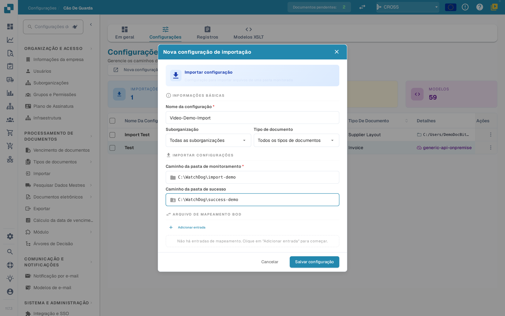<figcaption><p>Configuração de importação preenchida</p></figcaption></figure>

<figure>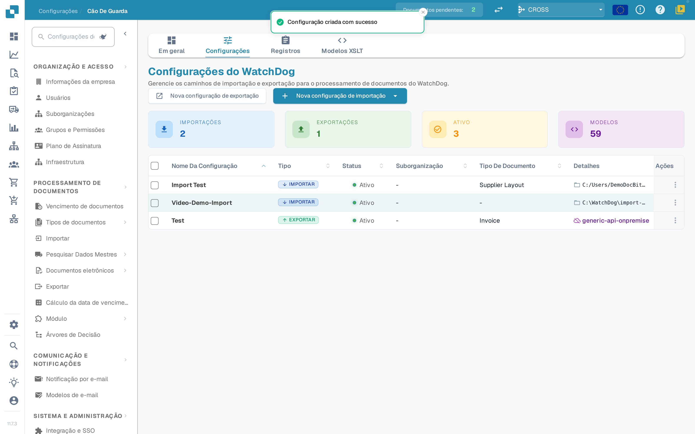<figcaption><p>Configuração de importação guardada</p></figcaption></figure>

<figure>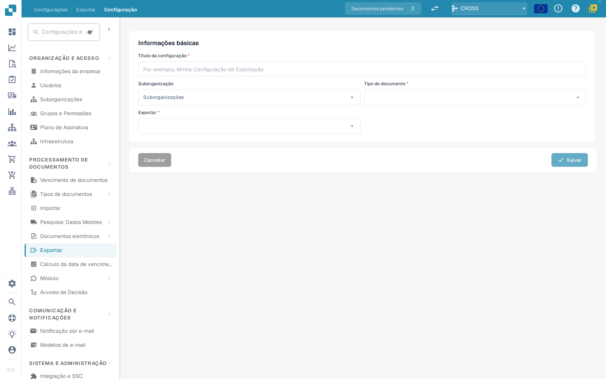<figcaption><p>Nova configuração de exportação</p></figcaption></figure>

<figure>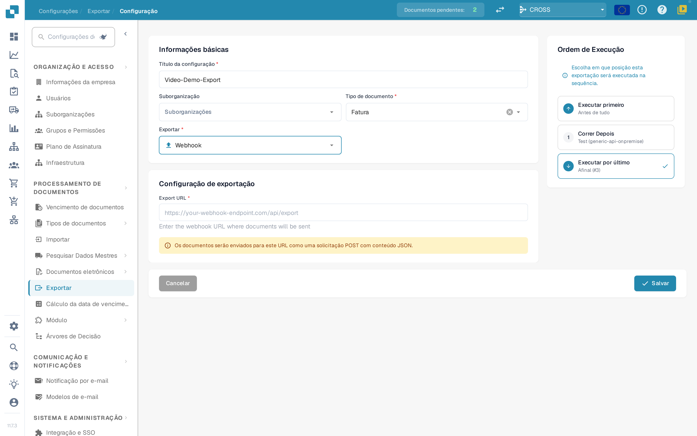<figcaption><p>Configuração de exportação com um webhook como destino</p></figcaption></figure>

<figure>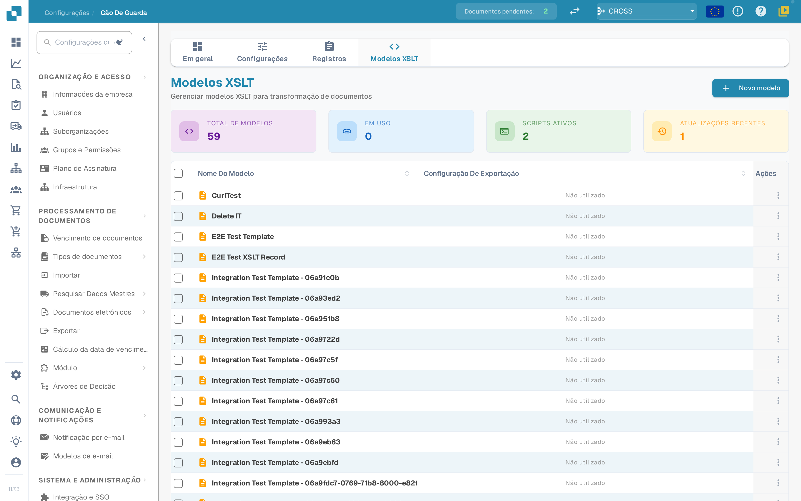<figcaption><p>Modelos XSLT</p></figcaption></figure>

<figure>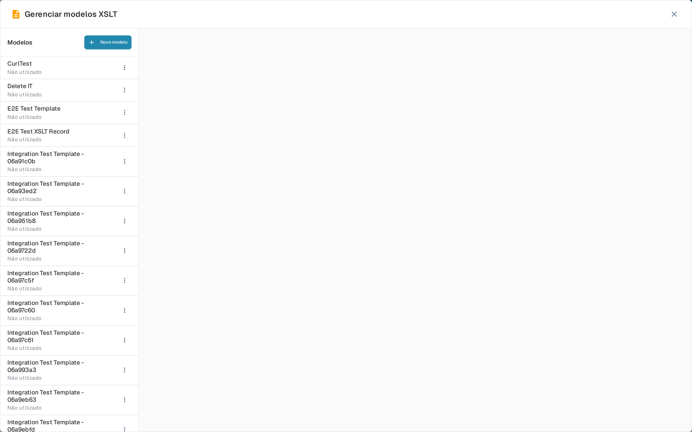<figcaption><p>Gerir modelos XSLT</p></figcaption></figure>

<figure>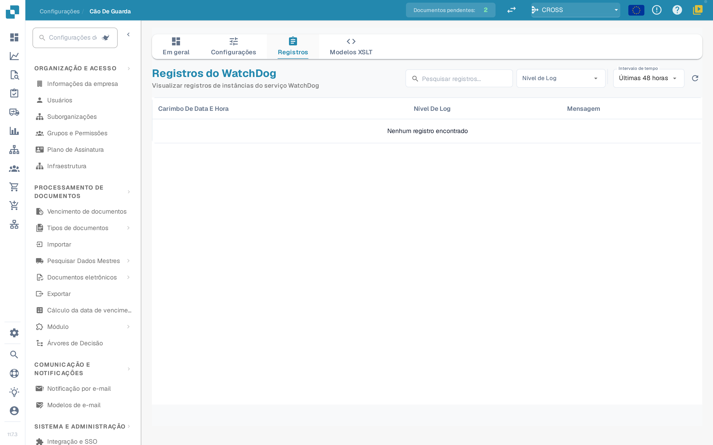<figcaption><p>Registos do WatchDog</p></figcaption></figure>
