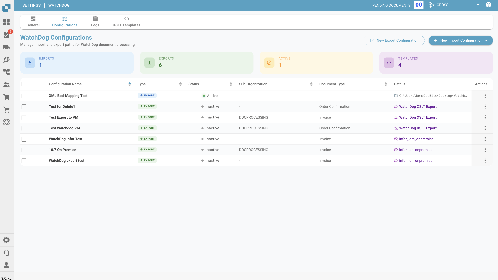
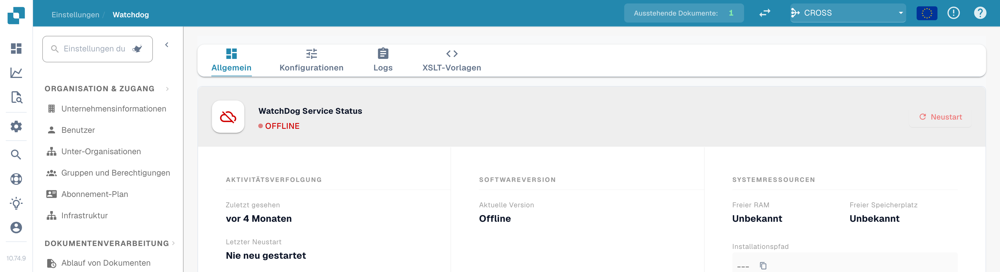
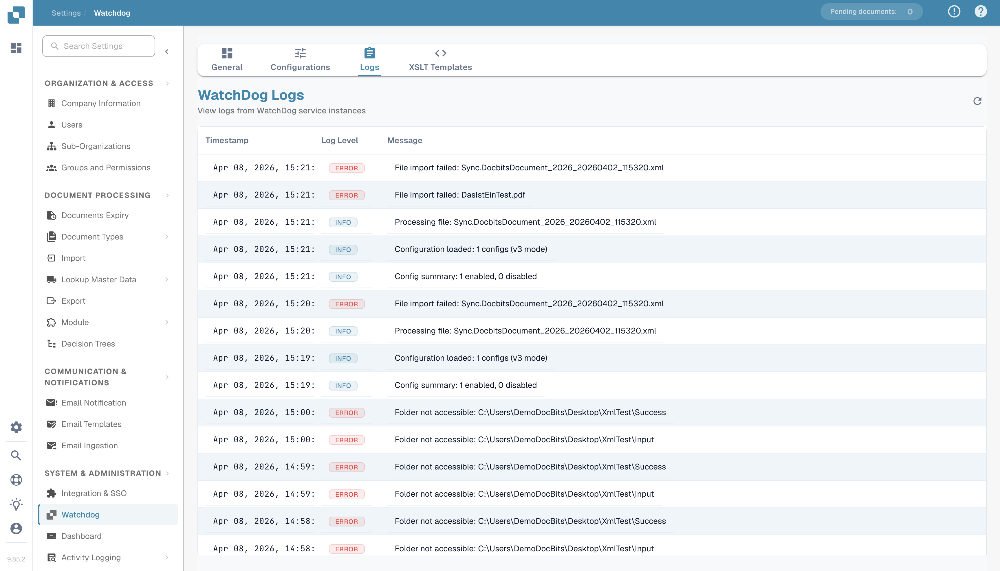
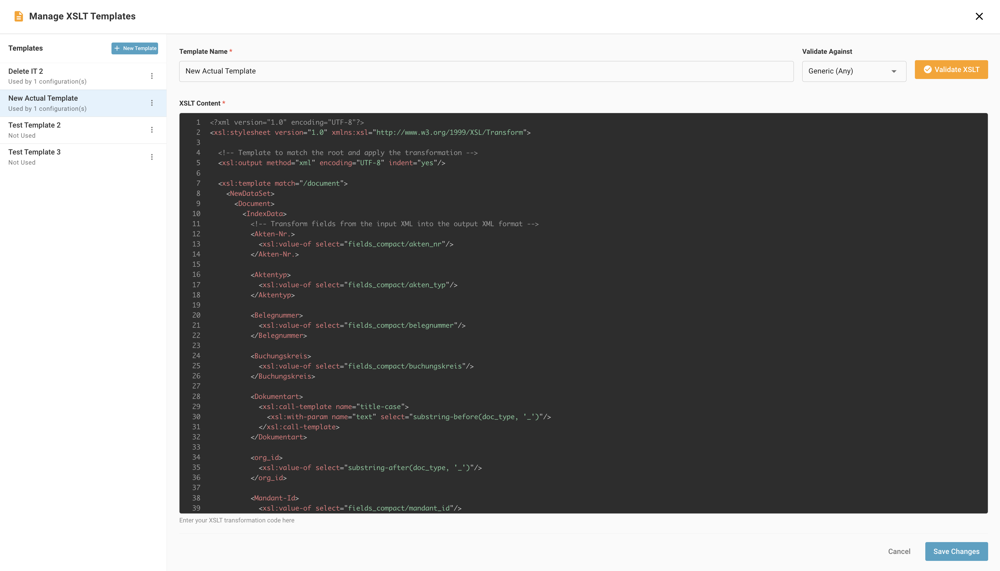

# WatchDog Konfiguration

Diese Anleitung erklärt, wie Sie den WatchDog-Dienst innerhalb der DocBits-Anwendung konfigurieren. Alle Konfigurationen werden direkt unter **Settings → Document Processing → WatchDog** verwaltet.

<figure><figcaption></figcaption></figure>

---

## 1. Registerkarte General

Die Registerkarte General enthält Einrichtungsanweisungen, Download-Links und Update-Einstellungen.

<figure><figcaption></figcaption></figure>

### 1.1 Download & Einrichtung

* Laden Sie die aktuelle `WatchDog.exe` direkt von der Registerkarte General herunter
* Kopieren Sie den angezeigten API Key
* Führen Sie den Konfigurationsbefehl in einer Eingabeaufforderung mit Administratorrechten aus:

```powershell
WatchDog.exe -api YOUR_API_KEY
```

### 1.2 Zeitplan für automatische Updates

| Option | Intervall |
| :--- | :--- |
| On Startup Only | Einmalige Prüfung beim Start |
| Hourly | Alle 3600 Sekunden |
| Daily | Alle 86400 Sekunden |
| Weekly | Alle 604800 Sekunden |

---

## 2. Registerkarte Configurations

Erstellen und verwalten Sie Import- und Exportkonfigurationen. Alle Konfigurationen werden direkt in DocBits angelegt – lokale Konfigurationsdateien sind nicht erforderlich.

<figure><figcaption></figcaption></figure>

### 2.1 Importkonfigurationen

Legen Sie fest, wo WatchDog nach neuen Dokumenten sucht.

<figure><figcaption></figcaption></figure>

| Feld | Beschreibung |
| :--- | :--- |
| **Name** | Anzeigename dieser Konfiguration |
| **Watch Folder** | Verzeichnis, das auf neue Dokumente überwacht wird (erforderlich) |
| **Success Folder** | Ordner, in den Dateien nach erfolgreichem Import verschoben werden |
| **Document Type** | INVOICE, CREDIT\_NOTE, PURCHASE\_ORDER usw. |
| **Sub-Organisation** | Optional – Dokumente an eine bestimmte Unterorganisation weiterleiten |

### 2.2 Exportkonfigurationen

Legen Sie fest, wie und wohin verarbeitete Dokumente exportiert werden.

> **Wichtig:** Exportkonfigurationen **erfordern jetzt einen Dokumenttyp** (`doc_type`). Konfigurationen ohne Dokumenttyp werden vom System abgelehnt.

| Feld | Beschreibung |
| :--- | :--- |
| **Name** | Anzeigename dieser Konfiguration |
| **Document Type** | Erforderlich – INVOICE, CREDIT\_NOTE usw. |
| **Export Method** | Wie Dokumente exportiert werden (siehe unten) |
| **Export Folder** | Zielverzeichnis für Ordner-Exporte |
| **Execution Order** | Priorität, wenn mehrere Konfigurationen zutreffen (Standard: 1) |
| **XSLT Template** | Optional – XML-Transformationsvorlage |

### 2.3 Exportmethoden

| Methode | Beschreibung |
| :--- | :--- |
| **Folder (watcher)** | PDF + XML in einen lokalen Ordner exportieren |
| **Infor IDM** | Upload in Infor Document Management |
| **Infor BOD** | BOD-XML an Infor ERP / SAP bzw. M3 senden |
| **ION API** | Infor-ION-API-Endpunkte aufrufen |
| **GLS840MI** | M3-Stapelverarbeitung (über REST API) |
| **REST API** | Senden an eine externe API mit ION-OAuth-Authentifizierung |

<figure><figcaption></figcaption></figure>

### 2.4 Verarbeitungsoptionen

* **Barcode Divider:** Mehrseitige Dokumente automatisch anhand von Barcodes aufteilen
* **DocBits Operator:** Browser-Automatisierungsaufgaben aktivieren

---

## 3. Registerkarte Status

Überwachen Sie den Zustand und die Aktivität des WatchDog-Dienstes.

<figure><figcaption></figcaption></figure>

### Statusinformationen

| Feld | Beschreibung |
| :--- | :--- |
| **Online/Offline** | Aktueller Verbindungsstatus (Heartbeat-Schwelle: 30 s) |
| **Version** | Installierte WatchDog-Version |
| **Version First Seen** | Zeitpunkt, an dem diese Version erstmals gemeldet wurde |
| **Last Restart** | Zeitstempel des letzten Neustarts des Dienstes |
| **Auto-Update Enabled** | Ob automatische Updates aktiv sind |
| **Latest Version** | Neueste verfügbare Version |
| **Latest Version Checked At** | Zeitpunkt der letzten Prüfung auf die neueste Version |
| **System Info** | Installationspfad, freier Arbeitsspeicher, freier Speicherplatz |

### Statusanzeige

| Status | Bedeutung |
| :--- | :--- |
| ✅ **Online** | WatchDog ist verbunden und aktiv |
| ⚠️ **Offline** | Seit mehr als 30 Sekunden kein Heartbeat empfangen |
| ❌ **Not Installed** | WatchDog hat sich noch nie mit dieser Organisation verbunden |

---

## 4. Registerkarte Logs

Zeigen Sie alle in OpenSearch gespeicherten WatchDog-Ereignisse an.

<figure><figcaption></figcaption></figure>

* Filtern Sie nach Datum, Ereignistyp oder Stichwörtern
* Ereignistypen: `FILE_IMPORT_STARTED`, `FILE_IMPORT_COMPLETED`, `FILE_IMPORT_FAILED`, `EXPORT_STARTED`, `EXPORT_COMPLETED`, `EXPORT_FAILED`, `FOLDER_VALIDATION_FAILED`, `CONFIG_LOADED`, `SERVICE_RESTART_INITIATED`, `SERVICE_RESTART_COMPLETED`

---

## 5. Registerkarte XSLT Templates

Verwalten Sie XSLT-Transformationsvorlagen, die für XML-Exporte verwendet werden.

<figure><figcaption></figcaption></figure>

* XSLT-Vorlagen hochladen und bearbeiten
* **Live-Validierung** – Vorlagen anhand von Beispiel-XML mit Feldanalyse testen
* Vorlagen mit Exportkonfigurationen verknüpfen
* Nutzungsanzahl anzeigen (welche Konfigurationen welche Vorlage verwenden)

<figure><figcaption></figcaption></figure>

---

## 6. Registerkarte Export Configurations

Übersicht aller aktiven Exportkonfigurationen mit Verbindungsstatus.

* Überwachen Sie den Zeitstempel der letzten erfolgreichen Verbindung
* Verwalten Sie Konfigurationen direkt in der Liste (bearbeiten, kopieren, löschen)
* Konfigurationen gesammelt über Unterorganisationen hinweg kopieren
