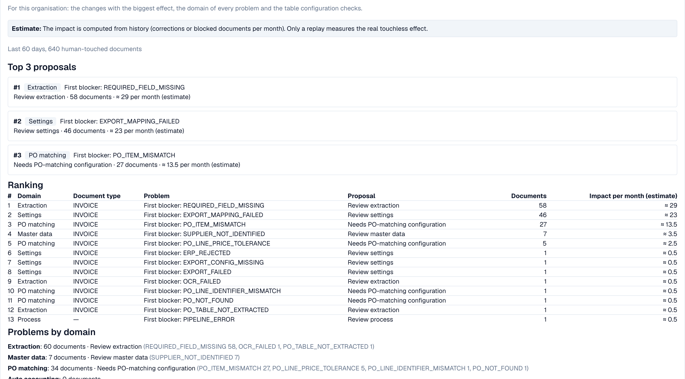

# Touchless Intelligence: Propozycje zmian i raporty

Rekomendacja może zawierać **propozycję zmiany** (change proposal), czyli pojedynczą zmianę ustawienia, która powinna pomóc. Administratorzy pracują z nią w czterech krokach:

1. **Podgląd** (Preview): pokazuje zmianę (obecna → proponowana wartość) i to, czego oczekuje DocBits. Nic nie jest zapisywane. **Zastosuj** jest możliwe dopiero po obejrzeniu podglądu.
2. **Zastosuj** (Apply): zapisuje dokładnie tę zmianę, która była w podglądzie. Jest to rejestrowane w logu.
3. **Mierz** (Measure): DocBits porównuje wskaźnik touchless tego samego typu dokumentu **przed i po**, w okresach o równej długości. W każdym okresie potrzeba co najmniej **20 dokumentów**, w przeciwnym razie wyświetla *not measurable* (niemierzalne).
4. **Cofnij** (Undo): wycofuje zmianę.


Różnica przed/po jest **obserwacją**, a nie dowodem przyczyny. W tym samym czasie mogą zmieniać się inne rzeczy (nowy dostawca, sezonowy szczyt).


**Przykład.** Stosujesz *Włącz automatyczne dopasowanie PO i eksport* dla faktur. Dwa tygodnie później **Historia zmian** (Change history) pokazuje: czysty wskaźnik przed 52 % (210 dokumentów), po 61 % (198 dokumentów). To +9 pp, wystarczająco dużo dokumentów, aby dało się to zmierzyć.

Administratorzy widzą też dwie sekcje między kluczowymi wskaźnikami a wykresami:

* **Prośby o usprawnienia** (Improvement requests): sugestie wysłane przez użytkowników z asystenta walidacji, w dwóch kartach **Otwarte** (Open) i **Historia** (History).
* **Propozycje nauczonych reguł** (Learned rule proposals): reguły, których DocBits nauczył się z korekt Twojego zespołu, na przykład „dla dostawcy X zamień wartość w polu Y". Zanim utworzysz regułę, sprawdź dokumenty, w których zastąpiłaby wartość zaakceptowaną przez Twój zespół. Sekcja **Po aktywacji** (After activation) pokazuje ręczne korekty pola docelowego przed i po wejściu reguły w życie.

<figure><figcaption>
Raport doradczy (Consulting report): najważniejsze propozycje, ranking wszystkich blokad z dokumentami i szacowanym wpływem miesięcznie oraz problemy według domeny. Przykładowa organizacja z danymi demonstracyjnymi; nazwy dostawców są fikcyjne.
</figcaption></figure>

Administratorzy znajdą **Raport doradczy** na dole karty. Kliknij **Utwórz raport** (Create report), aby go załadować. Łączy on dla Twojej organizacji:

* **zmiany o największym efekcie**, uszeregowane, każda z domeną, problemem, zalecanym działaniem, liczbą dokumentów i **szacowanym** efektem miesięcznie,
* **domenę każdego problemu** (ekstrakcja, dane podstawowe, dopasowanie PO, automatyczne księgowanie, ustawienia, proces),
* **kontrole konfiguracji tabel**, na przykład *structured table output not used* (nie używa się ustrukturyzowanego wyniku tabeli) lub *table column type mismatch* (niezgodność typu kolumny tabeli) dla typu dokumentu i kolumny.

Wartości efektu są **szacunkami**. Jeśli raport odpowiada *forbidden* (zabronione), Twoja rola na to nie pozwala.

## Powiązane strony

* [Touchless Intelligence](touchless-intelligence.md)
* [Diagnoza dostawcy i klastry problemów](touchless-supplier-diagnosis.md)
* [Diagnoza dopasowania PO](touchless-po-matching-diagnosis.md)
