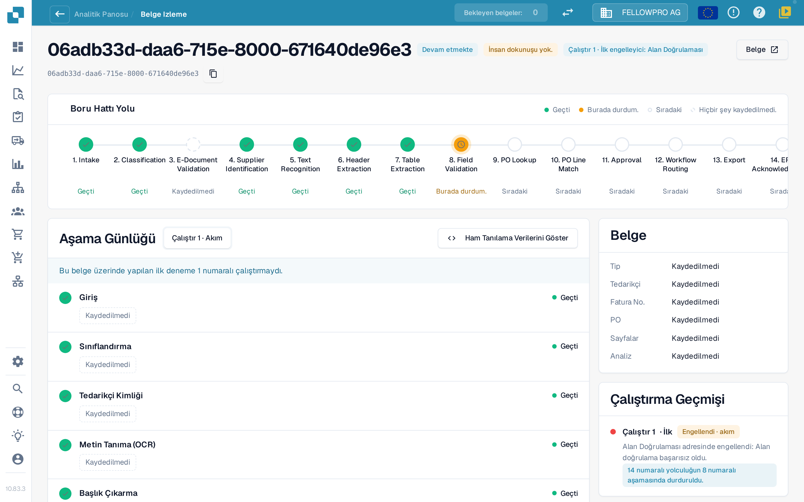
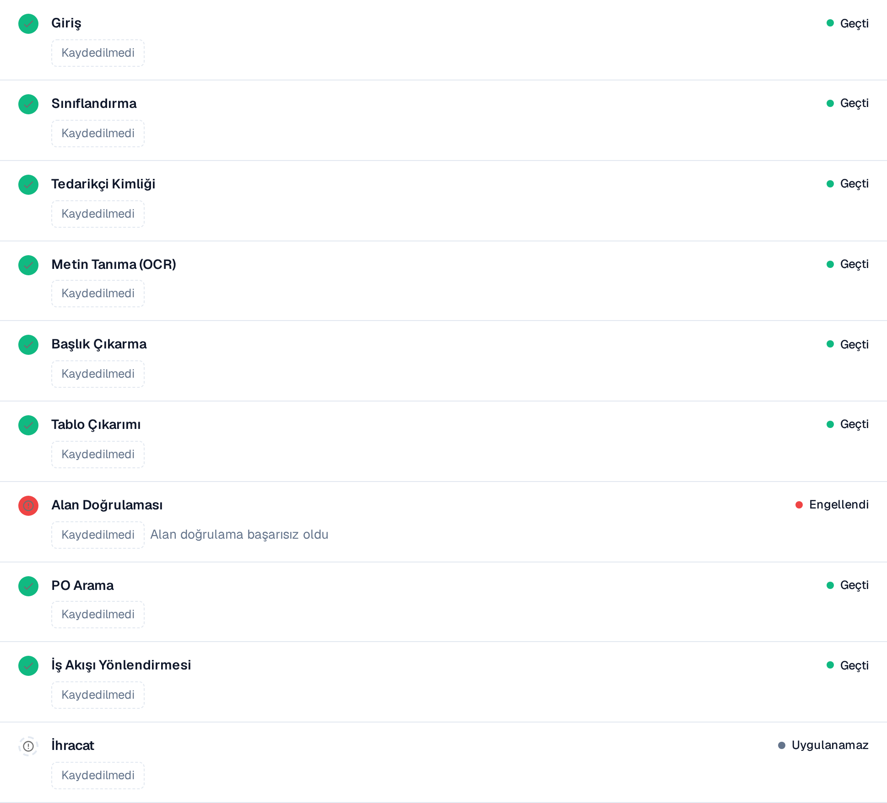

# Belge İzi

**Document ID** alanına bir belge kimliği girin veya bir kümeden örnek bir belge açın; böylece **bu belgeye ne olduğunu** görürsünüz.

Üst bilgi dosyayı, durumunu (örneğin **Devam ediyor**), görüntülediğiniz çalıştırmayı ve bu çalıştırmanın ilk engelleyicisini, ayrıca belge kimliğini taşıyan bir **Belge** düğmesini gösterir.

<figure><figcaption>
Belge izi: tüm aşamaları içeren boru hattı yolu ve her aşamanın kaydettiklerini gösteren aşama günlüğü.
</figcaption></figure>

**Boru Hattı Yolu** 14 aşama gösterir: Intake, Classification, E-Document Validation, Supplier Identification, Text Recognition, Header Extraction, Table Extraction, Field Validation, PO Lookup, PO Line Match, Approval, Workflow Routing, Export, ERP Acknowledgement. Her aşama tek bir durum taşır:

| Durum | Anlamı |
| --- | --- |
| **Geçti** (yeşil) | Aşama sorunsuz çalıştı |
| **Burada durdum** (turuncu) | Aşama belgeyi engelledi |
| **Sıradaki** | Belge bu noktaya hiç ulaşmadı |
| **Hiçbir şey kaydedilmedi** (kesik çizgi) | Bu aşama için veri kaydedilmedi |
| **Uygulanamaz** | Aşama bu belge için geçerli değil |

## Aşama günlüğü

Yolun altındaki **aşama günlüğü** aynı aşamaları, her birinin kaydettikleriyle birlikte listeler. Her satırın solunda bir durum noktası, sağında durum sözcüğü bulunur.

* Her değer bir **değer çipidir**: birimiyle birlikte bir sayı, örneğin **Güven 100 %**, **Eşik 60 %**, **Başarısız kurallar 0**, **8 eksik alan** veya **0 eşleme boşluğu**. Yüzdeler `97 %` biçiminde gösterilir, asla `0.97` olarak değil.
* **Ayrıntılar**, bir aşamanın kaydettiği değerlerin tam listesini, değerlendirdiği alternatifler dahil açar.
* Belgeyi engelleyen aşama nedenini belirtir, örneğin **Alan doğrulaması başarısız**.
* Hiçbir aşamanın kaydetmediği bir değer **Kaydedilmedi** olarak görünür, asla uydurma bir değer olarak değil. Değerler sayılardan ve sabit ifadelerden oluşur, belge metninden değil.
* Destek ekibi istediğinde **Ham tanılamayı göster** ham verileri açar.

<figure><figcaption>
Her aşama neyi kaydettiğini gösterir; engellenen aşama nedenini belirtir.
</figcaption></figure>

## Çalıştırmalar ve değişiklikler

Aşama günlüğünün üstündeki çalıştırma seçici (**Uygulamak 1 · Mevcut**) belgenin çalıştırmaları arasında geçiş yapar. Sağdaki **çalıştırma geçmişi** her çalıştırmayı sonucuyla ve nerede durduğuyla listeler. Bir belge birden fazla kez çalıştırıldıysa, seçiciden bir çalıştırma seçerek onu mevcut olanla karşılaştırın: değişen değerler o zaman farkı ve birimini taşıyan bir rozet alır, örneğin **−2 alan** veya **+3 %**.

Aşama günlüğünün yanındaki **Belge** kartı belge türünü, tedarikçiyi, fatura numarasını, satınalma siparişini, sayfa sayısını ve analizin **kural** tabanlı mı yoksa yapay zekâ tarafından mı yazıldığını belirtir.

**Örnek.** Bir tedarikçinin belgeleri hep 8. aşamada duruyor. İzde her seferinde aynı eksik alanları görürsünüz. Bu, tek tek belgelerin çıkarma sorunu değil, alan yapılandırmanızdaki eksik bir varsayılan değerdir: bir kez düzeltin, tüm küme geri kazanılabilir hale gelir.
